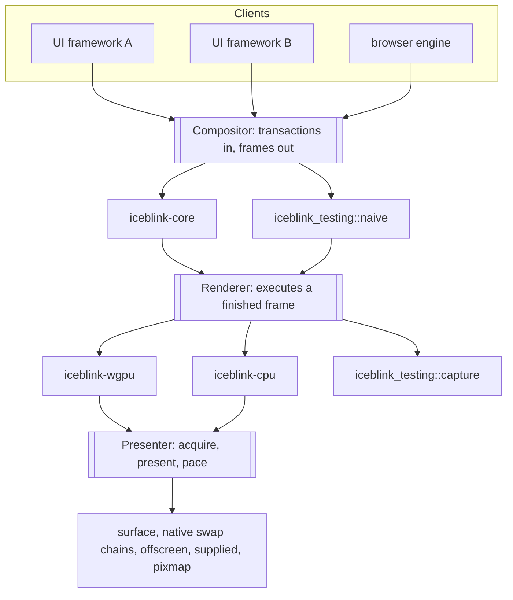
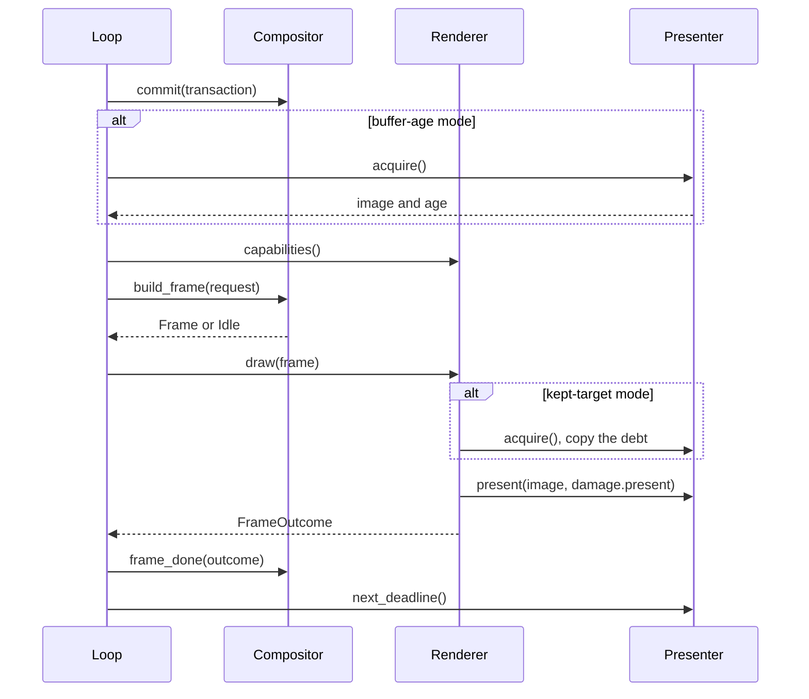

# iceblink specification

## Scope

This spec defines a retained, incremental compositor that any Rust UI framework can feed. Clients record keyed chunks of display items under property trees and submit them in transactions. The compositor derives damage, plans frames, and hands each frame to a renderer, which draws it and presents it through a presenter. The spec has two products. The first is the interface crate, `iceblink`, which holds every value type and trait named here. The second is a set of reference implementations of that interface.

The spec is the contract. A third party can write a conforming compositor, renderer or presenter from this text alone, and a client written against the interface crate works unchanged with any conforming implementation.

The keywords **must**, **must not**, **should** and **may** are used as in RFC 2119. Text marked *informative* explains a rule and adds none.

**Goals**

- One retained scene model below paint: keyed chunks of display items, property trees and an order tree.
- Cost proportional to change at every boundary, with counters that prove it.
- One shared reference renderer that runs on Linux, macOS, Windows and the web, plus a CPU renderer that proves the frame contract needs no GPU.
- Pluggable implementations at three seams: the compositor, the renderer and the presenter.
- Conformance suites that decide correct output independently of any one implementation.

**Non-goals**

- Layout, styling, text shaping, input dispatch, accessibility and state management stay in the clients.
- The compositor offers no drawing API for applications. Applications draw through their framework.
- Output is not bit-exact across renderers. Conformance tests declare a tolerance per test.

## Conformance

An implementation conforms to a seam when it implements that seam's trait, meets every **must** in the sections that apply to the seam, and passes that seam's conformance suite.

The rules for the scene seam fall into two profiles. A simple implementation and a fast one must produce the same pixels, and only the fast one is held to cost bounds:

- **Soundness** rules hold for every `Compositor`. They cover what a frame draws, the damage it declares and the frame invariants a renderer relies on. Damage must contain every pixel that changed (see "Damage"). Every invariant of the `Frame` in "The frame" holds.
- **Precision** rules hold for an implementation that reports `CompositorCapabilities::precise`. They bound how much a frame costs and how much it redraws: identical replace adds no damage, damage stays within the coalescing bound, shifts and opaque covers are emitted where the rules allow them, and commits and frames meet the cost bounds.

A rule marked *(precision)* belongs to the second profile. Every other rule belongs to the first. The reference compositor, `iceblink-core`, reports `precise`. The second implementation, `iceblink_testing::naive`, damages the whole output on every frame, emits one batch per item in paint order and plans one vector pass per frame path. It conforms to the soundness profile and does not report `precise`.

Where this spec describes how the reference compositor reaches a result, such as the lowest-order assignment behind batching or the rules that cut vector passes, the description is the reference strategy. Any strategy that keeps the frame invariants conforms.

## Architecture

The spec has three seams. Each has a trait in `iceblink`, a reference implementation and room for alternatives. A client talks only to the top seam. The application chooses every implementation in one place when it starts.

| Seam | Trait | Reference implementation | Example alternatives |
| --- | --- | --- | --- |
| Scene | `Compositor` | `iceblink-core`: retained store, property trees, order tree, damage, frame planning, glyph and image atlases, animation, scroll physics, hit testing | `iceblink_testing::naive`, a WebRender adapter |
| Draw | `Renderer` | `iceblink-wgpu`, with `iceblink-vello` or `iceblink_wgpu::vector_coverage` for path passes; `iceblink-cpu` | Skia, native Metal or Direct3D, `iceblink_testing::capture` |
| Output | `Presenter` | the presenters of `iceblink-wgpu` (surface, native Vulkan, DXGI, offscreen, supplied) and the pixmap presenter of `iceblink-cpu` | DRM/KMS scanout, Core Animation layers |

A backend may implement more than one seam. A WebRender adapter implements `Compositor` and draws for itself. Whatever sits above a seam names only that seam's traits and the shared types of `iceblink`, and never a graphics API.



A renderer owns its presenter: the application constructs the presenter, hands it to the renderer, and reaches it afterwards through `Renderer::presenter`.

A client either runs the frame lifecycle itself through `Compositor`, or leaves it to a driver behind the client seam, `CompositorClient` (see "The client seam"). A driver owns a compositor, its renderers and their presenters. `iceblink-driver` runs them on the client's thread, and `iceblink_driver::thread` on a thread of its own, behind a cloneable `ClientHandle`.

## Vocabulary

Every term below has one meaning in this spec.

| Term | Definition |
| --- | --- |
| Client | A party that submits transactions. A compositor may serve several clients. Each client has its own id namespace. |
| Output | One image the compositor produces frames for, such as a window or an offscreen target. |
| Item | One drawable thing recorded in a chunk: a quad, a glyph run, an image and so on. |
| Chunk | An ordered list of items under one `ChunkKey`, with default property state. The unit of retention, replacement and offset. |
| Chunk key | A `ChunkKey` the client chooses, unique within the client. |
| Property tree | One of the transform, scroll, clip and effect trees, whose nodes hold state shared by many items. |
| Order tree | The tree of order nodes whose depth-first traversal is the paint order of an output. |
| Paint order | The total order in which items are drawn. Later items are drawn over earlier ones. |
| Slot | A rewritable paint or shader parameter block that items reference by index. |
| Transaction | A batch of changes to chunks, nodes, slots, the order tree and resources. It applies atomically at commit. |
| Commit | Applying a transaction. The next frame built after a commit reflects every change in it. |
| Local space | The coordinate space of a transform node. Item geometry is recorded in local space. |
| Device space | The physical pixel grid of an output. |
| Ink | A device-space rectangle that contains every pixel an item, chunk or subtree can change. |
| Read extent | The device-space rectangle a filtered composite or a backdrop samples. |
| Damage | The device-space rectangles whose pixels may differ from the previous frame of the same output. |
| Group | Content drawn into a target of its own and composited as one, because of opacity, blending, filters or isolation. |
| Lowering | The conversion of client items into frame kinds, which the compositor performs. |
| Frame | The finished, renderer-neutral plan for one output image. |
| Frame kind | One of the instance layouts a frame carries to a renderer. |
| Resident chunk | A lowered chunk a renderer keeps on its device across frames and draws without uploading it again. |
| Renderer | An implementation of the draw seam. It executes frames. |
| Presenter | An implementation of the output seam. It owns surfaces, buffer rotation and pacing. |
| Capabilities | What a compositor, renderer or presenter supports, read before frames are built. |
| Driver | A party that owns a compositor, its renderers and their presenters, runs the frame lifecycle of every output, and serves clients through the client seam. |
| Latch | The moment a frame takes the calls queued before it. |
| Resource | An image, external texture, shader or font, held by id. |

## Foundations

All shared value types and every trait of the contract live at the root of `iceblink`, the interface crate. It depends on `bytemuck`, `smallvec`, `kurbo` and `web-time`, and on no graphics API and no async runtime. Its foundation modules `iceblink::geom`, `iceblink::color` and `iceblink::damage` hold geometry, colour spaces and damage sets. It re-exports `kurbo` and `smallvec` at its root, so a client that names only the interface crate builds every value of the contract.

### Coordinate spaces and units

- **Device space** is the pixel grid of one output. Its origin is the top-left corner, x grows to the right and y grows downwards. Units are physical pixels. Pixel `(i, j)` covers the square `[i, i+1) × [j, j+1)`, and its colour is decided at its centre `(i + 0.5, j + 0.5)`.
- **Local space** is the space of one transform node. A transform node's matrix maps its local space into its parent's local space. A node without a parent maps its local space into device space. Units of local space are whatever the client chooses.
- Item geometry, clip shapes, paint geometry and scroll ports are recorded in local space. The compositor resolves them to device space, and clients never do.
- The output's **scale factor** (`OutputConfig::scale`) is the number of device pixels per logical pixel. The compositor applies it to nothing implicitly. It is read in two places only: the glyph route threshold and the `scale` input of application shaders. A client that records in logical pixels puts a scale matrix on its root transform node.
- Lengths inside items (corner radii, border widths, shadow blur, line thickness, glyph size, stroke width) are in the item's local units and are transformed with the item.
- Lengths inside filters (blur deviation, drop-shadow offset and deviation, shader reach) are in device pixels and are not affected by any transform.

```rust
/// A rectangle in local space, as `[x, y, width, height]`.
pub type LocalRect = [f32; 4];

/// A rectangle of whole device pixels, from `iceblink::geom`: `origin` and `size`.
///
/// It covers the pixels `origin.x .. origin.x + size.width` and `origin.y .. origin.y + size.height`.
pub type DeviceRect = iceblink::geom::Rect<i32, iceblink::geom::Device>;

/// A 4x4 matrix stored as four columns of four rows, from `iceblink::geom`.
///
/// A point `(x, y)` maps to `(X/W, Y/W)` where `[X, Y, Z, W] = M · [x, y, 0, 1]`.
#[repr(C)]
#[derive(Clone, Copy, Debug, PartialEq, Pod, Zeroable)]
pub struct Matrix4 { pub columns: [[f32; 4]; 4] }
```

A rectangle whose width or height is zero or negative is empty and paints nothing. A rectangle with a non-finite component is invalid, and a commit that records one is rejected (see "Commit").

### Pixel coverage

Every analytic item kind defines a signed distance `d(p)` from a local point `p` to its shape, negative inside. The **reference coverage** of a pixel is

```text
coverage = clamp(0.5 - d(p) / u, 0, 1)
```

where `p` is the local point that maps to the pixel centre and `u` is the length in local units of one device pixel at that point, `max(|∂p/∂x|, |∂p/∂y|)` over the device axes. Under a translation `u` is 1.

The quad and the shader quad use `u` as written. Every other item kind writes its antialiasing band as 0.5 local units, with `u` taken as 1, and that formula is its reference. The two agree under any translation, which is how nearly all content is drawn.

Colour sources are premultiplied, and an item contributes `colour × coverage × clip coverage` to the pixel by source-over: `dst' = src + dst × (1 - src.a)`.

### Colour

- Every `Color` in an item, every inline colour of a `PaintRef` (scaled from eight bits), a solid paint and a frame table is **premultiplied, gamma-encoded sRGB**, `[r, g, b, a]` with every component in `[0, 1]` and `r, g, b ≤ a`. A colour with a component outside `[0, 1]`, or with `r`, `g` or `b` more than 10⁻⁴ above `a`, is invalid, and a commit that carries one in an item, a paint or a filter is rejected with `RejectReason::InvalidItem`. An inline colour is invalid when a channel lies above its alpha.
- Targets hold premultiplied gamma-encoded sRGB, and blending happens on those encoded values. This is the composition space of every output.
- A component `c` is quantised to eight bits as `(c.clamp(0.0, 1.0) * 255.0).round() as u8`, a multiply and a rounding in `f32` with halves rounded up. `Color::to_rgba8` computes it, and `Color::from_rgba8` scales eight bits back by `1 / 255`. A renderer draws the colour of every `Solid` paint and of every side of a `Sides` paint quantised this way (see "Frame tables"), and the compositor quantises the colour of every `Line`, `Shadow` and `DropShadow` filter when it builds a frame. A colour then paints exactly what an inline colour packed from it by `Color::to_rgba8` paints, however it was delivered.
- A colour is **opaque** when its alpha quantises to 255, which `Color::is_opaque` reports. Wherever this spec speaks of an opaque solid colour, such as for opaque covers and the colour beneath scrolled content, a solid paint is opaque by this rule, so a slot and an inline colour packed from it count alike.
- Gradient stops are written as `iceblink::color::Color` values, which carry their own colour space and straight alpha, and each gradient names the space it is interpolated in and the direction hue travels (see "Paints").
- Image pixels are gamma-encoded sRGB, either premultiplied or straight as the image's format says. The compositor premultiplies straight pixels once, when they are uploaded.

```rust
/// A premultiplied, gamma-encoded sRGB colour.
#[repr(transparent)]
#[derive(Clone, Copy, Debug, Default, PartialEq, Pod, Zeroable)]
pub struct Color(pub [f32; 4]);

impl Color {
    pub const TRANSPARENT: Self = Self([0.0; 4]);
    /// Premultiplies straight-alpha gamma-encoded sRGB.
    pub const fn from_straight(r: f32, g: f32, b: f32, a: f32) -> Self;
    /// Scales eight bits per component by `1 / 255`.
    pub fn from_rgba8(rgba: [u8; 4]) -> Self;
    /// Quantises each component to eight bits, halves rounded up.
    pub fn to_rgba8(self) -> [u8; 4];
    /// `Color::from_rgba8(self.to_rgba8())`.
    pub fn quantized(self) -> Self;
    /// Whether the alpha quantises to 255.
    pub fn is_opaque(self) -> bool;
}

/// Converts to gamma-encoded sRGB and premultiplies.
impl From<iceblink::color::Color> for Color { /* ... */ }
```

### Ids and generations

Every object a client creates is named by a typed id. An id carries an index and a generation. The index names a slot in the client's table for that kind, and the generation tells apart the successive objects that slot has held.

```rust
// Clone, Copy, Debug, PartialEq, Eq, Hash, PartialOrd and Ord are implemented by hand, with no
// bound on `T`.
pub struct Id<T> { index: u32, generation: u32, _kind: PhantomData<fn() -> T> }

impl<T> Id<T> {
    /// The slot an item stores for this id.
    pub const fn slot(self) -> u32;
    pub const fn generation(self) -> u32;
}

pub type TransformId = Id<TransformNode>;
pub type ScrollId    = Id<ScrollNode>;
pub type ClipId      = Id<ClipNode>;
pub type EffectId    = Id<EffectNode>;
pub type OrderId     = Id<OrderNode>;
pub type PaintId     = Id<Paint>;
pub type ParamsId    = Id<ParamsBlock>;
pub type ImageId     = Id<ImageDesc>;
pub type TextureId   = Id<TextureDesc>;
pub type ShaderId    = Id<ShaderDesc>;
pub type AnimationId = Id<Animation>;

/// One client of a compositor.
#[derive(Clone, Copy, Debug, PartialEq, Eq, Hash)]
pub struct ClientId(pub u32);

/// One output of a compositor, minted by `Compositor::create_output`.
#[derive(Clone, Copy, Debug, Default, PartialEq, Eq, Hash)]
pub struct OutputId(pub u32);

/// One frame of one output. Frame ids of an output increase by one per built frame.
#[derive(Clone, Copy, Debug, Default, PartialEq, Eq, Hash, PartialOrd, Ord)]
pub struct FrameId(pub u64);

/// A font, minted by a `FontRegistry`.
#[derive(Clone, Copy, Debug, PartialEq, Eq, Hash, Pod, Zeroable)]
#[repr(transparent)]
pub struct FontId(pub u32);

/// A chunk's name, chosen by the client.
// PartialEq, Eq, Hash, PartialOrd and Ord are implemented by hand over `(owner, part)`.
#[repr(C)]
#[derive(Clone, Copy, Debug, Pod, Zeroable)]
pub struct ChunkKey { pub owner: u64, pub part: u32, pub _pad: u32 }

impl ChunkKey {
    /// The key of chunk `part` of `owner`, with `_pad` zero.
    pub const fn new(owner: u64, part: u32) -> Self;
}
```

`ChunkKey::_pad` is ignored. Two keys are equal when `owner` and `part` are equal, and keys order by `owner`, then `part`.

**Client-side minting.** Ids are minted by the client, without a round trip to the compositor, through an `IdSpace`. `Compositor::register_client` returns the client's `IdSpace`. The `IdSpace` is cloneable. The client's transactions and the compositor share it, so ids can be minted on any thread and the compositor can return freed indices to it.

```rust
#[derive(Clone)]
pub struct IdSpace(Arc<IdAllocator>);

impl IdSpace {
    pub fn client(&self) -> ClientId;
    /// Mints a fresh id of kind `T`.
    pub fn mint<T: IdKind>(&self) -> Id<T>;
    /// Whether `self` and `other` are clones of one id space.
    pub fn same(&self, other: &IdSpace) -> bool;
}

/// The kinds `IdSpace` mints: one per id alias above. Sealed.
pub trait IdKind: private::Sealed {}
```

Minting is the only part of building a transaction that touches shared state: each kind's table in the `IdAllocator` sits behind a lock of its own, held for one mint or one free.

The rules for indices and generations are these:

1. A minted id's index is the lowest free index of its kind, or one past the highest index ever minted when none is free. The first generation of an index is 1. Generation 0 is never minted, so `Id` with generation 0 is never valid.
2. An index becomes free once a commit that removes the object it names succeeds. The compositor returns it to the `IdSpace` with its generation increased by one.
3. Ids minted by a transaction whose commit is rejected become free at the rejection, with their generation increased by one. So do the ids of a transaction that is dropped without being taken apart.
4. `IdSpace::free` ignores an id whose generation is not its index's current one, so freeing an id twice frees it once. An index whose generation is `u32::MAX` is retired when it is freed and is never minted again. Minting panics when every index of the kind below 2³¹ is live or retired.
5. An id names an object from the commit that creates it until the commit that removes it. A transaction method that takes an id of a removed object or an id with a generation other than its slot's current generation causes the commit to be rejected with `RejectReason::StaleId`.
6. A create command whose id names a live slot, or whose generation is not greater than every generation the compositor has held at that slot, is rejected with `RejectReason::StaleId`. So is a transaction whose `IdSpace` is not a clone of the one `register_client` returned for its client.

A client may free the id of an object with `IdSpace::free` before the commit that removes the object, so that a create in the same transaction mints its index again. The create then makes a new object at the slot, and the commit removes the old object as any removal does. An id of the new object names only the new object, including one in the props that `set_props` gives a chunk. A slot in an item that an earlier commit recorded names the old object (see "Raw slots"). If the commit is rejected, the old object stays live while its index is free, so a create that mints the index again is rejected by rule 6.

Ids carry no client, so an id minted from another client's space is not detected and names whatever holds its slot in the transaction's client.

**Raw slots.** Items are plain bytes, so they hold an id's slot as a `u32` and no generation. A slot in an item names whichever object holds that slot in the item's client when the commit that records the item is applied. Rejection rules keep every slot in a retained chunk valid for the chunk's lifetime: a commit that removes an object still named by a chunk that remains after the commit is rejected with `RejectReason::InUse`.

The reference methods of `ChunkRecorder` (`space_ref`, `clip_ref`, `paint_ref`, `params_slot`, `shader_slot`, `image_slot` and `texture_slot`) turn a typed id into the slot an item stores, and add the id with its generation to the chunk's `refs`. The commit rejects a chunk whose `refs` hold an id that is not live with its current generation (see "Commit"), so a stale id taken through them is never resolved to the object that later took its slot. A slot written into an item without them is not checked against a generation.

Typed references used inside items:

```rust
/// A transform node an item is drawn under.
#[repr(transparent)]
#[derive(Clone, Copy, Debug, PartialEq, Eq, Hash, Pod, Zeroable)]
pub struct SpaceRef(pub u32);

impl SpaceRef {
    /// The chunk's default space, `ChunkProps::space`.
    pub const INHERIT: Self = Self(u32::MAX);
}

/// A clip chain an item is drawn through.
#[repr(transparent)]
#[derive(Clone, Copy, Debug, PartialEq, Eq, Hash, Pod, Zeroable)]
pub struct ClipRef(pub u32);

impl ClipRef {
    /// The chunk's default clip, `ChunkProps::clip`.
    pub const INHERIT: Self = Self(u32::MAX);
    /// No clip at all.
    pub const NONE: Self = Self(u32::MAX - 1);
    /// The bit that marks a chunk-local clip. The bits below it are its index in the chunk.
    pub const LOCAL: u32 = 1 << 31;
    /// The chunk-local clip at `index`, of which only the low 24 bits are kept.
    pub const fn local(index: u32) -> Self;
    /// The index of the chunk-local clip, when the value names one.
    pub const fn local_index(self) -> Option<u32>;
}
```

A `ClipRef` is decoded in this order: `INHERIT`, then `NONE`, then a value with the `LOCAL` bit, which names a chunk-local clip, and otherwise a clip node's slot. Slots are below 2³¹. An item naming a clip node is clipped by that node's whole chain. The chunk's own clip is not applied in addition. A chunk-local clip is described under "Chunk-local clips".

**Enumerations inside items.** Items are Pod, so an enumeration stored in an item is a `u8` newtype with associated constants. A value outside the listed constants is invalid, and a commit that records one is rejected with `RejectReason::InvalidItem`. A bit set is a newtype of the same kind whose constants are single bits.

The enumeration and bit-set newtypes of items, nodes, chunks and resources derive `Clone, Copy, Debug, Default, PartialEq, Eq, Hash, Pod, Zeroable`, and each has `const fn is_valid(self) -> bool`, which reports whether the value is a listed constant, or for a bit set whether only listed bits are set. A bit set also has `const fn contains(self, other: Self) -> bool` and the `|` and `|=` operators. `MarkFlags::is_valid` also requires both caps to be listed caps, and `MarkFlags` has `start_cap` and `end_cap`, which return the two cap fields.

## Client items

The item set is what every conforming renderer draws, after the compositor has lowered it. Nine kinds are plain `#[repr(C)]` Pod structs with no padding, so a recorded item is copied as bytes. `PathItem` holds shared geometry and is an ordinary struct. Items carry no paint order and no kind header: the recorder keeps both.

### Fields every item shares

- `bounds` is a `LocalRect`. Where an item kind defines its ink from other fields, the section for that kind says so.
- `clip` is a `ClipRef` and `space` is a `SpaceRef`, described under "Ids and generations".
- Corner radii are `[f32; 8]`: a horizontal and a vertical radius for each corner, clockwise from the top left, as `[tl_x, tl_y, tr_x, tr_y, br_x, br_y, bl_x, bl_y]`. Radii must satisfy the CSS overlap constraint: on every side, the two radii along that side add up to no more than the side's length. Pixels drawn for radii that break the constraint are unspecified, but stay inside the item's ink.
- Corner exponents are `[f32; 4]`, one per corner, clockwise from the top left. A corner is the superellipse quadrant `|x/rx|^n + |y/ry|^n = 1`. Exponent 2 is the ellipse, 1 a bevel, 4 a squircle, values below 1 scoop the corner inwards and 64 closes it on the radius box. Exponents are clamped to `[0.01, 64]` where they are evaluated.

```rust
/// Superellipse exponents for the four corners.
pub type CornerShapes = [f32; 4];
pub const ROUND: CornerShapes = [2.0; 4];
```

### The rounded-rectangle distance

Quads, shader quads, shadows, images and clips share one shape: a rectangle `[x, y, w, h]` with radii and exponents. Its signed distance at local point `p` is computed as follows:

1. Let `c` be the centre and `h = (w/2, h/2)` the half size. The corner is chosen by the quadrant of `p - c`: left when `p.x < c.x`, top when `p.y < c.y`. Its radii are `(rx, ry)` and its exponent `n`.
2. Let `q = |p - c| - h + (rx, ry)`, component by component.
3. If `q.x ≤ 0`, `q.y ≤ 0`, `rx ≤ 0` or `ry ≤ 0`, then `d = max(q.x - rx, q.y - ry)`.
4. Otherwise, if `n = 2` and `rx = ry`, then `d = |q| - rx`.
5. Otherwise, if `n = 2`, then `d = k1 (k1 - 1) / k2` with `k1 = |q / r|` and `k2 = |q / r²|`.
6. Otherwise, with `a = max(|q| / r, 10⁻⁶)` per axis, `v = (a.x^n + a.y^n)^(1/n)` and `g = v^(1-n) · |(a.x^(n-1) / rx, a.y^(n-1) / ry)|`, the distance is `d = (v - 1) / max(g, 10⁻⁶)`.

Exponent 2 is evaluated by steps 4 and 5 and never by step 6, so a round corner has one exact definition.

### Quad

A rounded rectangle with a fill and a border.

```rust
#[repr(C)]
#[derive(Clone, Copy, Debug, PartialEq, Pod, Zeroable)]
pub struct Quad {
    pub bounds: LocalRect,
    pub radii: [f32; 8],
    pub shapes: CornerShapes,
    /// Border widths, as `[top, right, bottom, left]`.
    pub border: [f32; 4],
    pub fill: PaintRef,
    pub stroke: PaintRef,
    /// Subtracted from the local point before either paint is evaluated.
    pub paint_origin: [f32; 2],
    pub clip: ClipRef,
    pub space: SpaceRef,
    pub style: BorderStyle,
    pub _pad: [u8; 3],
}

#[repr(transparent)]
#[derive(Clone, Copy, Debug, Default, PartialEq, Eq, Hash, Pod, Zeroable)]
pub struct BorderStyle(pub u8);

impl BorderStyle {
    pub const SOLID: Self = Self(0);
    pub const DASHED: Self = Self(1);
    pub const DOTTED: Self = Self(2);
}
```

The ink is `bounds`. The colour at a pixel is computed in four steps:

1. **Outer edge.** `α` is the reference coverage of the rounded rectangle `(bounds, radii, shapes)`.
2. **Inner edge.** The inner shape is the rectangle `bounds` inset by the four border widths, with each corner's radii reduced by the widths of its two sides and floored at zero, and the same exponents. A side of width zero has no band. `β` is the coverage of the border band on its inner side, `clamp(0.5 + d_inner / u, 0, 1)`, where `d_inner` is the signed distance to the inner shape.
3. **Colours.** `F` is the fill paint and `B` the stroke paint, both evaluated at `p - paint_origin`. For a dashed or dotted style, `B` is multiplied by the dash coverage below. For a `SIDES` stroke, `B` is the colour of the side the point belongs to (see "Paints").
4. **Result.** `colour = lerp(F, B + F × (1 - B.a), β) × α × clip`.

The fill covers the whole outer shape, and the border is painted over it.

**Dash layout.** A dash is `2w` long for `DASHED` and `w` long for `DOTTED`, with a gap of `w`, where `w` is the width of the side being drawn. Positions along the border are measured in dash periods, so the period is `3w` or `2w` and a side's velocity is `v = 1 / period`, or zero for a side of width zero.

- *Without radii* (all eight radii zero), each side is laid out on its own. A point belongs to a horizontal side when it is nearer the top or bottom edge than the left or right edge. Its width is `max(top, bottom)` for a horizontal side and `max(left, right)` for a vertical one. The position is `t = x · v` along a horizontal side and `t = y · v` along a vertical one, from the bounds origin, and the extent is `T = length · v - L`, where `L` is the dash length in periods (2/3 dashed, 1/2 dotted). If `T ≥ 1`, there are `n = floor(T)` dashes with period `T / n`. If `0 < T - L < 1`, there is one gap of `T - L`. Otherwise the side is solid. Every side then starts and ends with a dash.
- *With radii*, the dashes run clockwise around the whole perimeter, starting where the top side leaves the top-left corner. A straight side's extent is its length less its two corners' radii along that axis, times its velocity. A corner's extent is its quarter-ellipse perimeter `π/4 (rx + ry)(1 + 3h / (10 + √(4 - 3h)))`, with `h = (rx - ry)² / (rx + ry)²`, times the smaller nonzero velocity of its two sides. Inside a corner, the position follows the eccentric anomaly `atan2(q.y / ry, q.x / rx)` scaled by the corner's extent. The total `T` is divided into `n = floor(T)` dashes of period `T / n`. When `T < 1` the border is solid.

A dash covers the positions within `L / 2` of the centre of its period. The dash coverage of a pixel is the reference coverage of that interval at the pixel's position, measured in local units along the border.

### ShaderQuad

A rounded rectangle whose pixels an application shader decides.

```rust
#[repr(C)]
#[derive(Clone, Copy, Debug, PartialEq, Pod, Zeroable)]
pub struct ShaderQuad {
    pub bounds: LocalRect,
    pub radii: [f32; 8],
    pub shapes: CornerShapes,
    pub border: [f32; 4],
    pub fill: PaintRef,
    pub stroke: PaintRef,
    pub paint_origin: [f32; 2],
    pub clip: ClipRef,
    pub space: SpaceRef,
    /// The shader's slot. Its mode is `ShaderMode::PAINT` or `ShaderMode::COVERAGE`.
    pub shader: u32,
    /// The parameter block's slot.
    pub params: u32,
    /// A multiplier on the result, clamped to `[0, 1]`.
    pub opacity: f32,
}
```

The ink is `bounds`. The shader's input at local point `p` is described under "Shaders". The result depends on the shader's mode:

- **Paint.** `colour = clamp(shade(input, params), 0, 1) × α × clip × opacity`, where `α` is the reference coverage of `(bounds, radii, shapes)`. The fill, the stroke and the border widths are not read.
- **Coverage.** `outer = clamp(coverage(input, params), 0, 1)`. When a border width is nonzero, `inner` is the same function evaluated on the box inset by `((left + right) / 2, (top + bottom) / 2)` on each axis, and otherwise `inner = outer`. `colour = (F × inner + B × max(outer - inner, 0)) × clip × opacity`, with `F` and `B` the fill and stroke at `p - paint_origin`. The radii and exponents are not read.

When the renderer reports `custom_shaders: false`, the compositor lowers a coverage-mode shader quad to the `Quad` with the same fields and a solid border style, and drops a paint-mode shader quad.

### Shadow

A blurred rounded rectangle cast by a rounded rectangle, the caster.

```rust
#[repr(C)]
#[derive(Clone, Copy, Debug, PartialEq, Pod, Zeroable)]
pub struct Shadow {
    /// The shape the blur is applied to.
    pub shape_bounds: LocalRect,
    pub radii: [f32; 8],
    /// The rectangle that casts the shadow.
    pub caster_bounds: LocalRect,
    pub caster_radii: [f32; 8],
    /// The exponents of both shapes.
    pub shapes: CornerShapes,
    pub color: Color,
    /// The standard deviation of the blur, in local units.
    pub blur: f32,
    pub clip: ClipRef,
    pub space: SpaceRef,
    /// One for an inset shadow, zero for a drop shadow.
    pub inset: u32,
}
```

Let `S(p)` be the shape `(shape_bounds, radii, shapes)` convolved with a two-dimensional Gaussian of deviation `blur`, as a coverage in `[0, 1]`. A blur of zero or less makes `S` the reference coverage of the shape. Let `d_c` be the signed distance to the caster `(caster_bounds, caster_radii, shapes)`.

- A drop shadow paints `color × S(p) × clamp(0.5 + d_c, 0, 1) × clip`. It paints nothing inside the caster. Its ink is `shape_bounds` outset by `3 × blur` on every side.
- An inset shadow paints `color × (1 - S(p)) × clamp(0.5 - d_c, 0, 1) × clip`. It paints only inside the caster. Its ink is `caster_bounds`.

The reference integrates the Gaussian exactly. A renderer may integrate analytically along x and sample four rows along y over `±3 × blur`, as the reference renderer does, within the conformance tolerance.

*Informative.* A CSS `box-shadow` with offset `(dx, dy)`, spread `s` and blur radius `b` on a border box `B` becomes a drop shadow with `shape_bounds = B` moved by `(dx, dy)` and outset by `s`, radii grown by `s` as CSS specifies, `caster = B` and `blur = b / 2`. An inset shadow uses the padding box as the caster and `shape_bounds` moved by the offset and inset by `s`.

### Line

A decoration line: underline, overline or line-through.

```rust
#[repr(C)]
#[derive(Clone, Copy, Debug, PartialEq, Pod, Zeroable)]
pub struct Line {
    pub bounds: LocalRect,
    pub color: Color,
    /// The stroke thickness in local units. Values below 1 draw at 1.
    pub thickness: f32,
    pub clip: ClipRef,
    pub space: SpaceRef,
    pub style: LineStyle,
    pub _pad: [u8; 3],
}

#[repr(transparent)]
#[derive(Clone, Copy, Debug, Default, PartialEq, Eq, Hash, Pod, Zeroable)]
pub struct LineStyle(pub u8);

impl LineStyle {
    pub const SOLID: Self = Self(0);
    pub const WAVY: Self = Self(1);
    pub const DASHED: Self = Self(2);
    pub const DOTTED: Self = Self(3);
    pub const DOUBLE: Self = Self(4);
}
```

The ink is `bounds`. Let `(x, y)` be the local point relative to the bounds origin, `(w, h)` the bounds size and `t = max(thickness, 1)`. With `ends = clamp(0.5 + min(x, w - x), 0, 1)` and `edges = clamp(0.5 + min(y, h - y), 0, 1)`, the coverage is:

- `SOLID`: `ends × edges`.
- `DASHED` and `DOTTED`: `ends × edges × clamp(0.5 + D/2 - |φ - D/2|, 0, 1)`, with dash length `D = 3t` for dashed and `D = t` for dotted, period `2D` and `φ = x mod 2D` taking the sign of `x`.
- `DOUBLE`: two lines of height `h/3` centred at `h/6` and `5h/6`, each with coverage `clamp(0.5 + h/6 - |y - centre|, 0, 1)`. The coverage is the larger of the two, times `ends × edges`.
- `WAVY`: a sine wave of amplitude `A = max((h - t)/2, 0)` and wavelength `λ = max(4t, 1)` about the middle of the bounds, `y_w = h/2 + A sin(2πx / λ)`. The coverage is `clamp(0.5 + t/2 - |y - y_w|, 0, 1) × ends × edges`.

The colour is `color × coverage × clip`. The bounds of a wavy or double line must be tall enough for the shape. A client computes them from the thickness.

### GlyphRun

Positioned glyphs of one font at one size, filled with one paint.

```rust
#[repr(C)]
#[derive(Clone, Copy, Debug, PartialEq, Pod, Zeroable)]
pub struct GlyphRun {
    pub font: FontId,
    /// The em size, in local units.
    pub size: f32,
    /// A range of the chunk's glyph arena.
    pub glyphs: ArenaRange,
    /// A range of the chunk's coordinate arena: normalised variation coordinates.
    pub coords: ArenaRange,
    /// The fill. Solid paints take the atlas route. Other paints take the path route.
    pub paint: PaintRef,
    /// Synthetic emboldening, in device pixels at the rasterised size.
    pub embolden: f32,
    /// Synthetic slant, in degrees, positive leaning forwards.
    pub skew: f32,
    pub clip: ClipRef,
    pub space: SpaceRef,
    pub flags: GlyphFlags,
    pub _pad: [u8; 1],
    /// The colour palette index for colour glyphs.
    pub palette: u16,
}

#[repr(C)]
#[derive(Clone, Copy, Debug, Default, PartialEq, Eq, Hash, Pod, Zeroable)]
pub struct ArenaRange { pub start: u32, pub len: u32 }

impl ArenaRange {
    /// The indices of the range, for slicing its arena.
    pub const fn indices(self) -> core::ops::Range<usize>;
}

/// One glyph: its id in the font, and its origin on the baseline in local space.
#[repr(C)]
#[derive(Clone, Copy, Debug, PartialEq, Pod, Zeroable)]
pub struct Glyph { pub id: u32, pub x: f32, pub y: f32 }

/// A bit set.
#[repr(transparent)]
#[derive(Clone, Copy, Debug, Default, PartialEq, Eq, Hash, Pod, Zeroable)]
pub struct GlyphFlags(pub u8);

impl GlyphFlags {
    /// Hinted outlines on the atlas route.
    pub const HINT: Self = Self(1 << 0);
    /// Per-channel coverage where the output supports it.
    pub const SUBPIXEL: Self = Self(1 << 1);
    /// A silhouette of the run, such as a text shadow, in which colour glyphs draw nothing.
    pub const SILHOUETTE: Self = Self(1 << 2);
}
```

The glyph arena holds `Glyph` values and the coordinate arena holds `i16` coordinates in F2Dot14, one per variation axis in the font's axis order. An empty coordinate range is the font's default instance. How glyphs are rasterised, positioned and routed is specified under "Text".

The ink is the union of the device boxes of the glyphs the run draws:

- A glyph drawn from a tile on whole device pixels has the box its bitmap lands on (see "Text").
- A glyph drawn from a resampled tile has the device bounding box of its sprite, rounded outwards.
- A glyph on the path route has the ink of the path it is drawn as (see "PathItem").

A glyph that draws nothing adds nothing. Under a projective world matrix, the run's local ink is the bounding box of its glyph origins grown on every side by twice the em size and the emboldening, and its device ink is computed from it as under "Ink". The compositor computes the ink at commit or when a frame lowers the run, and it holds every pixel the run changes. A run drawn on several outputs may have an ink on each.

The bitmap of an unhinted glyph lies inside the box of its outline grown by the emboldening (see "Glyph rasterisation"), and `iceblink-text` sizes it to exactly that box. A client therefore computes the ink of such a run from the font, without a rasteriser: `PenPosition::bitmap_box` takes a glyph's device position and the bounding box of the points of the outline the compositor's rasteriser writes for it at the device size, grown on every side by the emboldening when it is above zero, and returns the box. A client takes that outline from the same font data through the same outline source, such as skrifa for `iceblink-text` and the box for a test rasteriser that draws boxes, and not from its shaper's line metrics. The union of those boxes holds the run's ink, and equals it under `iceblink-text`. A client that cannot tell whether a glyph is drawn as a subpixel sprite takes the subpixel box, which holds the mono box. A hinted glyph and a colour glyph have the box the rasteriser gives their bitmap.

### Image

An image resource drawn into a rectangle.

```rust
#[repr(C)]
#[derive(Clone, Copy, Debug, PartialEq, Pod, Zeroable)]
pub struct Image {
    /// Where one copy of the source rectangle lands.
    pub bounds: LocalRect,
    /// The rectangle the picture is cut to. The radii are measured against it.
    pub frame: LocalRect,
    /// The source rectangle, in texels of the image.
    pub source: [f32; 4],
    pub radii: [f32; 8],
    pub shapes: CornerShapes,
    /// The tint of a mask image.
    pub paint: PaintRef,
    pub image: u32,
    /// A multiplier on the result, clamped to `[0, 1]`.
    pub opacity: f32,
    pub clip: ClipRef,
    pub space: SpaceRef,
    pub flags: ImageFlags,
    /// How the picture continues past `bounds`, as `[x, y]`.
    pub extend: [Extend; 2],
    pub filter: ImageFilter,
}

/// A bit set.
#[repr(transparent)]
#[derive(Clone, Copy, Debug, Default, PartialEq, Eq, Hash, Pod, Zeroable)]
pub struct ImageFlags(pub u8);

impl ImageFlags {
    /// Draw desaturated.
    pub const GRAYSCALE: Self = Self(1 << 0);
    /// Use the image's alpha as coverage for `paint`.
    pub const MASK: Self = Self(1 << 1);
}

#[repr(transparent)]
#[derive(Clone, Copy, Debug, Default, PartialEq, Eq, Hash, Pod, Zeroable)]
pub struct Extend(pub u8);
impl Extend {
    pub const NONE: Self = Self(0);
    pub const REPEAT: Self = Self(1);
}

#[repr(transparent)]
#[derive(Clone, Copy, Debug, Default, PartialEq, Eq, Hash, Pod, Zeroable)]
pub struct ImageFilter(pub u8);
impl ImageFilter {
    pub const LINEAR: Self = Self(0);
    pub const NEAREST: Self = Self(1);
}
```

At local point `p`, the picture is sampled at `u = (p - bounds.xy) / bounds.wh` on each axis. On an axis with `REPEAT`, `u` becomes `fract(u)`. On an axis with `NONE`, the picture is transparent outside `[0, 1]`. The texel position is `source.xy + u × source.wh`, filtered as `filter` says and never reading outside the source rectangle. Minification may use a mip chain. The picture is then cut to the rounded rectangle `(frame, radii, shapes)` by its reference coverage `κ`.

- In colour mode, the colour is the texel `c`. With `GRAYSCALE`, `g = 0.30 r + 0.59 g + 0.11 b` of the straight colour, and `c = (g a, g a, g a, a)`. The result is `c × opacity × κ × clip`.
- With `MASK`, the result is `paint(p) × c.a × opacity × κ × clip`. `GRAYSCALE` has no effect on a mask.

The ink is `bounds ∩ frame`, widened to `frame` along an axis that repeats.

A source that reaches outside the image is cut to the image. The tile of the colour sprite an image lowers to is whole texels, so a fractional source is lowered on each axis as follows:

- Without repeat, the source is rounded outwards to whole texels, and the sprite's `bounds` grow or shrink by the texels the rounding and the cut to the image add or remove, so every texel keeps its place. When the bounds change, the sprite's `frame` is cut to the item's `bounds`, so nothing is drawn outside the item's ink, and a corner that the cut moves by at least its radius along the axis loses its rounding.
- With repeat, the source is rounded to the nearest whole texels and the bounds are kept, so the period keeps its length and the picture in it is scaled by less than a texel.

### Marks

One shared payload of shapes drawn as one item: chart points, series lines, repeated icons.

```rust
#[repr(C)]
#[derive(Clone, Copy, Debug, PartialEq, Pod, Zeroable)]
pub struct Marks {
    /// Everything the prims paint. Drawing is cut to it.
    pub bounds: LocalRect,
    pub paint: PaintRef,
    pub paint_origin: [f32; 2],
    /// Added to every mapped payload position.
    pub origin: [f32; 2],
    /// The linear map from payload to local space, `[a, b, c, d]`: `x' = a x + c y`, `y' = b x + d y`.
    pub axes: [f32; 4],
    /// Half the width of the polyline stroke.
    pub half_width: f32,
    pub discs: u32,
    pub boxes: u32,
    /// Polyline vertices read, separators included.
    pub vertices: u32,
    pub placements: u32,
    /// The first prim drawn, for an item that draws a single payload kind.
    pub first: u32,
    /// The payload's index in the chunk's payload list.
    pub payload: u32,
    pub clip: ClipRef,
    pub space: SpaceRef,
    pub flags: MarkFlags,
}

/// A bit set, with the caps of polyline runs in two 2-bit fields.
#[repr(transparent)]
#[derive(Clone, Copy, Debug, Default, PartialEq, Eq, Hash, Pod, Zeroable)]
pub struct MarkFlags(pub u32);

impl MarkFlags {
    /// Paint the union of the prims' coverage once.
    pub const UNION: Self = Self(1 << 0);
    /// Map positions by the axes, and measure lengths in local units.
    pub const SCREEN: Self = Self(1 << 1);
    /// Draw discs as squares.
    pub const SQUARE_DISCS: Self = Self(1 << 2);
    /// Where the cap of every run start is stored.
    pub const START_CAP_SHIFT: u32 = 8;
    /// Where the cap of every run end is stored.
    pub const END_CAP_SHIFT: u32 = 10;
    pub const CAP_BUTT: u32 = 0;
    pub const CAP_SQUARE: u32 = 1;
    pub const CAP_ROUND: u32 = 2;
    /// The cap bits for runs that start with `start` and end with `end`.
    pub const fn caps(start: u32, end: u32) -> Self;
}

/// The geometry of a `Marks` item, shared by every item and frame that draws it.
#[derive(Clone, Debug, Default)]
pub struct MarkPayload {
    /// Discs and rings, as `[cx, cy, outer, inner]`.
    pub discs: Vec<[f32; 4]>,
    pub boxes: Vec<MarkBox>,
    /// Polyline vertices. A vertex with a NaN `x` separates runs, and one comes first and last.
    pub vertices: Vec<[f32; 2]>,
    /// Outlines, in device pixels with y down and the anchor at the origin.
    pub shapes: Vec<Arc<kurbo::BezPath>>,
    pub placements: Vec<MarkPlacement>,
}

#[repr(C)]
#[derive(Clone, Copy, Debug, PartialEq, Pod, Zeroable)]
pub struct MarkBox {
    /// The outer edge, as `[x0, y0, x1, y1]`.
    pub rect: [f32; 4],
    pub radii: [f32; 8],
    /// The corner exponent, the border width, and two zeros.
    pub shape: [f32; 4],
}

#[repr(C)]
#[derive(Clone, Copy, Debug, PartialEq, Pod, Zeroable)]
pub struct MarkPlacement { pub x: f32, pub y: f32, pub shape: u32, pub _pad: u32 }
```

The item draws `discs` discs, `boxes` boxes, the polyline segments among `vertices` vertices and `placements` placements, each counted from the start of its payload list. When exactly one count is nonzero, `first` offsets that list, and otherwise `first` must be zero. Counts that reach past the payload are invalid.

A payload position `(x, y)` maps to local space as `(a x + c y + origin.x, b x + d y + origin.y)`. Without `SCREEN`, the whole payload maps that way and every length scales with it, so a disc may become an ellipse. With `SCREEN`, centres and vertices map that way, and radii, half extents of boxes, border widths and `half_width` are local units.

- A **disc** `[cx, cy, outer, inner]` is the ring between radius `inner` and radius `outer` around the centre. An inner radius of zero fills the disc. With `SQUARE_DISCS`, it is the square of half side `outer` with a square hole of half side `inner`.
- A **box** is the rounded rectangle `rect` with its radii and the exponent `shape[0]` at all four corners. A border width `shape[1]` above zero draws only the band of that width inside the edge.
- A **polyline** stroke draws segment `i` from vertex `i` to vertex `i + 1` when neither is a separator, `half_width` to each side. An end next to a separator takes the start or end cap from the flags, and every other end is round, which joins segments with round joins. Where segments of one run overlap, the pixel is painted once.
- A **placement** fills `shapes[shape]` with the non-zero rule, anchored at the device position `a` of its mapped payload point. On each axis the anchor is quantised to a quarter pixel, `q = round(4a) / 4`, and split into the pixel `floor(q)` and the phase `round(4 (q - floor(q))) mod 4`. The shape is drawn on whole device pixels at that phase. The item's transform moves the anchor and does not scale or turn the shape. The compositor rasterises the shapes. A client never supplies their pixels.

Every prim is filled with `paint` evaluated at `p - paint_origin`. Without `UNION`, each prim is drawn on its own, and two prims that overlap blend twice. With `UNION`, the prims' coverage is combined and the item paints `paint × min(1, coverage) × clip` once. The reference combines exact coverage of the union of the shapes. A renderer may add fill coverage per quarter pixel and take the largest polyline coverage, within the conformance tolerance. Nothing is drawn outside `bounds`, and the ink is `bounds`.

A compositor may draw the placements of a shape too large for its atlas as paths. Each such path fills the shape at the quantised anchor with `paint` and is cut to `bounds` mapped to the device, as a path clip. Under a projective world matrix the anchor is the projected point, a placement whose anchor has `W` of zero or below is not drawn, and the paint is evaluated in local space moved so that the anchor's local point lands on its device point. These paths are drawn after the item's other prims. With `UNION`, the paths of one item are filled as one path with the non-zero rule, so they blend once among themselves, and that path blends over the item's other prims. *Informative.* The reference compositor does this for a shape whose cells are wider or taller than a quarter of a page side.

### PathItem

A path filled, stroked or both.

```rust
#[derive(Clone, Debug)]
pub struct PathItem {
    pub path: Arc<kurbo::BezPath>,
    /// Maps path space into the item's local space.
    pub placement: kurbo::Affine,
    /// Maps paint space into path space.
    pub brush: kurbo::Affine,
    pub fill: Option<PathFill>,
    pub stroke: Option<PathStroke>,
    /// Outlines in path space. The item draws only inside all of them.
    pub clips: Arc<[PathClip]>,
    pub clip: ClipRef,
    pub space: SpaceRef,
}

#[derive(Clone, Copy, Debug, PartialEq)]
pub struct PathFill { pub paint: PaintRef, pub rule: FillRule }

#[derive(Clone, Debug, PartialEq)]
pub struct PathStroke { pub paint: PaintRef, pub style: kurbo::Stroke }

#[derive(Clone, Debug)]
pub struct PathClip { pub path: Arc<kurbo::BezPath>, pub rule: FillRule }

#[repr(transparent)]
#[derive(Clone, Copy, Debug, Default, PartialEq, Eq, Hash, Pod, Zeroable)]
pub struct FillRule(pub u8);
impl FillRule {
    pub const NON_ZERO: Self = Self(0);
    pub const EVEN_ODD: Self = Self(1);
}
```

The fill is drawn first and the stroke over it. Both are in path space, so the stroke width and dashes scale with `placement` and the item's transform. A paint is evaluated at path point `q` as `paint(brush⁻¹(q))`. Coverage is the exact area of each pixel inside the shape, and renderers approximate it within the conformance tolerance.

The ink is the control-point bounding box of `path` outset by the stroke's reach, mapped through `placement` and cut to the bounding box of `clips`. The reach is `w/2 × max(1, j, k)`, where `w` is the stroke width, `j` is the miter limit when the join is a miter and 1 otherwise, and `k` is `√2` when either cap is square and 1 otherwise. Without a stroke the reach is zero.

The compositor and renderers may key caches on the address of `path`. A client that redraws the same geometry keeps the same `Arc`.

**Path masks.** A path that meets the conditions below is drawn as **path masks**: mono sprites that hold the coverage of its fill and of its stroke, filled with their paints, the fill first. Every other path becomes a frame path. Every compositor routes paths by these rules, so two compositors draw a path the same way, apart from the atlas exception at the end.

A path becomes masks when all of these hold:

1. It has a fill or a stroke, and no path clips.
2. Its fill and stroke paints are solid colours, from a slot or inline.
3. Its world matrix is two-dimensional (see `Matrix4::to_affine2`), with `x' = a x + c y + tx` and `y' = b x + d y + ty`. Its scales `kx = hypot(a, b)` and `ky = hypot(c, d)`, computed in `f32`, are finite and at least 10⁻⁴.
4. The matrix keeps the axes, with `|b| ≤ 10⁻⁴ kx` and `|c| ≤ 10⁻⁴ ky`, or turns them by quarter turns, with `|a| ≤ 10⁻⁴ kx` and `|d| ≤ 10⁻⁴ ky`.
5. With a stroke, `|kx - ky| ≤ 10⁻⁴ max(kx, ky)`, and the scales of the two columns of `placement` pass the same test. The stroke width is positive, and the width, the miter limit, the dash offset and the dashes are finite.
6. Each part's mask, as laid out below, is at least 1 texel wide and tall, at most 1024 wide and 256 tall, and at most 65536 texels in all, and every point of the outline lands at a finite texel position.
7. Its route history admits it (see "Route history" below).

**Mask layout.** A mask has `kx` texels per local unit across and `ky` down. Its phase `(px, py)` is `(tx - floor(tx), ty - floor(ty))` when `b` and `c` are zero and `a` and `d` positive, and `(0, 0)` otherwise, so the masks of a path under such a matrix land on whole device pixels at one texel per pixel. Let `P` be `placement` followed by the chunk offset, and `s` the scale of the first column of `placement`. The fill's local box is the control-point bounding box of `path` mapped through `P`, and the stroke's is that box outset by `s` times the stroke's reach. A part whose local box is `(x0, y0, x1, y1)` covers the texels from `left = floor(x0 kx + px)` to `ceil(x1 kx + px)` across and from `top = floor(y0 ky + py)` to `ceil(y1 ky + py)` down, computed in `f64`. Its coverage is the area coverage of the outline whose points `q` lie at `(P(q).x kx + px - left, P(q).y ky + py - top)` texels, rounded to `f32`. A stroke's width, dash offset and dashes are multiplied by `s kx`, and its joins, caps and miter limit are kept. The sprite's `bounds` are `((left - px) / kx, (top - py) / ky)` with the mask's width over `kx` and height over `ky`, and its `paint_origin` is the chunk offset.

**Route history.** The compositor keeps a route history for each path item, which it knows by its client, its chunk's key and its position among the chunk's items. Every `build_frame` call counts as a frame, for any output and whether or not it builds one. The compositor observes a path that meets conditions 1 to 6 when it lowers it, and records the mask of each part:

- Each part keeps its two most recent distinct masks. Two masks are the same when they have the same size, style and outline in texels, so a move by whole texels keeps the mask.
- The path's masks differ in a frame when a part asks for a mask other than its most recent one. The path changes when a part that kept a mask asks for one it kept neither of. A frame in which its masks do not differ is one without a change.
- The path is volatile in a frame when it changed in at least three of that frame and the three before, or when it was volatile in the frame before and changed in at least one of these four frames.

The route follows from the observation:

- If the path's masks do not differ, it takes the route it took when they last differed.
- Otherwise the path becomes masks, unless it is volatile and has more than 4096 segments, counting lines and curves, or its new masks, those its parts did not keep, would take the frame past 256 new masks of volatile paths or 2²⁰ texels of them. In those two cases it becomes a frame path.

A path without a history becomes masks. The frame counts paths in the order it observes them, and spends nothing on a path it declines.

The compositor forgets a path's history at the start of the eighth frame after the one in which its masks last differed. It also forgets it when a commit removes the path, so that its chunk no longer exists or holds no path item at the path's position, and when the path's client is unregistered. It forgets every history when it drops its atlas, as `forget_caches` does.

A frame path whose history is forgotten takes masks again without a call. While a frame path keeps its history, the compositor wants the next frame of every output: `build_frame` returns frames or `Built::Idle` with `wake_ns` set, and `next_wake` asks for the next frame. Once the history is forgotten, the path's ink is damaged on every output that draws it.

A compositor observes a path in every frame in which the path shows on the output and either its masks differ from those it was last observed with or it is a frame path whose history was forgotten since then. It may observe it in other frames as well, such as each time it lowers the path's chunk again. Such an observation changes the route only of a path that changed while it did not show, of a path whose history was forgotten, since its next change then counts towards its volatility, and of the paths after it in a frame whose budget it spends.

When the atlas cannot hold a mask, even after eviction, the path becomes a frame path in that frame. This is the one case a compositor routes on its own.

### ExternalQuad

A texture the renderer did not draw, such as a video frame or a surface of another process.

```rust
#[repr(C)]
#[derive(Clone, Copy, Debug, PartialEq, Pod, Zeroable)]
pub struct ExternalQuad {
    pub bounds: LocalRect,
    pub texture: u32,
    /// A multiplier on the result, clamped to `[0, 1]`.
    pub opacity: f32,
    pub clip: ClipRef,
    pub space: SpaceRef,
}
```

The texture is stretched over `bounds`, sampled bilinearly, and premultiplied on the way in when it is straight. The result is `texel × opacity × clip`. A renderer holding no texture for the slot draws nothing. The ink is `bounds`.

### Backdrop

A filter chain applied to what is already drawn beneath a rectangle.

```rust
#[repr(C)]
#[derive(Clone, Copy, Debug, PartialEq, Pod, Zeroable)]
pub struct Backdrop {
    pub bounds: LocalRect,
    /// The chain's index in the chunk's filter-chain list.
    pub filters: u32,
    pub clip: ClipRef,
    pub space: SpaceRef,
}
```

Let `R` be the device bounding box of `bounds`. The backdrop reads the content of the target it draws into, as drawn so far in paint order, over `read_extent(R, filters)`. It applies the chain and paints the result over `bounds` by source-over, times the reference coverage of `bounds` and the clip. The target is the innermost open group, or the output when no group is open. The ink is `R`, and the read extent is `read_extent(R, filters)`.

### Layouts

Every Pod type of the contract has 4-byte alignment, except `ChunkKey` with 8, and no padding. Fields are laid out in declaration order, so these sizes are part of the contract and are checked at compile time:

| Type | Bytes | | Type | Bytes |
| --- | --- | --- | --- | --- |
| `Quad` | 116 | | `PaintRef` | 8 |
| `ShaderQuad` | 124 | | `Glyph` | 12 |
| `Shadow` | 144 | | `MarkBox` | 64 |
| `Line` | 48 | | `MarkPlacement` | 16 |
| `GlyphRun` | 52 | | `ParamsBlock` | 80 |
| `Image` | 124 | | `FrameShadow` | 160 |
| `Marks` | 96 | | `Sprite` | 64 |
| `ExternalQuad` | 32 | | `ColorSprite` | 132 |
| `Backdrop` | 28 | | `FrameMarks` | 100 |
| `ItemSource` | 12 | | `AtlasTile` | 20 |
| `ItemOp` | 8 | | `MarkCell` | 24 |
| `FrameStop` | 20 | | `ChunkKey` | 16 |

## Property trees, slots and the order tree

Nodes hold state that many items share. Writing a node changes every item under it without recording any of them again, which is how motion, scrolling, clipping and fades stay cheap. A node keeps its id across writes.

### Transform nodes

```rust
#[derive(Clone, Copy, Debug, PartialEq)]
pub struct TransformNode {
    pub parent: Option<TransformId>,
    /// Maps this node's local space into its parent's.
    pub local: Matrix4,
    /// The scroll node whose offset this node applies.
    pub scroll: Option<ScrollId>,
    pub anchor: Anchor,
}

#[derive(Clone, Copy, Debug, PartialEq)]
pub enum Anchor {
    /// Moves with every scroll offset above it.
    Scrolls,
    /// Takes none of the scroll offsets above it.
    Fixed,
    /// Moves with the scroll offsets above it, held inside a scroll port by insets.
    Sticky(StickyAnchor),
    /// Moves with the scroll offsets above it, and along a track by the offset of a scroll node.
    Thumb(ThumbAnchor),
}

#[derive(Clone, Copy, Debug, PartialEq)]
pub struct StickyAnchor {
    pub scroll: ScrollId,
    /// The sticky rectangle, in the scroll node's space at zero offset.
    pub rect: LocalRect,
    /// The rectangle it may not leave, in the same space.
    pub limit: LocalRect,
    /// Insets from the port's edges, as `[top, right, bottom, left]`. NaN leaves an edge free.
    pub inset: [f32; 4],
}

#[derive(Clone, Copy, Debug, PartialEq)]
pub struct ThumbAnchor {
    pub scroll: ScrollId,
    /// How far the node moves over the scroll node's whole range, in the parent's units, as `[x, y]`.
    pub track: [f32; 2],
}
```

A node's **world matrix** maps its local space to device space:

```text
world(n) = world(parent) · S(n) · local(n) · O(n)
```

- `world(parent)` is the identity for a node without a parent.
- `O(n)` is `translate(-offset - overscroll)` of the node's scroll node when `scroll` is set, and the identity otherwise. The offset and the overscroll displacement are described under "Scroll nodes".
- `S(n)` is `translate(σ)` for a sticky node, with `σ` below, `translate(τ)` for a thumb node, and the identity otherwise.
- For a `Fixed` node, `world(parent)` is evaluated with `O` taken as the identity on every ancestor. The offsets `S` of sticky and thumb ancestors still apply, computed from the current offsets as always. A fixed node and its descendants hold still while any scroll above it moves, apart from the stick of a sticky ancestor and the travel of a thumb ancestor.

The sticky offset `σ` is computed per axis in the space of the anchor's scroll node. Let `P` be the scroll port, `B = rect - offset` and `L = limit - offset`, where `offset` is the scroll node's current offset. On the vertical axis:

1. `σ = 0`.
2. If the top inset `t` is set, `σ = max(σ, P.y + t - B.y)`, and then `σ = min(σ, L.y + L.h - B.y - B.h)`.
3. If the bottom inset `b` is set, `σ = min(σ, P.y + P.h - b - B.y - B.h)`, and then `σ = max(σ, L.y - B.y)`.

The horizontal axis uses the left and right insets in the same way. `σ` is a translation in the parent's space, so a sticky node's parent space must differ from its scroll node's space by a translation only.

The thumb offset `τ` moves a node such as a scrollbar thumb along its track. On each axis, `τ = track × offset / max` with the current offset and the largest offset of the anchor's scroll node, and `τ = 0` where `max` is zero. The overscroll displacement does not move a thumb. `τ` is a translation in the parent's space, so a thumb sits at the start of its track at offset zero and at its end at the largest offset, whatever the parent's space is. A compositor without the compositor-driven tier computes it from the offset the client wrote.

A projective world matrix is legal. Items are projected per item, with no depth sorting, and in paint order. A point whose homogeneous `W` is zero or negative is not drawn. An item with such a point inside its local ink has its device ink taken as the whole output.

### Scroll nodes

```rust
#[derive(Clone, Debug, PartialEq)]
pub struct ScrollNode {
    /// The space the port and the offsets are measured in.
    pub space: TransformId,
    /// The visible rectangle.
    pub port: LocalRect,
    /// The size of the content. The largest offset is `max(content - port size, 0)` per axis.
    pub content: [f32; 2],
    /// How far the content is scrolled, in `[0, max]` per axis.
    pub offset: [f32; 2],
    /// How the compositor scrolls the node on its own. `None` scrolls only by client writes.
    pub behaviour: Option<ScrollBehaviour>,
}
```

An offset is clamped to the range when it is written, with `scroll_to` or as part of the node, against the port and content size of the node it is written with. The node's **current offset** is the client's written offset plus the compositor's own movement not yet acknowledged, clamped (see "Scrolling"). The **overscroll displacement** is a separate translation the compositor adds past an end when the behaviour bounces the gesture's source, and it is zero otherwise. Transform nodes naming the scroll node apply both.

A scroll node does not clip. A client that wants the port to clip its content records a clip node for the port and names it from the content's chunks.

### Clip nodes

```rust
#[derive(Clone, Debug, PartialEq)]
pub struct ClipNode {
    pub parent: Option<ClipId>,
    /// The space the shape is measured in.
    pub space: TransformId,
    pub shape: ClipShape,
}

#[derive(Clone, Debug, PartialEq)]
pub enum ClipShape {
    RoundedRect { rect: LocalRect, radii: [f32; 8], shapes: CornerShapes },
    Mask { image: ImageId, rect: LocalRect, source: [f32; 4], mode: MaskMode },
}

#[repr(transparent)]
#[derive(Clone, Copy, Debug, Default, PartialEq, Eq, Hash, Pod, Zeroable)]
pub struct MaskMode(pub u8);
impl MaskMode {
    pub const ALPHA: Self = Self(0);
    pub const LUMINANCE: Self = Self(1);
}
```

A clip **chain** is a node and all its ancestors. Its coverage at a device pixel is the product of each link's coverage, where each link is evaluated at the point of its own space that maps to the pixel centre:

- A `RoundedRect` link with all radii zero whose world matrix maps the rectangle to an axis-aligned device rectangle is a **hard edge**. Its coverage is 1 when the pixel centre lies within the device rectangle, edges included, and 0 otherwise.
- Every other `RoundedRect` link is **soft**. Its coverage is `clamp(0.5 - d, 0, 1)` of its shape, with `d` measured in the link's local units, and 0 at every point outside its rectangle grown by half a local unit on every side, which holds the whole ramp. A distance that underestimates near a thin elliptical corner therefore never reaches past the grown rectangle.
- A `Mask` link maps `source`, in texels of the image, onto `rect`. Its coverage is the bilinearly sampled alpha for `ALPHA`, and `(0.2126 r + 0.7152 g + 0.0722 b) × a` of the straight colour for `LUMINANCE`. It is 0 outside `rect`.

A renderer evaluates every link of a chain, whatever the number and order of its rounded and mask links. How it flattens or caches chains is its own decision.

### Effect nodes

```rust
#[derive(Clone, Debug, PartialEq)]
pub struct EffectNode {
    pub clip: Option<ClipId>,
    pub opacity: f32,
    pub blend: BlendMode,
    pub filters: Arc<[Filter]>,
    pub isolate: bool,
}

impl EffectNode {
    /// Whether the effect isolates, by the isolation rule below.
    pub fn isolates(&self) -> bool;
}

#[derive(Clone, Copy, Debug, PartialEq)]
pub enum Filter {
    /// A Gaussian blur with this standard deviation, in device pixels.
    Blur(f32),
    /// A blurred, offset, tinted copy of the content's alpha, drawn beneath it.
    DropShadow { offset: [f32; 2], std_dev: f32, color: Color },
    /// A 4x5 matrix in row-major order, applied to straight colour.
    ColorMatrix([f32; 20]),
    /// A multiplier on every premultiplied channel, clamped to `[0, 1]`.
    Opacity(f32),
    /// An application shader in filter mode.
    Shader { shader: ShaderId, params: ParamsId, reach: f32 },
}

#[repr(transparent)]
#[derive(Clone, Copy, Debug, Default, PartialEq, Eq, Hash, Pod, Zeroable)]
pub struct BlendMode(pub u8);
impl BlendMode {
    pub const NORMAL: Self = Self(0);
    pub const MULTIPLY: Self = Self(1);
    pub const SCREEN: Self = Self(2);
    pub const OVERLAY: Self = Self(3);
    pub const DARKEN: Self = Self(4);
    pub const LIGHTEN: Self = Self(5);
    pub const COLOR_DODGE: Self = Self(6);
    pub const COLOR_BURN: Self = Self(7);
    pub const HARD_LIGHT: Self = Self(8);
    pub const SOFT_LIGHT: Self = Self(9);
    pub const DIFFERENCE: Self = Self(10);
    pub const EXCLUSION: Self = Self(11);
    pub const HUE: Self = Self(12);
    pub const SATURATION: Self = Self(13);
    pub const COLOR: Self = Self(14);
    pub const LUMINOSITY: Self = Self(15);
    pub const PLUS_LIGHTER: Self = Self(16);
}
```

An effect applies to the subtree of every order node that names it.

**The isolation rule.** An effect **isolates** exactly when at least one of these holds:

1. `opacity < 1`,
2. `blend != BlendMode::NORMAL`,
3. `filters` is not empty,
4. `isolate` is true.

An isolating effect draws its subtree into a group. A group's content is drawn into a cleared, transparent target in paint order. The group is then composited once onto the target beneath it, at the position of its order node in paint order:

1. The filters apply in sequence to the content.
2. The result is multiplied by `opacity`, clamped to `[0, 1]`, by the coverage of `clip` when it is set, and by the coverage of the clips of the effects above it that do not isolate, up to the nearest enclosing group.
3. It is blended onto the target beneath with `blend`.

An effect that does not isolate draws its subtree in place. Its `clip`, when set, is applied to every item of the subtree outside nested groups, in addition to the item's own chain, and to the composite of each outermost group nested in the subtree. It is not applied to the items inside such a group, so the group's filters read its content uncut and the clip cuts their result once. Nested groups nest.

**Filters.**

- `Blur(σ)` convolves premultiplied colour with a Gaussian of deviation `σ`. Content outside the group's content ink is transparent, and content the output's edge or the group's clip cuts from view is still read. A deviation of zero or below is the identity. A non-finite deviation is rejected at commit.
- `DropShadow` draws `color × A` beneath the content, where `A` is the content's alpha blurred by `std_dev` and moved by `offset`. The content is composited over it by source-over.
- `ColorMatrix(m)` maps the straight colour `(r, g, b, a)` to `r' = m[0] r + m[1] g + m[2] b + m[3] a + m[4]` and likewise for the rows `g'`, `b'`, `a'`. The results are clamped to `[0, 1]` and premultiplied again. A pixel with zero alpha stays transparent. The CSS functions brightness, contrast, grayscale, hue-rotate, invert, saturate and sepia are matrices of this form, which the client builds.
- `Opacity(a)` multiplies every premultiplied channel by `a`, clamped to `[0, 1]`.
- `Shader` runs the shader's `apply` function over the group's content (see "Shaders"). When the renderer reports `custom_shaders: false`, it is the identity: the compositor either leaves it out of the frame's filter chain or keeps it, naming a shader slot the renderer was sent, and the renderer then draws it as the identity. Its reach may grow the group's written region and read extent either way.

**Blending.** Blend modes follow W3C Compositing and Blending Level 1 on gamma-encoded values: `co = cs (1 - αb) + cb (1 - αs) + αs αb B(Cb, Cs)`, with `B` the mode's function of the straight colours. `PLUS_LIGHTER` is `min(1, cs + cb)` per channel. A renderer lists the modes it draws in `RenderCapabilities::blend_modes` and composites every other mode as `NORMAL`.

**The read extent.** One function gives the region a filtered composite reads, and the compositor, every renderer and the damage rules all use it:

```rust
/// Every device pixel a composite of `bounds` under `filters` reads.
pub fn read_extent(bounds: [f32; 4], filters: &[Filter]) -> [f32; 4];
```

`bounds` is a device rectangle as `[x, y, width, height]`. The function adds each filter's support, left, top, right and bottom, and outsets `bounds` by the sums. The supports add because the chain applies in sequence. With `r(σ) = 3 max(σ, 0) + 2`:

| Filter | Left | Top | Right | Bottom |
| --- | --- | --- | --- | --- |
| `Blur(σ)` with `σ > 0` | `r(σ)` | `r(σ)` | `r(σ)` | `r(σ)` |
| `DropShadow { offset: (dx, dy), std_dev: σ, .. }` | `max(r(σ) - dx, 0)` | `max(r(σ) - dy, 0)` | `max(r(σ) + dx, 0)` | `max(r(σ) + dy, 0)` |
| `Shader { reach, .. }` | `max(reach, 0)` | `max(reach, 0)` | `max(reach, 0)` | `max(reach, 0)` |
| everything else, and `Blur` with `σ ≤ 0` | 0 | 0 | 0 | 0 |

When every sum is zero, the result equals `bounds`. The 3 is how many deviations of a Gaussian are visible at eight bits, and the 2 is the reach of a half-resolution blur's resampling.

A group's **content ink** is the union of the device ink of its subtree. Its **source** is `read_extent(content ink, filters)`, cut neither to the clip nor to the output: the content is drawn over it, and the filters read it. Its **written region** is the source cut to the bounding box of `clip` when it is set, and to the output when no other group encloses it. A nested group is not cut to the output, since the source of the group around it holds its written region. Its **read extent** is the written region. A group whose content ink is empty draws nothing, whatever its filters, and its written region is empty. The written region is not cut to the clips of the effects above the group, so its filters read the content those clips cut away. A compositor may round it outwards to whole pixels before it cuts it to the output. `FrameGroup::bounds` is the written region and `FrameGroup::source` the source. Inside a group whose filters read past what they write, a frame draws the content that meets the draw damage grown by the read extents of the enclosing groups' filters, including content past the output. Paths drawn through a vector pass and union marks are the exception: their passes and bins lie on the output. `FrameBackdrop::bounds` is the device bounding box of the backdrop's `bounds` and `source` its read extent, neither rounded nor cut.

### Paints

```rust
#[derive(Clone, Debug, PartialEq)]
pub enum Paint {
    Solid(Color),
    Gradient(Gradient),
    /// One colour per border side: top, right, bottom, left.
    Sides([Color; 4]),
}

#[derive(Clone, Debug, PartialEq)]
pub struct Gradient {
    pub shape: GradientShape,
    /// Stops in non-decreasing offset order.
    pub stops: Arc<[GradientStop]>,
    pub interpolation: Interpolation,
    /// Whether the ramp repeats outside its extent.
    pub repeat: bool,
}

#[derive(Clone, Copy, Debug, PartialEq)]
pub enum GradientShape {
    Linear { start: [f32; 2], end: [f32; 2] },
    /// An ellipse with these radii reaches offset 1.
    Radial { center: [f32; 2], radius: [f32; 2] },
    /// The sweep starts `angle` radians clockwise from twelve o'clock.
    Conic { center: [f32; 2], angle: f32 },
}

// Re-exported from `iceblink::color`.
pub struct GradientStop { pub offset: f32, pub color: iceblink::color::Color }
pub struct Interpolation { pub space: ColorSpace, pub hue: HueInterpolation }
pub enum ColorSpace {
    Srgb, SrgbLinear, Hsl, Hwb, Lab, Lch, Oklab, Oklch,
    DisplayP3, A98Rgb, ProPhotoRgb, Rec2020, XyzD50, XyzD65,
}
pub enum HueInterpolation { Shorter, Longer, Increasing, Decreasing }

#[repr(C)]
#[derive(Clone, Copy, Debug, Default, PartialEq, Eq, Hash, Pod, Zeroable)]
pub struct PaintRef { pub kind: PaintKind, pub _pad: [u8; 3], pub index: u32 }

#[repr(transparent)]
#[derive(Clone, Copy, Debug, Default, PartialEq, Eq, Hash, Pod, Zeroable)]
pub struct PaintKind(pub u8);
impl PaintKind {
    pub const NONE: Self = Self(0);
    pub const SOLID: Self = Self(1);
    pub const GRADIENT: Self = Self(2);
    pub const SIDES: Self = Self(4);
    /// A colour carried in the reference itself.
    pub const INLINE: Self = Self(8);
}

impl Paint {
    /// The kind a `PaintRef` to this paint carries: `SOLID`, `GRADIENT` or `SIDES`.
    pub const fn kind(&self) -> PaintKind;
}

impl PaintRef {
    pub const NONE: Self;
    /// A reference of kind `INLINE` that paints `rgba`, premultiplied gamma-encoded sRGB.
    pub const fn color(rgba: [u8; 4]) -> Self;
    /// The colour of an `INLINE` reference, or `None` for every other kind.
    pub const fn inline_color(self) -> Option<[u8; 4]>;
}
```

A paint is a **slot**: items name it by index, and `Transaction::set_paint` rewrites it in place. Every item naming the slot is drawn with the new paint, and nothing is recorded again. The kind travels in the `PaintRef` beside the index, so a renderer chooses how to shade before it reads the table. A `PaintRef` must carry the kind of the paint its index names, and `set_paint` must keep the slot's kind. A kind other than the five listed is invalid. A reference of kind `NONE` paints nothing, and its index is ignored.

**Inline colours.** A reference of kind `INLINE` names no slot and carries its colour in `index`, as `u32::from_le_bytes([r, g, b, a])` with eight bits per component of a premultiplied gamma-encoded sRGB colour. `PaintRef::color` packs it. Wherever an item takes a `PaintRef`, an inline colour paints exactly what a `Solid` slot holding `Color([r / 255, g / 255, b / 255, a / 255])` paints, and it counts as a solid paint wherever this spec speaks of one, such as the atlas route of glyph runs, subpixel sprites and opaque covers. Changing an inline colour means recording the item again. Clients that rebuild their content every frame, and text with a colour per run, then need no slot per colour.

**Colour spaces.** A gradient stop's colour is a `iceblink::color::Color`: three channels, a straight alpha and a space. The spaces and their channels are those of CSS Color Level 4, with the same names: `srgb`, `srgb-linear`, `hsl`, `hwb`, `lab`, `lch`, `oklab`, `oklch`, `display-p3`, `a98-rgb`, `prophoto-rgb`, `rec2020`, `xyz-d50` and `xyz-d65`. Channels are not clamped until the final conversion to premultiplied gamma-encoded sRGB.

**Hue directions.** In the polar spaces `hsl`, `hwb`, `lch` and `oklch`, two hues `h₁` and `h₂` in degrees are adjusted before they interpolate as plain numbers. With `Δ = h₂ - h₁`:

| Direction | Adjustment |
| --- | --- |
| `Shorter` | If `Δ > 180`, add 360 to `h₁`. If `Δ < -180`, add 360 to `h₂`. |
| `Longer` | If `0 < Δ < 180`, add 360 to `h₁`. If `-180 < Δ ≤ 0`, add 360 to `h₂`. |
| `Increasing` | If `Δ < 0`, add 360 to `h₂`. |
| `Decreasing` | If `Δ > 0`, add 360 to `h₁`. |

Paint geometry is in the local space of the item that samples it, after `paint_origin` is subtracted where the item has one.

A **gradient** colour at a point is computed in three steps:

1. **Position.** Linear: `t = (p - start) · (end - start) / |end - start|²`, and 0 when the line has zero length. Radial: `t = |(p - center) / max(radius, 10⁻⁶)|`. Conic: `t = ((atan2(p.x - c.x, c.y - p.y) - angle) / 2π) mod 1`, which runs clockwise from twelve o'clock in y-down space.
2. **Extent.** `t = fract(t)` when `repeat` is set, and `t = clamp(t, 0, 1)` otherwise.
3. **Ramp.** At or before the first stop's offset the colour is the first stop, and at or after the last stop's offset it is the last. Otherwise the colour interpolates between the first pair of adjacent stops whose offsets enclose `t`, as CSS Images Level 4 interpolates in `interpolation.space`: premultiplied, with hue travelling as `interpolation.hue` says in polar spaces. The result is converted to premultiplied gamma-encoded sRGB. Two stops at one offset make a hard transition.

The compositor lowers gradients for renderers (see "Frame tables"). A renderer interpolates linearly in one of three encodings, and the compositor densifies every other space into sRGB stops within half an eight-bit step.

A `Sides` paint is meant for a quad's stroke. A border point belongs to the vertical side when `dx × w_y < dy × w_x`, where `dx` and `dy` are the point's distances in from the nearer vertical and horizontal outer edges and `w_x`, `w_y` are those sides' widths. A side of width zero never wins. The two colours blend over one device pixel across the diagonal. Read anywhere else, a `Sides` paint is its top colour.

### Shader parameter slots

```rust
#[repr(C)]
#[derive(Clone, Copy, Debug, PartialEq, Pod, Zeroable)]
pub struct ParamsBlock {
    /// The pointer, in the local units of the item, from its bounds origin.
    pub pointer: [f32; 2],
    /// One while the pointer is over the item, zero otherwise.
    pub hovered: f32,
    pub _reserved: f32,
    /// The shader's own parameters, zero-padded.
    pub user: [u8; 64],
}
```

A parameter block is a slot, like a paint. `Transaction::set_params` rewrites it and damages every shader quad and filter naming it. The client writes all 80 bytes, the pointer fields included. Two items that draw with the same shader and the same parameter slot can share a draw call.

### The order tree

```rust
#[derive(Clone, Copy, Debug, Default, PartialEq)]
pub struct OrderNode { pub effect: Option<EffectId> }

#[derive(Clone, Copy, Debug, PartialEq, Eq, Hash)]
pub enum OrderEntry { Chunk(ChunkKey), Node(OrderId) }
```

Each order node holds a sequence of entries, which the client edits with `Transaction::splice`. An output draws the tree under its root, set with `Transaction::set_root`. An output has one root. A `set_root` of any client replaces the output's root, and the root belongs to the client that set it, so `set_root(output, None)` of any client clears it. The **paint order** of an output is the depth-first traversal of its root: a node's entries in sequence, a `Chunk` entry contributing its items in record order and a `Node` entry contributing its subtree. An order node with an isolating effect wraps its subtree in a group, so a group's content is always contiguous in paint order.

After every commit, the order tree of each client satisfies these rules:

1. Every order node appears at most once: as one entry of one node's sequence, or as the root of one output. The roots counted are those that belong to the client.
2. No node appears in its own subtree.
3. Every chunk key appears in at most one entry across all of the client's sequences.

An entry may name a chunk that has not been recorded. It draws nothing until the chunk is recorded. A chunk recorded with no entry naming it is retained and not drawn. An output with no root draws nothing.

The compositor caches each order node's ink, so a frame skips subtrees that miss its damage *(precision)*.

## Transactions

A client changes the scene only through transactions. A `Transaction` is a concrete, owned, `Send` type in `iceblink`. It holds a command buffer and per-kind arenas, and a client builds it on any thread without a round trip to the compositor. Committing moves it into the compositor, which applies it atomically. Anything a transaction does not mention is unchanged.

```rust
pub struct Transaction { /* command buffer, item arenas, id space */ }

impl Transaction {
    /// An empty transaction for `client`, without recycled buffers.
    pub fn new(ids: IdSpace) -> Self;
    pub fn client(&self) -> ClientId;
    pub fn is_empty(&self) -> bool;

    // Transform and scroll nodes.
    pub fn create_transform(&mut self, node: TransformNode) -> TransformId;
    pub fn set_transform(&mut self, id: TransformId, local: Matrix4);
    pub fn set_transform_node(&mut self, id: TransformId, node: TransformNode);
    pub fn create_scroll(&mut self, node: ScrollNode) -> ScrollId;
    pub fn set_scroll_node(&mut self, id: ScrollId, node: ScrollNode);
    pub fn scroll_to(&mut self, id: ScrollId, offset: [f32; 2]);
    pub fn acknowledge_scroll(&mut self, id: ScrollId, serial: u64, offset: [f32; 2]);

    // Clip and effect nodes.
    pub fn create_clip(&mut self, node: ClipNode) -> ClipId;
    pub fn set_clip(&mut self, id: ClipId, node: ClipNode);
    pub fn create_effect(&mut self, node: EffectNode) -> EffectId;
    pub fn set_effect(&mut self, id: EffectId, node: EffectNode);

    // Slots.
    pub fn create_paint(&mut self, paint: Paint) -> PaintId;
    pub fn set_paint(&mut self, id: PaintId, paint: Paint);
    pub fn create_params(&mut self, block: ParamsBlock) -> ParamsId;
    pub fn set_params(&mut self, id: ParamsId, block: ParamsBlock);

    // The order tree.
    pub fn create_order(&mut self, node: OrderNode) -> OrderId;
    pub fn set_order_effect(&mut self, id: OrderId, effect: Option<EffectId>);
    pub fn splice(&mut self, node: OrderId, at: u32, remove: u32, insert: &[OrderEntry]);
    pub fn set_root(&mut self, output: OutputId, root: Option<OrderId>);

    // Chunks.
    pub fn record(&mut self, key: ChunkKey, props: ChunkProps) -> ChunkRecorder<'_>;
    pub fn empty_chunk(&mut self, key: ChunkKey, props: ChunkProps) -> RecordedChunk;
    pub fn record_chunk(&mut self, chunk: RecordedChunk);
    pub fn set_props(&mut self, key: ChunkKey, props: ChunkProps);
    pub fn set_offset(&mut self, key: ChunkKey, offset: [f32; 2]);
    pub fn remove_chunk(&mut self, key: ChunkKey);

    // Resources.
    pub fn create_image(&mut self, desc: ImageDesc) -> ImageId;
    pub fn write_image(&mut self, id: ImageId, write: ImageWrite);
    pub fn create_texture(&mut self, desc: TextureDesc) -> TextureId;
    pub fn texture_frame(&mut self, id: TextureId);
    pub fn create_shader(&mut self, desc: ShaderDesc) -> ShaderId;

    // Animations.
    pub fn animate(&mut self, animation: Animation) -> AnimationId;
    pub fn cancel_animation(&mut self, id: AnimationId);

    /// Removes a node, slot or resource. Removing an animation id cancels it.
    pub fn remove(&mut self, id: impl Into<AnyId>);

    /// Declares that the transaction changes no pixel of `output` outside `damage`.
    pub fn declare_damage(&mut self, output: OutputId, damage: DamageSet);
}

/// Any id a client mints.
#[derive(Clone, Copy, Debug, PartialEq, Eq, Hash)]
pub enum AnyId {
    Transform(TransformId), Scroll(ScrollId), Clip(ClipId), Effect(EffectId), Order(OrderId),
    Paint(PaintId), Params(ParamsId), Image(ImageId), Texture(TextureId), Shader(ShaderId),
    Animation(AnimationId),
}
```

Commands take effect in the order they were issued, and the commit validates the state the whole transaction leaves behind. A later command on the same object overrides an earlier one: a chunk recorded twice keeps the second recording, and a node written twice keeps the second value.

### Reading a transaction

A compositor reads a transaction by taking it apart. The parts are public, so a compositor written against this spec alone applies them.

```rust
impl Transaction {
    /// Takes the transaction apart for a compositor to apply. The minted ids move into the parts,
    /// so they are not freed when the transaction is dropped.
    pub fn into_parts(self) -> TransactionParts;
    /// An empty transaction that reuses the buffers of `parts`. Every chunk of `parts.chunks`
    /// is emptied and becomes a spare beside the empty chunks of `parts.spare`, which `record`
    /// and `empty_chunk` reuse before they allocate a new chunk.
    pub fn from_recycled(ids: IdSpace, parts: TransactionParts) -> Self;
}

pub struct TransactionParts {
    /// The id space the transaction minted from, which carries its client.
    pub ids: IdSpace,
    /// The commands, in the order they were issued.
    pub commands: Vec<Command>,
    /// The recorded chunks, indexed by `Command::Record`.
    pub chunks: Vec<RecordedChunk>,
    /// The entries of every splice, indexed by `Command::Splice`.
    pub entries: Vec<OrderEntry>,
    /// Every id the transaction minted, in mint order.
    pub minted: Vec<AnyId>,
    /// Empty recycled chunks the transaction did not record into, for a later `from_recycled`.
    pub spare: Vec<RecordedChunk>,
}

#[derive(Clone, Debug)]
pub enum Command {
    CreateTransform(TransformId, TransformNode),
    SetTransform(TransformId, Matrix4),
    SetTransformNode(TransformId, TransformNode),
    CreateScroll(ScrollId, ScrollNode),
    SetScrollNode(ScrollId, ScrollNode),
    ScrollTo(ScrollId, [f32; 2]),
    AcknowledgeScroll { id: ScrollId, serial: u64, offset: [f32; 2] },
    CreateClip(ClipId, ClipNode),
    SetClip(ClipId, ClipNode),
    CreateEffect(EffectId, EffectNode),
    SetEffect(EffectId, EffectNode),
    CreatePaint(PaintId, Paint),
    SetPaint(PaintId, Paint),
    CreateParams(ParamsId, ParamsBlock),
    SetParams(ParamsId, ParamsBlock),
    CreateOrder(OrderId, OrderNode),
    SetOrderEffect(OrderId, Option<EffectId>),
    /// The inserted entries are `insert` of `TransactionParts::entries`.
    Splice { node: OrderId, at: u32, remove: u32, insert: ArenaRange },
    SetRoot(OutputId, Option<OrderId>),
    /// An index into `TransactionParts::chunks`.
    Record(u32),
    SetProps(ChunkKey, ChunkProps),
    SetOffset(ChunkKey, [f32; 2]),
    RemoveChunk(ChunkKey),
    CreateImage(ImageId, ImageDesc),
    WriteImage(ImageId, ImageWrite),
    CreateTexture(TextureId, TextureDesc),
    TextureFrame(TextureId),
    CreateShader(ShaderId, ShaderDesc),
    /// Boxed, so the rare animation does not double the size of every command.
    Animate(AnimationId, Box<Animation>),
    CancelAnimation(AnimationId),
    Remove(AnyId),
    /// Boxed, like `Animate`.
    DeclareDamage(OutputId, Box<DamageSet>),
}

/// One recorded chunk: one array per item kind, and the record order across them.
#[derive(Clone, Debug)]
pub struct RecordedChunk {
    pub key: ChunkKey,
    pub props: ChunkProps,
    /// Every item in record order, as its kind and its index in that kind's array.
    pub ops: Vec<ItemOp>,
    pub quads: Vec<Quad>,
    pub shader_quads: Vec<ShaderQuad>,
    pub shadows: Vec<Shadow>,
    pub lines: Vec<Line>,
    pub glyph_runs: Vec<GlyphRun>,
    pub images: Vec<Image>,
    pub marks: Vec<Marks>,
    pub paths: Vec<PathItem>,
    pub externals: Vec<ExternalQuad>,
    pub backdrops: Vec<Backdrop>,
    pub glyphs: Vec<Glyph>,
    pub coords: Vec<i16>,
    pub payloads: Vec<Arc<MarkPayload>>,
    pub filters: Vec<Arc<[Filter]>>,
    pub local_clips: Vec<LocalClip>,
    pub hint: Option<LocalRect>,
    /// The ids the items' slots were taken from, whose generations the commit checks.
    pub refs: Vec<AnyId>,
}

impl RecordedChunk {
    /// A recorder that appends items to the chunk.
    pub fn recorder(&mut self) -> ChunkRecorder<'_>;
    /// Empties every array and list, keeping their capacity.
    pub fn clear(&mut self);
}

#[repr(C)]
#[derive(Clone, Copy, Debug, PartialEq, Eq, Hash, Pod, Zeroable)]
pub struct ItemOp { pub kind: ItemKind, pub _pad: [u8; 3], pub index: u32 }

#[repr(transparent)]
#[derive(Clone, Copy, Debug, Default, PartialEq, Eq, Hash, Pod, Zeroable)]
pub struct ItemKind(pub u8);
impl ItemKind {
    pub const QUAD: Self = Self(0);
    pub const SHADER_QUAD: Self = Self(1);
    pub const SHADOW: Self = Self(2);
    pub const LINE: Self = Self(3);
    pub const GLYPH_RUN: Self = Self(4);
    pub const IMAGE: Self = Self(5);
    pub const MARKS: Self = Self(6);
    pub const PATH: Self = Self(7);
    pub const EXTERNAL: Self = Self(8);
    pub const BACKDROP: Self = Self(9);
}
```

An item's index in its chunk, as hit testing reports it, is its position in `ops`.

The compositor side of `IdSpace` has two calls:

```rust
impl IdSpace {
    /// An empty id space for `client`.
    pub fn new(client: ClientId) -> Self;
    /// Frees ids so their indices can be minted again with the next generation. An id at
    /// generation `u32::MAX` retires its index.
    pub fn free(&self, ids: &[AnyId]);
}
```

A compositor frees the ids a successful commit removed, and every id in `minted` when it rejects a commit. `Transaction` implements `Drop`: a transaction dropped without `into_parts` frees the ids it minted.

### Recycling

`Compositor::transaction` hands out a transaction whose buffers were recycled from earlier commits. A recorded item array moves into chunk storage at commit without a copy, and the arrays of replaced chunks come back through later transactions *(precision)*. A replaced chunk is emptied once, when it becomes a spare, so handing out a transaction costs nothing per spare chunk.

### Chunks

A chunk is an ordered list of items under one key. Recording a key replaces the whole chunk.

```rust
#[derive(Clone, Copy, Debug, PartialEq)]
pub struct ChunkProps {
    /// The space of every item whose `space` is `SpaceRef::INHERIT`.
    pub space: TransformId,
    /// The clip of every item whose `clip` is `ClipRef::INHERIT`.
    pub clip: Option<ClipId>,
    pub flags: ChunkFlags,
}

/// A bit set.
#[repr(transparent)]
#[derive(Clone, Copy, Debug, Default, PartialEq, Eq, Hash, Pod, Zeroable)]
pub struct ChunkFlags(pub u8);
impl ChunkFlags {
    /// Hit testing passes through the chunk's items.
    pub const HIT_TRANSPARENT: Self = Self(1 << 0);
}

pub struct ChunkRecorder<'a> { /* borrows the chunk */ }

impl ChunkRecorder<'_> {
    pub fn quad(&mut self, item: Quad) -> u32;
    pub fn shader_quad(&mut self, item: ShaderQuad) -> u32;
    pub fn shadow(&mut self, item: Shadow) -> u32;
    pub fn line(&mut self, item: Line) -> u32;
    pub fn glyph_run(&mut self, item: GlyphRun) -> u32;
    pub fn image(&mut self, item: Image) -> u32;
    pub fn marks(&mut self, item: Marks) -> u32;
    pub fn path(&mut self, item: PathItem) -> u32;
    pub fn external(&mut self, item: ExternalQuad) -> u32;
    pub fn backdrop(&mut self, item: Backdrop) -> u32;

    /// Appends glyphs to the chunk's glyph arena.
    pub fn glyphs(&mut self, glyphs: &[Glyph]) -> ArenaRange;
    /// Appends variation coordinates to the chunk's coordinate arena.
    pub fn coords(&mut self, coords: &[i16]) -> ArenaRange;
    /// Adds a payload to the chunk's payload list and returns its index.
    pub fn payload(&mut self, payload: Arc<MarkPayload>) -> u32;
    /// Adds a filter chain to the chunk's filter-chain list and returns its index.
    pub fn filters(&mut self, chain: Arc<[Filter]>) -> u32;
    /// Adds a chunk-local clip and returns the reference items name it by. Panics past 2²⁴.
    pub fn local_clip(&mut self, clip: LocalClip) -> ClipRef;

    // The reference methods. Each returns the slot an item stores for the id, and adds the id to
    // `refs` unless the previous call added the same id.
    pub fn space_ref(&mut self, id: TransformId) -> SpaceRef;
    pub fn clip_ref(&mut self, id: ClipId) -> ClipRef;
    pub fn paint_ref(&mut self, kind: PaintKind, id: PaintId) -> PaintRef;
    pub fn params_slot(&mut self, id: ParamsId) -> u32;
    pub fn shader_slot(&mut self, id: ShaderId) -> u32;
    pub fn image_slot(&mut self, id: ImageId) -> u32;
    pub fn texture_slot(&mut self, id: TextureId) -> u32;
    /// Narrows the damage a re-recording of this chunk adds. A second call widens the hint to
    /// the bounding box of both rectangles.
    pub fn hint(&mut self, within: LocalRect);
}
```

Each push returns the item's index in the chunk, counting every kind from zero in record order. The index is what hit testing reports. A client calls a reference method once per id and chunk, and reuses the result for every item that names the id.

**Recording apart from the transaction.** `record` returns a recorder that borrows the transaction, so no other command can be issued until the recorder is dropped. A client that creates nodes and slots while it records a chunk takes an empty chunk with `empty_chunk`, fills it through `RecordedChunk::recorder` or its public fields, and hands it back with `record_chunk`. The chunk reuses a spare's buffers like `record` does, and `record_chunk` follows the rules of `record`. A chunk filled through its fields is held to the rules a recorder keeps: its `ops` name every entry of each item array once, in array order (see "Commit").

**Absence means keep.** A chunk that a transaction does not name keeps its items, props, offset and place in the order tree.

**Chunk offsets.** `set_offset(key, offset)` translates the whole chunk by `offset`, in each item's own local units, together with its paint geometry and its chunk-local clips. Every formula under "Client items" takes its local point before the offset is applied, so paints move with the chunk. The offset replaces the previous one and is not added to it. It persists until the next `set_offset` or until the chunk is recorded again, which resets it to zero. Moving a chunk this way records nothing. *(precision)* It lowers nothing again, unless the chunk holds glyph sprites or path masks that the move puts at another device pixel or phase (see "Text"), or holds frame paths. Such a chunk is lowered again whole.

### Chunk-local clips

A chunk-local clip is a clip that belongs to one chunk and moves with its offset.

```rust
#[derive(Clone, Debug, PartialEq)]
pub struct LocalClip {
    pub parent: LocalParent,
    pub shape: ClipShape,
}

#[derive(Clone, Copy, Debug, PartialEq)]
pub enum LocalParent {
    /// The chunk's clip, `ChunkProps::clip`, or nothing when it has none.
    Chunk,
    /// An earlier chunk-local clip, by its index.
    Local(u32),
    /// A clip node.
    Node(ClipId),
    /// No parent.
    None,
}
```

The shape of a chunk-local clip is measured in the chunk's space, `ChunkProps::space`, translated by the chunk's offset. Local clips are numbered from zero in the order they are added. A chunk holds at most 2²⁴ of them.

### Commit

```rust
#[derive(Clone, Debug, Default, PartialEq)]
pub struct CommitReport {
    /// The animation ids this commit started.
    pub animations: SmallVec<[AnimationId; 2]>,
    pub counters: CommitCounters,
}

#[derive(Clone, Debug, PartialEq)]
pub struct CommitError {
    pub reason: RejectReason,
    /// The index of the command that broke the rule, by the precedence below, or `None` when
    /// the transaction's client or id space is wrong.
    pub command: Option<u32>,
}

#[non_exhaustive]
#[derive(Clone, Copy, Debug, PartialEq, Eq)]
pub enum RejectReason {
    /// An id was removed or has a stale generation, a create reuses a live slot, or the
    /// transaction was built on a foreign id space.
    StaleId,
    /// A removed object is still named by a chunk, a node, a slot or an order entry.
    InUse,
    /// A transform, clip or order parent chain would form a cycle.
    Cycle,
    /// An order node or chunk key would appear in two places.
    OrderConflict,
    /// A splice reaches past the end of a sequence.
    SpliceOutOfRange,
    /// `set_paint` would change a slot's kind, or a `PaintRef` names a paint of another kind.
    PaintKindChanged,
    /// An item, a node or a paint holds a non-finite number, an invalid colour or an unlisted
    /// enumeration value, or an item holds a slot of no live object of its kind or a range past
    /// its arena.
    ///
    /// The commit also returns it for a malformed command value, such as a non-finite chunk
    /// offset, a local clip parent that is not an earlier local clip, or an unlisted image format.
    InvalidItem,
    /// `set_offset`, `set_props` or `remove_chunk` names a chunk that does not exist.
    UnknownChunk,
    /// The output does not exist.
    UnknownOutput,
    /// An image write lies outside the image or does not match its format.
    InvalidWrite,
    /// A shader's mode or reads are unlisted or its parameters are larger than 64 bytes, or a
    /// shader is used in the wrong mode.
    InvalidShader,
    /// The transaction animates, and the compositor does not implement the animation tier.
    Unsupported,
    /// The compositor stopped before it applied the transaction.
    Stopped,
}
```

`CommitError` implements `Display` and `std::error::Error`.

A commit is **atomic**. Either every command applies and the commit returns `Ok`, or none applies and it returns `Err`. A rejected commit changes nothing in the compositor and frees the ids its transaction minted (see "Ids and generations").

The commit checks a transaction in two stages. **Command rules** are checked as each command applies, against the state the commands before it left: an id created earlier in the transaction counts as live, and one removed earlier counts as removed. **State rules** are checked once every command has applied, against the state the whole transaction leaves behind.

The command rules are these:

1. A compositor without the animation tier rejects `animate` with `Unsupported`, and checks nothing else about the command. `cancel_animation` and `remove` of an animation id never break a rule (see "Animations").
2. Every id a command takes names a live object of the transaction's client, with the current generation, or the commit is rejected with `StaleId`. The typed ids inside the values a command takes count as taken by it: those of nodes, `ChunkProps`, chunk-local clips, clip shapes, filter chains, order entries and output roots. Creates and the transaction's id space follow rule 6 of "Ids and generations".
3. `set_props`, `set_offset` and `remove_chunk` name a chunk that exists, or the commit is rejected with `UnknownChunk`. `set_root` and `declare_damage` name an output that exists, or it is rejected with `UnknownOutput`.
4. A splice stays inside its node's sequence, or the commit is rejected with `SpliceOutOfRange`.
5. `set_paint` keeps the slot's kind, or the commit is rejected with `PaintKindChanged`.
6. An image write lies inside the image, and its `bytes` hold every row it reads at its `stride`, or the commit is rejected with `InvalidWrite`. A write of zero width or height writes nothing.
7. A shader's `mode` is a listed `ShaderMode`, its `reads` hold only listed bits, its parameters are at most 64 bytes, and every `Filter::Shader` of an effect node names a shader in filter mode, or the commit is rejected with `InvalidShader`.
8. The values a command carries are well formed, or the commit is rejected with `InvalidItem`. Every number in a node, a paint, a parameter block's pointer fields, a chunk offset and a scroll offset is finite, every enumeration in them and in `ChunkProps` is a listed value, every `Sources` set holds only listed sources, and every colour in them is valid (see "Colour"). Three values may be NaN: a sticky inset, which leaves its edge free, an axis of a snap point, which does not snap, and the `x` of a polyline separator. An image's format is a listed `ImageFormat`, and an image of zero width or height draws nothing. An animation follows the rules under "Animations". `record` and `record_chunk` are held to rule 2 for the ids of the chunk's props, the parents and masks of its chunk-local clips and its filter chains, and to this rule for its props. The rest of a recorded chunk is checked by rule 9.

The state rules are these:

9. Every chunk the transaction recorded that exists after the commit is checked in its last recording, by these rules in order:
   1. Every id in its `refs`, and every typed id in its props, its chunk-local clips and its filter chains, names a live object of the client, with the current generation, or the commit is rejected with `StaleId`.
   2. Every `PaintRef` of a slot kind names a paint of that kind, or the commit is rejected with `PaintKindChanged`. An `INLINE` reference names no slot.
   3. A `ShaderQuad` names a shader in paint or coverage mode, and every `Filter::Shader` of its filter chains names one in filter mode, or the commit is rejected with `InvalidShader`.
   4. The chunk is well formed, or the commit is rejected with `InvalidItem`. Its `ops` name every entry of each item array once, in array order. Every slot inside an item names a live object of its kind: transform and clip slots, paint indices, parameter, shader, image and texture slots, and fonts known to the font registry. Every arena range and payload, filter-chain and local-clip index lies inside the chunk, and a `LocalParent::Local` names an earlier local clip. Every number in an item, a chunk-local clip, a filter chain, the side data and the chunk's hint is finite, with the exceptions of rule 8, every enumeration is a listed value, and every colour is valid. `Shadow::inset` is 0 or 1. A `Marks` item's payload counts only with the prims the item draws, `first..first + count` of each list, and with all its shapes when it draws a placement, and every placement it draws names a shape of its payload.
10. No object that a commit removes is named, after the commit, by a chunk the transaction did not record, a node, a scroll anchor, an order entry or an output root, or the commit is rejected with `InUse`. A recorded chunk that names a removed object breaks rule 9 instead. Removing a chunk and the clip it names in one transaction is legal.
11. Every order node and chunk key satisfies the order-tree rules 1 and 3 (see "The order tree"), or the commit is rejected with `OrderConflict`.
12. Transform parents, clip parents and order sequences form trees, or the commit is rejected with `Cycle`.

**Which rule a rejection reports.** A transaction can break several rules. The commit reports one of them, and `CommitError::command` is the index of the command that broke it:

- If a command breaks a command rule, the commit reports the first such command in transaction order. The state rules are not checked.
- Otherwise every broken state rule is attributed to a command, and the commit reports the earliest of them. Rule 9 is attributed to the last `Record` of the chunk's key and rule 10 to the `Remove`. Rule 11 is attributed to the earliest splice or `set_root` that places an order node or chunk key that appears twice after the commit. Rule 12 is attributed to the earliest command that creates or writes a transform or clip node on the cycle, or to the earliest splice that inserts an order node on it.
- A command that breaks several rules reports the first of them in the order of the two lists, and of the sub-rules of rule 9.

A rejection of a transaction whose id space is not the one its client was given, or whose client is not registered, names no command.

The commit report and the counters cover only the commit that returned them.

**Cost bound** *(precision)*. A commit costs `O(bytes recorded + nodes and slots written + entries spliced + objects removed × their references + glyphs first seen)`, amortised. Nothing in a commit walks the whole scene.

**Identical replace adds no damage** *(precision)*. When a chunk is recorded again, the compositor compares the new items with the old ones position by position. Two items at one position are identical when they have the same kind, equal bytes, and equal side data: the same glyphs and coordinates, payloads and filter chains that are the same `Arc` or have equal content, path items whose fields are equal with `Arc`s compared by address. The chunks' `refs` are not compared. The damage of the recording depends on what else changed:

- If the chunk's offset after the commit differs from its offset before, which a recording that resets a nonzero offset causes, or a transform or clip write in the same commit moved what the chunk is drawn through, or the chunk names an object the commit created at the slot of a removed one, the recording adds the old and new ink of every position.
- Otherwise a position differs when its items differ, when it is present in only one of the two lists, or, unless a scroll in the same commit moved the chunk, when its ink changed. Every position differs when the props or the chunk-local clips differ. The recording adds the old and new ink of every differing position, cut to the hint only when no scroll moved the chunk.

A recording in which no position differs adds no damage, unless the first case applies.

**Shape changes** *(precision)*. In the second case, a differing position whose two items are `Quad`s that differ only in `bounds`, `radii`, `shapes` or `border` adds only the pixels where their coverage changes, cut to their old and new ink. This holds when all of these hold:

- The two quads have the same `fill`, `stroke`, `clip` and `space`.
- Each paint is of kind `NONE`, `SOLID` or `INLINE`.
- Each quad's border is `SOLID` or has no width.
- The world matrix of the quads' space only scales and translates the plane.

The pixels where the coverage changes are the coverage change of two `RoundedRect` links (see "Clip writes") whose every edge ramps over half a device pixel on either side, taken once for the outer shapes and once for the inner shapes of the borders. A solid paint has the same colour at every point, so a pixel changes only where its coverage by the outer or the inner shape does. A window background that grows with its window then damages only the band it gained.

## Resources

Resources are created and written through transactions, and removed with `Transaction::remove`.

### Images

```rust
#[derive(Clone, Copy, Debug, PartialEq, Eq)]
pub struct ImageDesc { pub width: u32, pub height: u32, pub format: ImageFormat }

#[repr(transparent)]
#[derive(Clone, Copy, Debug, Default, PartialEq, Eq, Hash, Pod, Zeroable)]
pub struct ImageFormat(pub u8);
impl ImageFormat {
    /// Four bytes per texel, premultiplied gamma-encoded sRGB.
    pub const RGBA8_PREMULTIPLIED: Self = Self(0);
    /// Four bytes per texel, straight-alpha gamma-encoded sRGB.
    pub const RGBA8: Self = Self(1);
    /// One byte per texel: alpha only.
    pub const A8: Self = Self(2);
}

#[derive(Clone, Debug, PartialEq)]
pub struct ImageWrite {
    /// The texels written, in texels of the image.
    pub rect: DeviceRect,
    pub bytes: Arc<[u8]>,
    /// Where the first texel starts in `bytes`.
    pub offset: usize,
    /// Bytes from one row to the next.
    pub stride: u32,
}
```

A new image holds transparent texels. A write replaces the texels of `rect`, and every item that draws the image, and every clip that masks with it, is damaged where it draws. A client that rasterises content on its own, such as vector tiles drawn on the processor, updates it as an image.

The compositor owns image placement. It packs small images into atlas pages, gives large images pages of their own, and draws an image larger than `RenderCapabilities::max_texture_size` downsampled to fit. A page of its own carries levels of detail, so an image drawn smaller than its texels is sampled from the level of that size. *Informative.* The reference compositor gives an image wider or taller than half a shared page a page of its own, with levels down to one texel, and downsamples by a whole factor, averaging each block of texels. Each level is a 2×2 box filter of the premultiplied, gamma-encoded level above, with an odd last row or column left out. A write into such an image computes the levels again and uploads the texels it changed on each level. Shared pages have one level. Renderers receive pages and uploads through the frame (see "Resource work").

### External textures

```rust
#[derive(Clone, Copy, Debug, PartialEq, Eq)]
pub struct TextureDesc { pub width: u32, pub height: u32, pub premultiplied: bool }
```

An external texture is a slot for content a renderer receives from outside the compositor, such as a video decoder or another process. The compositor holds only its id and description. A renderer's backend companion binds the device resource to the slot, as `iceblink-wgpu` does with a `wgpu::Texture`. `texture_frame(id)` tells the compositor that new content is bound, which damages every `ExternalQuad` naming the slot.

### Shaders

```rust
#[derive(Clone, Debug, PartialEq)]
pub struct ShaderDesc {
    pub mode: ShaderMode,
    pub source: ShaderSource,
    /// The bytes of the shader's own parameters, at most 64.
    pub params_size: u32,
    pub reads: ShaderReads,
}

#[repr(transparent)]
#[derive(Clone, Copy, Debug, Default, PartialEq, Eq, Hash, Pod, Zeroable)]
pub struct ShaderMode(pub u8);
impl ShaderMode {
    pub const PAINT: Self = Self(0);
    pub const COVERAGE: Self = Self(1);
    pub const FILTER: Self = Self(2);
}

/// A bit set.
#[repr(transparent)]
#[derive(Clone, Copy, Debug, Default, PartialEq, Eq, Hash, Pod, Zeroable)]
pub struct ShaderReads(pub u8);
impl ShaderReads {
    /// The shader reads the clock, so its users are drawn again on every frame.
    pub const TIME: Self = Self(1 << 0);
}

#[derive(Clone, Debug, PartialEq)]
pub struct ShaderSource {
    pub wgsl: Arc<str>,
    pub prebuilt: Option<Prebuilt>,
}

#[derive(Clone, Debug, PartialEq)]
pub struct Prebuilt {
    /// The encoding of `bytes` and the assembly they were compiled from, such as
    /// `"iceblink-wgsl-0.1.0/naga-30"`.
    pub format: Arc<str>,
    pub bytes: Arc<[u8]>,
}
```

A prebuilt program is the whole module a renderer assembles from the WGSL source, compiled ahead of time. Its format identifies both the encoding of the bytes and the assembly the module came from, because two renderers that decode one encoding bind different resources. A renderer uses `prebuilt` when it recognises the format and compiles `wgsl` otherwise. Both must describe the same program.

The reference renderer recognises one format, `iceblink_wgsl::PREBUILT_FORMAT`: the naga 30 IR of the module `iceblink_wgsl::effect` assembles, encoded with bincode 1. The format changes with the version of `iceblink-wgsl`. A client may use `iceblink-wgsl` to assemble the prebuilt programs it gives the reference renderer.

The WGSL source declares the one function its mode calls, and `struct Params` if the shader has parameters. `Params` is no larger than `params_size`, and a source without it is given an empty one:

| Mode | Function | Returns |
| --- | --- | --- |
| `PAINT` | `fn shade(input: ShaderInput, params: Params) -> vec4<f32>` | premultiplied gamma-encoded sRGB |
| `COVERAGE` | `fn coverage(input: ShaderInput, params: Params) -> f32` | coverage in `[0, 1]` |
| `FILTER` | `fn apply(input: ShaderInput, params: Params, source: texture_2d<f32>, source_sampler: sampler, region: FilterSource) -> vec4<f32>` | premultiplied gamma-encoded sRGB |

Every renderer compiles the source with the same prelude, `iceblink::shader::PRELUDE`, which declares these types and helpers:

```wgsl
struct ShaderInput {
    uv: vec2<f32>,       // position in the item's bounds, zero to one on each axis
    local: vec2<f32>,    // position from the bounds origin, in local units
    size: vec2<f32>,     // the bounds size, at least 1e-4 on each axis
    scale: f32,          // the output's scale factor
    time: f32,           // seconds from the compositor's start to the frame's present time
    delta: f32,          // seconds from the previous frame's present time
    pointer: vec2<f32>,  // ParamsBlock::pointer
    hovered: f32,        // ParamsBlock::hovered
}

struct FilterSource {
    origin: vec2<f32>,         // the device position of the group's origin
    source_origin: vec2<f32>,  // the device position of the source's first texel
    scale: f32,                // source texels per device pixel
    extent: vec2<f32>,         // the source's size, in texels
    low: vec2<f32>,            // the lowest texel that may be read
    high: vec2<f32>,           // the highest texel that may be read
}

fn source_at(source: texture_2d<f32>, source_sampler: sampler, region: FilterSource, point: vec2<f32>) -> vec4<f32>;
fn premultiplied(color: vec3<f32>, alpha: f32) -> vec4<f32>;
fn coverage_of(distance: f32) -> f32;                          // clamp(0.5 - distance, 0, 1)
fn superellipse_sdf(point: vec2<f32>, radii: vec2<f32>, exponent: f32) -> f32;
fn hsl(hue: f32, saturation: f32, lightness: f32) -> vec3<f32>;
```

For a filter, `local` and `size` describe the group's written region, and `source_at` clamps reads to `[low, high]`. A filter reads no further than its declared `reach`. The renderer clamps the colour a shader returns to `[0, 1]`.

A shader uses no declarations other than the prelude's and its own. The renderer adds its own code to the module, and every module-scope name it adds begins with `cr_`, `iceblink::shader::RESERVED_PREFIX`. A shader may declare any other module-scope name except those of the prelude and WGSL's predeclared names. `Params` is read from a uniform buffer as the `user` field of a `ParamsBlock`, so it follows WGSL's uniform layout rules.

A client validates a shader without a renderer. `iceblink::shader::validation_module(mode, wgsl)` returns the prelude and the source, followed by a `ParamsBlock` that holds `Params` and a function that calls the mode's function with the arguments of the table above. A WGSL front end that validates that module refuses a source that reads a name outside the prelude, declares its function with another signature, or declares a `Params` that does not fit the block.

When a shader declares `ShaderReads::TIME`, every item and filter drawing with it is damaged on every frame of every output that draws it, and `build_frame` does not return `Built::Idle` while one is drawn.

### Fonts

```rust
/// A font file, shared with whatever else holds it, such as a font database or a memory map.
pub type FontBytes = Arc<dyn AsRef<[u8]> + Send + Sync>;

/// Equality and hashing compare the bytes of the file and the index.
#[derive(Clone)]
pub struct FontData { pub file: FontBytes, pub index: u32 }

impl FontData {
    /// The face `index` of `file`, which is shared without being copied.
    pub fn new(file: impl AsRef<[u8]> + Send + Sync + 'static, index: u32) -> Self;
    /// The bytes of the font file.
    pub fn bytes(&self) -> &[u8];
}
impl PartialEq for FontData { /* ... */ }
impl Eq for FontData {}
impl Hash for FontData { /* ... */ }
impl Debug for FontData { /* ... */ }

pub trait FontRegistry: Send + Sync {
    /// Registers a font and returns its id. Registering equal bytes and index again returns the same id.
    fn register(&self, data: FontData) -> FontId;
    fn get(&self, id: FontId) -> Option<FontData>;
    /// Increases whenever a font is registered.
    fn generation(&self) -> u64;
}
```

A compositor holds one registry. `Compositor::use_font_registry` shares the client's registry, so a font has the same `FontId` in the client's layout and in the compositor's glyph cache. Without that call, the compositor keeps a registry of its own, which `Compositor::font_registry` returns. Fonts are never removed.

### Text

A glyph reaches the screen by one of two routes. The **atlas route** rasterises glyphs once into atlas pages owned by the compositor, and draws one sprite per glyph. The **path route** fills glyph outlines as paths. The compositor chooses the route when it lowers a run:

1. A **colour glyph** is one the font draws from colour layers or a colour bitmap, which the compositor learns from `GlyphRaster::is_color`. It draws nothing when the run has `GlyphFlags::SILHOUETTE`. Otherwise it is drawn from a colour tile, whatever else holds.
2. Every other glyph takes the route of its run. A run takes the atlas route when all of these hold:
   - The paint is `SOLID`.
   - The world matrix is a **uniform positive scale**: it is affine with no turn or shear, `x' = a x + tx` and `y' = d y + ty`, its factors are positive and equal within a relative 10⁻⁶, `|a - d| ≤ 10⁻⁶ × max(a, d)`, and its scale is `s = max(a, d)`. A translation is the case `s = 1`.
   - The device size `size × s` is at most `min(96 × max(output scale, 1), 256)` device pixels.
3. Every other run takes the path route.

A glyph the font lacks, for which `GlyphRaster::rasterize` returns `None`, draws nothing, and so does a glyph whose bitmap fits on no atlas page the compositor can create. *Informative.* The reference compositor gives a bitmap too large for a shared page a page of its own, up to `max_texture_size`.

A compositor may also keep a run on the atlas route while its transform is moving, when its world matrix is `x' = a x + tx`, `y' = d y + ty` with `a` and `d` in `[0.8, 1.25]` and not both 1, the paint is `SOLID` and `size` is at most the limit above. This takes precedence over rule 2. Each glyph is then rasterised at the em size `size` with phase zero, and its bitmap is placed in local space at the glyph origin moved to `round(p + t) - t` on each axis, where `p` is the glyph's origin with the chunk offset and `t` the matrix's translation. The sprite is mapped through the matrix and sampled bilinearly.

A transform node is **moving** from a commit that changes the linear part of its world matrix, by a client's write to the node or an ancestor or by a sample of a compositor animation, until the first frame drawing its client whose present time is 100 ms or more after the latest present time of the client's frames at that commit, or after zero if it had none. A sample counts the frame it is taken for. A commit that creates the node starts no motion. While a run is drawn under the exception, `build_frame` returns frames, or `Built::Idle` with `wake_ns` no later than the time its node comes to rest. The frame at which the node comes to rest, as a commit of the compositor's own, lowers the run again by rule 2 and damages its ink before and after, as for a write of the node's value.

On the atlas route, each glyph is rasterised at the device size `size × s` and placed by its absolute device position `(x, y)`: the glyph's origin mapped through the run's world matrix, with the chunk offset applied.

- Horizontally, `x` is quantised to a quarter pixel and then split: `q = round(4x) / 4`, `pen = floor(q)`, `phase = round(4 (q - pen)) mod 4`. The glyph is rasterised with its outline shifted right by `phase / 4` pixels, and the bitmap's left edge lands at `pen + placement.left`. A fraction that rounds up to the next pixel moves `pen`, and the phase is zero.
- Vertically, there is no phase. The bitmap's top edge lands at `round(y) - placement.top`.

On the atlas route, sprites land on whole device pixels and are drawn without resampling. A sprite's `bounds` is the device rectangle of its bitmap mapped back into local space. When a move or a transform write would put a resident sprite at a different pixel or phase, the compositor lowers the run again.

Each atlas glyph is drawn as one of three sprites:

- A **colour sprite** for colour glyphs, rasterised as straight-alpha gamma-encoded sRGB and stored premultiplied. It carries the run's paint with `SpriteFlags::PAINT_ALPHA`, so the glyph is drawn at the alpha of the paint at each point and a `set_paint` changes resident sprites through the paint table.
- A **subpixel sprite**, three coverage values per pixel, when all of these hold: the renderer reports `subpixel_text`, the frame request names a subpixel order, the output is opaque, the run has `GlyphFlags::SUBPIXEL` and not `GlyphFlags::SILHOUETTE`, the run's paint is a solid colour, no group isolates the run, and the run is on the atlas route without the moving exception.
- A **mono sprite**, one coverage value per pixel, in every other case.

A colour glyph of a run off the atlas route, and on the path route a glyph for which `GlyphRaster::outline` returns false, such as one the font draws only from a bitmap, are drawn from tiles too, as a colour sprite and a mono sprite. Under a uniform positive scale they are rasterised and placed as on the atlas route, unless the moving exception's conditions on the transform hold. Otherwise they are rasterised at the em size with phase zero, positioned as under the moving exception, with `t` taken as zero when its conditions on the transform do not hold, and resampled through the matrix.

When a paint write, a transform write or an output change would change the route or the sprite kind a run lowers to, the compositor lowers the run again.

The compositor rasterises glyphs through the `GlyphRaster` it was given (see "Glyph rasterisation"). A glyph's atlas key depends on the run's world matrix, on the output's scale, which decides the route, and on the renderer's capabilities and the frame request's stripe order, which decide the sprite kind, so a run drawn on two outputs may need a key for each. A compositor rasterises each key a frame needs at the commit that records the run or later, and before the first frame that draws the glyph with it. *Informative.* The reference compositor rasterises the glyphs first seen in a commit at that commit, in parallel on scoped worker threads, with the scale and stripe order of the output that draws the client, and rasterises any other key when a frame lowers the run.

On the path route, each glyph's outline at the run's size, slanted by `skew`, is placed at the glyph origin with the chunk offset and filled with the run's paint with the non-zero rule, as a path of its own through the run's transform, so overlapping glyphs under a translucent paint blend twice. When `embolden` is above zero, the outline is also stroked over the fill with the run's paint. The stroke is `2 × embolden / √|det|` local units wide, where `det` is the determinant of the linear part of the run's world matrix, so under a uniform positive scale each side of the outline grows by `embolden` device pixels. Under a projective world matrix the outline is mapped to the device like any path (see "Frame kinds and lanes"), and the stroke is `2 × embolden` device pixels wide. The atlas route's rasteriser grows a glyph by `embolden` device pixels on each side too, so a run that changes route keeps its weight.

### Laying out text

*Informative.* The `iceblink_text::typeset` module, which the `typeset` feature of `iceblink-text` turns on, lets a client without a text stack of its own, such as a small toolkit, an example or a test, draw text through the compositor with no other dependency. Its `FontRegistry` implements the trait over a fontique collection of the system fonts and the font files registered with it, and shares each file without copying it. Shared with the compositor through `use_font_registry`, it gives a font the same `FontId` in layout and in the glyph cache.

A `Typesetter` lays text out over Parley. Spans of the text set the family, size, weight, slant, variation values, letter spacing, the paint as an inline colour or a paint slot, and underlines, overlines and lines through. The resulting `Layout` holds glyph runs with their variation coordinates and synthetic emboldening and slant, and a `Line` for each decoration, broken into lines at a width and aligned. A layout also gives the rectangles that cover a byte range, the rectangle of a caret, and the position under a point. A `TextRecorder` records a layout into a `ChunkRecorder` at an origin, and a selection or a caret as `Quad`s.

## Damage

The compositor derives damage from what changed. A client may also declare a transaction's damage (see "Declared damage"), which a compositor may take in place of what it derives. Damage is per output and is always conservative.

**The soundness rule.** Every device pixel whose correct value in a frame differs from its correct value in the previous frame of the same output lies inside the frame's damage. The correct value is the one a full redraw of the frame produces.

### Ink

The **device ink** of an item is computed in three steps:

1. Take the item's local ink, as its kind defines it, translated by its chunk's offset.
2. Map its four corners through the item's world matrix and take their bounding box. If any corner has `W ≤ 0`, the ink is the whole output.
3. Cut the box to the bounding box of the item's clip chain, and round it outwards to whole pixels.

A glyph run gives its ink on the device (see "GlyphRun") in place of the first two steps.

The bounding box of a chain is the intersection of its links' boxes. A link's box is the device bounding box of its rectangle, grown where needed so that, rounded outwards, it holds every pixel whose centre the link covers. A soft link (see "Clip nodes") covers up to half a local unit outside its rectangle, which reaches past those pixels in a space that enlarges the link.

The ink of a chunk, an order subtree or a group is the union of its items' inks, and a group's ink is its written region.

### Derivation

The table lists the damage each change adds to every output that draws the affected content. "Old" is measured with the state before the commit or frame, and "new" with the state after.

| Change | Damage added |
| --- | --- |
| A chunk recorded for a key that had none | The new chunk's ink |
| A chunk recorded again | Old and new ink of the chunk. *(precision)* Only the positions that differ (see "Commit"), and of a quad that only changed its shape the pixels its coverage change holds, cut to the hint when one was given |
| `remove_chunk` | The old chunk's ink |
| `set_props` | Old and new ink of the chunk |
| `set_offset` | Old and new ink of the chunk |
| `splice` | The ink of every inserted entry's subtree and every removed entry's subtree |
| `set_order_effect`, `set_effect` | Old and new written region of every group the effect forms, and old and new ink of the subtree of every order node naming the effect |
| `set_root` | The whole output |
| `set_transform`, `set_transform_node` | Old and new ink of every item, chunk-local clip and group whose world matrix depends on the node, and the damage of a clip write for every clip node measured in such a space |
| A scroll offset or overscroll change, by `scroll_to`, `acknowledge_scroll`, `set_scroll_node`, input or animation, or a change of the port or content size, which moves thumb nodes | Old and new ink of every item whose world matrix depends on the scroll node, and of every item and group drawn through a clip node measured in such a space, or the exposed bands of a shift (see "Shifts") |
| `set_clip` | Old and new ink of every item and group drawn through the clip. *(precision)* Cut to the clip's coverage change (see "Clip writes") |
| `set_paint` | The ink of every item naming the slot |
| `set_params` | The ink of every shader quad naming the slot, and the written region of every group whose filters name it |
| `write_image` | The ink of every item drawing the image, of every item whose chain holds a chunk-local clip that masks with it, and of every item and group drawn through a clip node that masks with it |
| `texture_frame` | The ink of every `ExternalQuad` naming the texture |
| A shader reading `TIME` | The ink of every item and group drawing with it, on every frame |
| An animation sample | As the write it stands for |
| `configure_output` | The pixels the new size adds. The whole output when the scale or the opacity changes |
| A change of the frame request's subpixel order or of the renderer's capabilities | The whole output |
| A frame path whose route history is forgotten (see "PathItem") | The path's ink |
| `forget_caches`, and `use_glyph_raster` or `use_font_registry` while any chunk exists | The whole output, of every output. The two `use_` calls drop the caches as `forget_caches` does |
| `FrameOutcome::Recovered` | The whole output, on the next frame |
| A renderer that has not drawn the output before | The whole output |

A change to content that no output draws adds no damage *(precision)*. Removing a node, a slot or a resource adds none, since commit rules forbid removing anything still drawn.

**Content inside filtered groups.** A change to content inside a group with a filter of nonzero support also changes the group's output around the change, as far as the filters reach. Every rectangle the table adds for content inside such groups is grown by `read_extent` under the filters of each enclosing group, innermost first, before it is cut to the output. The read-extent closure below grows damage only to the composites the new frame draws, so without this growth the blurred edge of moved, removed or scrolled content stays behind where the group's written region shrank or the group is no longer drawn.

### Clip writes

An item or group is **drawn through** a clip node when the node is a link of its chain: through its own clip reference, a chunk-local clip under the node, or the clip of an effect above it that does not isolate, up to the nearest enclosing group. A group is also drawn through its own effect's clip.

*(precision)* A clip write changes pixels only where the coverage of a chain changes. The damage of a clip write is the old and new ink of every item and group drawn through the clip, cut to the clip's **coverage change**: device rectangles that hold every pixel whose coverage by the chain can differ between the two states. A chain's coverage change is the union of the changes of its links, and an unchanged link adds none. An item or group that the commit changes in another way is damaged by that change's own rule as well.

A link's coverage change compares its old shape under the old world matrix of its space with its new shape under the new one:

- If neither changed, the change is empty.
- If both are `RoundedRect` links in spaces that only scale and translate the plane, the change holds these regions, measured on the device:
  1. A band around every edge that moved, from its old to its new position, grown on either side by the edge's ramp: zero for a hard edge, and half a local unit for a soft one. The band reaches across the whole output.
  2. The old and the new zone of every corner whose position, radii or exponent changed. A corner's zone is the region from its radii outwards, where the corner decides the distance.
  3. Where the rectangle's centre moved on one axis, the strip between the old and new centre, in the rows or columns that hold the zones of the corners. Points there change quadrant, and so the corner that measures them.
  4. Every edge band and every zone, when the ramp changed, as when the radii become zero or the scale of the space changes.
- If both are `RoundedRect` links without radii under equal world matrices of any other kind, the change holds the bands of item 1 with a ramp of half a local unit, cut to the two rectangles grown by that ramp and mapped to the device.
- Otherwise the change is every pixel. This covers a changed mask, rounded links in turned spaces, a link whose parent changed, and radii that break the overlap constraint.

The bands of hard edges hold exactly the pixels whose centre lies between the old and new edge, so moving one edge of a rectangle damages only the strip it uncovers or covers.

### Read-extent closure

Damage that reaches a composite which reads outside the pixels it writes must grow to everything that composite reads. Otherwise the composite reads the previous frame's pixels outside the redrawn region. A blurred group would fade at the damage edge, and a backdrop would read its own previous output and smear.

A **reading composite** is a group with a filter of nonzero support, or a `Backdrop` with such a filter. The closure rule: after derivation, for every reading composite `c` drawn by the frame whose read extent intersects the damage, the read extent of `c` lies wholly inside one rectangle of the damage. The reference compositor reaches this by iteration:

1. For every reading composite whose read extent intersects the damage and lies inside no single damage rectangle, absorb the read extent into the damage as one rectangle.
2. Repeat until a pass absorbs nothing. Every pass that absorbs something absorbs a composite no earlier pass reached, so the number of composites bounds the passes.
3. If the bound is reached, or the damage covers more than half of the output, damage the whole output.

The closure runs before the frame decides what to draw, and nothing adds damage after it.

### The damage set

```rust
/// Up to `N` pairwise disjoint rectangles, or the whole output. From `iceblink::damage`.
// Clone, Copy, Debug, Default, PartialEq and Eq.
pub struct DamageSet<const N: usize = MAX_DAMAGE> { /* ... */ }

pub const MAX_DAMAGE: usize = 6;

impl<const N: usize> DamageSet<N> {
    pub const fn new() -> Self;
    pub const fn full() -> Self;
    pub fn is_empty(&self) -> bool;
    pub fn is_full(&self) -> bool;
    /// The rectangles, empty when the set is full.
    pub fn rects(&self) -> &[DeviceRect];
    pub fn absorb(&mut self, rect: DeviceRect);
    pub fn intersects(&self, rect: DeviceRect) -> bool;
    /// The pixels covered, or `None` when the set is full.
    pub fn area(&self) -> Option<i64>;
}
```

A frame's damage sets hold at most `MAX_DAMAGE` pairwise disjoint rectangles, or are full. Absorbing a rectangle that a held one contains changes nothing. Otherwise every held rectangle that intersects the absorbed one is merged into it when their union adds no more pixels than the larger of the two covers. The part of the result outside the other held rectangles is then added as separate disjoint pieces. If that part takes more pieces than the set can hold, the result is instead merged with every held rectangle it reaches. Absorbing one more than the set can hold merges the pair whose union adds the fewest pixels, counting every held rectangle the union reaches. No pixel is ever covered twice, and the set never covers less than it was given.

**Coalescing bound** *(precision)*. Besides the merges of absorbing, a set merges a group of rectangles into their bounding box only when the pixels the merge adds are at most half of the pixels the group covers.

### Hints

`ChunkRecorder::hint(within)` declares that re-recording the chunk changed nothing outside `within`, a rectangle in the chunk's space. A compositor may cut the damage of that recording to the hint's device ink. A hint never adds damage. A wrong hint leaves stale pixels, which verification mode exists to catch.

### Declared damage

`Transaction::declare_damage(output, damage)` declares that the transaction changes no pixel of `output` outside `damage`, measured on the output's device as the output is configured at commit. Declarations for one output add up. A declaration must hold every pixel the transaction's changes damage under the derivation table with the precision rules, so a client that declares damage computes it as precisely as a compositor would, or more widely. A commit of a declaration for an output that does not exist is rejected with `UnknownOutput`.

A compositor may take a transaction's declared damage of an output in place of the damage it derives for that output from the transaction's changes, so it need not work out where those changes draw. The declaration does not apply to a transaction that writes a scroll node, whose damage the compositor derives so that a frame can answer the scroll with a shift. An `acknowledge_scroll` writes no scroll node in this sense when it leaves the shown offset where it is, or when the node is in motion (see "Reconciling with the client"), so the next frame moves it. Damage that does not come from the transaction, such as `configure_output`, animation samples and time-reading shaders, is derived as always. A compositor that ignores declarations conforms.

### Verification mode

`Compositor::set_verification(true)` switches verification on, as debug builds and the conformance suites do. While it is on, a hinted recording and a transaction that declared damage are damaged as if they had no hint and no declaration. *(precision)* The compositor also reports where they fell short. It diffs every hinted recording against the chunk it replaces, item by item, and when the diff reaches outside the hint, it emits `CompositorEvent::HintViolated` and counts the violation in `Counters::hint_violations`. It derives the damage of every transaction that declared damage, and when a rectangle the derivation adds for the transaction reaches outside the declaration, it emits `CompositorEvent::DamageUndeclared` with the derived damage and counts the violation in `Counters::damage_violations`. Merges the damage set makes afterwards are not held against the declaration. The end-to-end suite adds the pixel check: each frame drawn incrementally must equal the same frame drawn from scratch.

## The frame

A frame is finished when a renderer receives it. The compositor decides order, culling, batching, group nesting, vector-pass and mark-bin placement, shifts and opaque covers. A renderer executes that plan and never derives order or culling. Every decision can be tested without a device, and two renderers cannot disagree about what to draw.

The frame is expressed in **frame kinds**, a renderer-facing set of instance layouts. Client items are lowered into them: glyph runs become sprites over atlas pages owned by the compositor, images become colour sprites, mark shapes become atlas cells, and slots become frame-table indices. A small solid path becomes **path masks**, mono sprites that hold its rasterised coverage (see "PathItem"). The frame-kind set is part of this spec, so any conforming renderer can draw a `Frame` from any conforming compositor.

### Requesting a frame

```rust
#[derive(Clone, Copy, Debug, PartialEq)]
pub struct FrameRequest<'a> {
    /// Read from the renderer before every build.
    pub caps: &'a RenderCapabilities,
    pub age: BufferAge,
    pub clock: FrameClock,
    /// The display's stripe order, when per-channel text may be drawn.
    pub subpixel: Option<SubpixelOrder>,
}

#[derive(Clone, Copy, Debug, PartialEq, Eq)]
pub enum BufferAge {
    /// The renderer composes into a target it keeps, which holds the previous frame.
    Kept,
    /// The image drawn into holds the frame presented this many frames ago. At least 1.
    Known(u32),
    /// The image's contents are unknown.
    Unknown,
}

/// Times on one monotonic clock in nanoseconds, shared by the compositor and the presenter.
#[derive(Clone, Copy, Debug, Default, PartialEq, Eq)]
pub struct FrameClock {
    /// When the frame is built.
    pub now_ns: u64,
    /// When the frame is predicted to reach the display.
    pub present_ns: u64,
    /// The display's refresh interval.
    pub interval_ns: u64,
}

/// The times application shaders read, as `ShaderInput::time` and `ShaderInput::delta`.
#[derive(Clone, Copy, Debug, Default, PartialEq)]
pub struct ShaderClock {
    /// Seconds from the compositor's start, the `now_ns` of its first `build_frame` call, to
    /// the frame's present time.
    pub time: f32,
    /// Seconds from the previous frame's present time to this frame's, zero on an output's
    /// first frame.
    pub delta: f32,
}

#[derive(Clone, Copy, Debug, PartialEq, Eq)]
pub enum Built {
    /// `into` holds a frame to draw.
    Frame,
    /// Nothing changed. The frame is untouched and must not be drawn.
    Idle {
        /// When a scheduled change, such as an animation's delay ending, needs a frame.
        wake_ns: Option<u64>,
    },
}

#[derive(Clone, Copy, Debug, Default, PartialEq, Eq)]
pub enum SubpixelOrder { #[default] RedToBlue, BlueToRed }
```

`Compositor::build_frame(output, &request, &mut frame)` fills a frame that the caller reuses from frame to frame, keeping its allocations. It returns `Built::Idle` only when the frame's own damage `D` (see "Damage in the frame") would be empty and the frame would have no shift. Damage that `draw` holds for older images under `BufferAge::Known` does not keep an output from idling. Resource work alone needs no frame: the page and shader operations an idle output's renderer owes may wait for its next frame. A compositor may also build a frame with empty damage that carries only notes, table deltas and resource work, so that an output that stays idle does not hold back the pages, revisions and frame slots the compositor frees. *Informative.* The reference compositor builds such a frame when the output's renderer holds a shader the compositor destroyed, and when other outputs have built 64 frames since the output's last one. Animations and time-reading shaders are sampled at `clock.present_ns`.

### The frame type

```rust
#[derive(Debug, Default)]
pub struct Frame {
    pub id: FrameId,
    pub output: OutputId,
    /// The output's size, in device pixels.
    pub size: [u32; 2],
    pub scale: f32,
    pub opaque: bool,
    pub clock: FrameClock,
    pub shader_clock: ShaderClock,
    pub damage: FrameDamage,
    pub shifts: SmallVec<[Shift; 1]>,
    pub chunk_notes: Vec<ChunkNote>,
    pub drawn: Vec<DrawnChunk>,
    pub lanes: Lanes,
    pub paths: Vec<FramePath>,
    pub externals: Vec<FrameExternal>,
    pub backdrops: Vec<FrameBackdrop>,
    pub groups: Vec<FrameGroup>,
    pub batches: Vec<Batch>,
    pub vector_plan: VectorPlan,
    pub mark_plan: MarkPlan,
    pub opaque_covers: SmallVec<[OpaqueCover; 4]>,
    pub tables: Tables,
    pub resources: ResourceWork,
}
```

A `Frame` is owned and `Send`, so it can be built on one thread and drawn on another.

```rust
impl Frame {
    /// Empties every list, every table delta and every damage set, keeping the allocations. The
    /// id, output, size, scale, opacity and clocks are kept.
    pub fn clear(&mut self);
}
```

`Lanes::clear`, `Lane::clear`, `VectorPlan::clear`, `MarkPlan::clear`, `ResourceWork::clear` and `Tables::clear` do the same for their parts, and `ResourceWork::is_empty` reports whether a frame has resource work.

### Frame kinds and lanes

The instanced frame kinds are carried in lanes, one per kind:

```rust
#[derive(Debug, Default)]
pub struct Lanes {
    pub quads: Lane<Quad>,
    pub shader_quads: Lane<ShaderQuad>,
    pub shadows: Lane<FrameShadow>,
    pub lines: Lane<Line>,
    pub mono: Lane<Sprite>,
    pub subpixel: Lane<Sprite>,
    pub color: Lane<ColorSprite>,
    pub marks: Lane<FrameMarks>,
    /// Payloads of transient marks, indexed by `FrameMarks::marks.payload`.
    pub mark_payloads: Vec<FrameMarkPayload>,
}

/// `Default` is implemented by hand, with no bound on `T`.
#[derive(Debug)]
pub struct Lane<T> {
    /// Instances whose only copy is this frame.
    pub items: Vec<T>,
    /// Every instance drawn, in draw order, as runs.
    pub sources: Vec<ItemSource>,
}

impl<T> Lane<T> {
    /// How many instances the lane draws: the sum of its runs' lengths.
    pub fn drawn(&self) -> usize;
    /// Every instance drawn, in draw order, each as a run of one.
    pub fn instances(&self) -> impl Iterator<Item = ItemSource> + '_;
}

/// A run of consecutive instances, drawn in array order.
#[repr(C)]
#[derive(Clone, Copy, Debug, PartialEq, Eq, Pod, Zeroable)]
pub struct ItemSource {
    /// An index into `Frame::drawn`, or `ItemSource::TRANSIENT`.
    pub chunk: u32,
    /// The first instance: an index into the resident chunk's array for this kind, or into
    /// `Lane::items`.
    pub index: u32,
    /// How many instances the run draws, at least one.
    pub len: u32,
}

impl ItemSource {
    pub const TRANSIENT: u32 = u32::MAX;
    /// The run of the one instance `items[index]`.
    pub const fn transient(index: u32) -> Self;
    /// The run of the one instance `index` of `drawn[chunk]`.
    pub const fn resident(chunk: u32, index: u32) -> Self;
    pub const fn is_transient(self) -> bool;
    /// The indices of the instances the run draws, `index..index + len`.
    pub const fn indices(self) -> Range<u32>;
}

/// The frame clip slot of an instance drawn without a clip.
pub const FRAME_NO_CLIP: u32 = u32::MAX;
```

A lane's **instance sequence** is its runs' instances, run after run in `sources` order. An instance's position in that sequence is its position in the lane, which batch ranges, opaque covers and mark bins count in. A run's length is at least one, so the sequence of a lane drawn one instance per run is its `sources` itself.

`Quad`, `ShaderQuad` and `Line` keep their client layouts. In a frame, every slot inside an instance is a **frame slot**, assigned by the compositor:

- `clip` indexes the frame clip table, or is `FRAME_NO_CLIP` (`u32::MAX`) for no clip.
- `space` indexes the frame space table.
- The colour of a `Line`, of a `Shadow` and of a `DropShadow` frame filter is quantised to eight bits per component (see "Colour").
- A `PaintRef` index indexes the frame paint table. A frame never holds an `INLINE` reference: the compositor lowers each inline colour to a `SOLID` reference to a frame paint slot holding that colour, and equal inline colours share one slot.
- `shader` and `params` index the frame's shaders and its parameter table.

A frame slot named by a resident revision keeps standing for one object, as rule 4 of "Resident chunks" says. Any other frame slot stands for what the frame's tables hold when the frame is drawn, and a compositor may assign it anew in every frame.

```rust
#[repr(C)]
#[derive(Clone, Copy, Debug, PartialEq, Pod, Zeroable)]
pub struct FrameShadow {
    /// The shadow's ink, in local space.
    pub bounds: LocalRect,
    pub shadow: Shadow,
}

/// A rectangle of an atlas page, in texels, with `rect` as `[x, y, width, height]`.
#[repr(C)]
#[derive(Clone, Copy, Debug, Default, PartialEq, Eq, Pod, Zeroable)]
pub struct AtlasTile { pub page: u32, pub rect: [u32; 4] }

/// A coverage sprite: a glyph mask or a path mask.
#[repr(C)]
#[derive(Clone, Copy, Debug, PartialEq, Pod, Zeroable)]
pub struct Sprite {
    pub bounds: LocalRect,
    pub paint: PaintRef,
    pub paint_origin: [f32; 2],
    pub tile: AtlasTile,
    pub clip: u32,
    pub space: u32,
    pub _pad: u32,
}

/// A full-colour sprite: a colour glyph or an image.
#[repr(C)]
#[derive(Clone, Copy, Debug, PartialEq, Pod, Zeroable)]
pub struct ColorSprite {
    pub bounds: LocalRect,
    pub frame: LocalRect,
    pub radii: [f32; 8],
    pub shapes: CornerShapes,
    pub tile: AtlasTile,
    /// The tint of a mask, or the paint whose alpha scales the result.
    pub paint: PaintRef,
    pub paint_origin: [f32; 2],
    pub opacity: f32,
    pub clip: u32,
    pub space: u32,
    pub flags: SpriteFlags,
}

/// A bit set.
#[repr(transparent)]
#[derive(Clone, Copy, Debug, Default, PartialEq, Eq, Hash, Pod, Zeroable)]
pub struct SpriteFlags(pub u32);
impl SpriteFlags {
    pub const GRAYSCALE: Self = Self(1 << 0);
    pub const MASK: Self = Self(1 << 1);
    pub const REPEAT_X: Self = Self(1 << 2);
    pub const REPEAT_Y: Self = Self(1 << 3);
    pub const NEAREST: Self = Self(1 << 4);
    /// The paint's alpha at the point as a multiplier on the result, never set with `MASK`.
    pub const PAINT_ALPHA: Self = Self(1 << 5);
}

#[repr(C)]
#[derive(Clone, Copy, Debug, PartialEq, Pod, Zeroable)]
pub struct FrameMarks {
    pub marks: Marks,
    /// The atlas page that holds the payload's shape cells.
    pub page: u32,
}

#[derive(Clone, Debug)]
pub struct FrameMarkPayload {
    pub payload: Arc<MarkPayload>,
    /// Sixteen cells per shape, indexed `shape × 16 + phase_y × 4 + phase_x`.
    pub cells: Arc<[MarkCell]>,
}

#[repr(C)]
#[derive(Clone, Copy, Debug, Default, PartialEq, Eq, Pod, Zeroable)]
pub struct MarkCell {
    /// The cell, in texels of the payload's page, as `[x, y, width, height]`.
    pub rect: [u32; 4],
    /// Where the cell starts, from the anchor's pixel, in device pixels.
    pub offset: [i32; 2],
}
```

A **mono or subpixel sprite** stretches the coverage of its tile over `bounds` and paints `paint(p - paint_origin) × coverage × clip`. A subpixel sprite uses one coverage per colour channel, in the stripe order the renderer was given, and needs dual-source blending. Every subpixel sprite is a glyph mask. The coverage is first corrected for contrast and gamma, as below. The compositor places glyph sprites of the atlas route, and path masks under a world matrix with no turn and positive scales, so that `bounds` maps to whole device pixels at one texel per pixel, and such a sprite is drawn without resampling. Any other sprite is sampled bilinearly.

A **colour sprite** is drawn as the `Image` item describes, with `tile` as the source rectangle on its page, the flags standing for the image flags, extend and filter, and its paint evaluated at `p - paint_origin`. Its texels are premultiplied. With `PAINT_ALPHA`, the result is also multiplied by the alpha of the paint at the point. A colour glyph is a colour sprite with `frame = bounds`, zero radii, the run's paint, opacity 1 and only `PAINT_ALPHA` set.

**Frame marks** are drawn as the `Marks` item describes. The `payload` of a resident instance indexes its lowered chunk's `mark_payloads`, and that of a transient instance indexes `Lanes::mark_payloads`. Placements read their cells from `page` at the phase of their anchor, and a cell of zero width or height draws nothing. `page` is read only when the instance draws a placement whose shape has a cell of nonzero size, and holds any value otherwise.

**Coverage contrast.** A mono or subpixel sprite's coverage `c` is corrected under the straight colour `(r, g, b)` of the paint at the point, which is the premultiplied colour itself when its alpha is zero. Let `k` be 0.5 for a mono sprite and 1 for a subpixel sprite, and let `[g0, g1, g2, g3]` be `iceblink::color::gamma_correction_ratios(2.2)`. The correction takes four steps:

1. The brightness is `l = 0.30 r + 0.59 g + 0.11 b`.
2. The contrast is `k' = k × clamp(4 (0.75 - l), 0, 1)`.
3. The enhanced coverage is `e = c (k' + 1) / (c k' + 1)`.
4. The corrected coverage is `e + e (1 - e) ((g0 v + g1) e + g2 v + g3)`, where `v` is `l` for a mono sprite and, for each stripe of a subpixel sprite, that stripe's channel of `(r, g, b)`.

A subpixel sprite corrects each stripe's coverage on its own and blends each channel of the straight colour over the target with that stripe's corrected coverage times the paint's alpha and the clip.

Each sprite kind reads pages of one format: mono sprites `A8`, subpixel sprites `SUBPIXEL` and colour sprites `RGBA8_PREMULTIPLIED`, masks included. The page of a frame marks instance with placements is `A8`. The compositor stores an `A8` image as premultiplied black at its alpha, so it is drawn from an `RGBA8_PREMULTIPLIED` page.

The other frame kinds are drawn one at a time and are carried in arrays of their own:

```rust
#[derive(Clone, Debug)]
pub struct FramePath {
    pub path: Arc<kurbo::BezPath>,
    /// Maps path space to device space.
    pub transform: kurbo::Affine,
    pub brush: kurbo::Affine,
    pub fill: Option<PathFill>,
    pub stroke: Option<PathStroke>,
    pub clips: Arc<[PathClip]>,
    pub ink: DeviceRect,
}

#[derive(Clone, Copy, Debug, PartialEq)]
pub struct FrameExternal {
    pub quad: ExternalQuad,
    /// The texture, for the renderer's companion to resolve.
    pub client: ClientId,
    pub texture: TextureId,
}

#[derive(Clone, Debug, PartialEq)]
pub struct FrameBackdrop {
    pub backdrop: Backdrop,
    /// The device rectangle written.
    pub bounds: [f32; 4],
    /// The device rectangle the chain reads.
    pub source: [f32; 4],
    pub filters: Arc<[FrameFilter]>,
}

#[derive(Clone, Debug, PartialEq)]
pub struct FrameGroup {
    /// The written region, which is also the read extent, in device pixels inside the output or
    /// inside the source of the group around it.
    pub bounds: [f32; 4],
    /// The device rectangle the content is drawn over, which holds `bounds`.
    pub source: [f32; 4],
    /// The clip applied when the group is composited, or `FRAME_NO_CLIP`.
    pub clip: u32,
    pub opacity: f32,
    pub blend: BlendMode,
    pub filters: Arc<[FrameFilter]>,
}

/// The filters of `Filter`, with the shader and its parameters named by frame slots.
#[derive(Clone, Copy, Debug, PartialEq)]
pub enum FrameFilter {
    Blur(f32),
    DropShadow { offset: [f32; 2], std_dev: f32, color: Color },
    ColorMatrix([f32; 20]),
    Opacity(f32),
    Shader { shader: u32, params: u32, reach: f32 },
}

impl FrameFilter {
    /// How far outside a rectangle the filter reads, `[left, top, right, bottom]`, from the
    /// table under "Effect nodes".
    pub fn support(&self) -> [f32; 4];
}
```

A path under a projective world matrix is passed with its points mapped through the matrix and an identity `transform`. Its control points and those of its clips are mapped one by one, so curves stay curves of their kind, which approximate the projected curves. `brush` and the stroke are kept, so its paints are evaluated at `brush⁻¹` of the device point, and its stroke width and dashes are device pixels. A path with a control point whose `W` is zero or below is not drawn. A path's `ink` is its device ink, rounded outwards to whole pixels and not cut to the output. The paints of a path are frame paint slots. The `quad` of a `FrameExternal` has frame clip and space slots, and its `texture` stays the client's slot, which the companion resolves through `client` and `texture`. A frame cannot hold `Filter`, whose shader variant names typed ids, so groups and backdrops carry `FrameFilter` chains. A group's `bounds` and a backdrop's `bounds` and `source` are already measured on the device through the frame's own matrices, so a renderer needs no read extent of its own.

### Batches

```rust
#[derive(Clone, Debug, PartialEq, Eq)]
pub struct Batch {
    pub kind: BatchKind,
    pub range: Range<u32>,
    /// The device pixels the batch can change.
    pub ink: DeviceRect,
}

#[derive(Clone, Copy, Debug, PartialEq, Eq)]
pub enum BatchKind {
    Quads,
    ShaderQuads { shader: u32, params: u32 },
    Shadows,
    Lines,
    Mono { page: u32 },
    Subpixel { page: u32 },
    Color { page: u32 },
    Marks,
    Paths { pass: u32 },
    External(u32),
    Backdrop(u32),
    GroupBegin(u32),
    GroupEnd(u32),
}
```

For an instanced kind, `range` is a range of positions in that lane's instance sequence, and the batch draws those instances in lane order. Every instance of a sprite batch reads `page`, and every instance of a shader-quad batch has that shader and parameter slot. The other kinds draw the object their index names, and their range is empty. The batches of each lane together cover its instance sequence exactly once, in order from the first position to the last. No external quad or backdrop is drawn by two batches. An external quad or backdrop that no batch draws, and a group without markers, draw nothing. A renderer draws the batches in sequence. A batch's `ink` contains every pixel of its target the batch can change. Outside every group the whole output is always a valid `ink`. Inside a group the target reaches over the group's source, so the ink can lie past the output. A frame with several draw rectangles replays the sequence once per rectangle, and a renderer may leave out an instanced batch in a rectangle its `ink` misses.

`GroupBegin(i)` redirects drawing into a cleared target for `groups[i]`, and `GroupEnd(i)` composites that target into the target beneath it, as the effect rules describe. `Paths { pass }` composites a vector pass, and `Backdrop(i)` applies `backdrops[i]` to the target open at that point.

### Frame invariants

Every frame satisfies these invariants, whatever compositor built it:

1. **Paint order.** For any two drawn instances whose device inks intersect, the one earlier in paint order is drawn earlier. Instances with disjoint inks may be drawn in any relative order.
2. **Group nesting.** `GroupBegin` and `GroupEnd` batches pair up and nest properly. A group's markers enclose exactly the drawn instances of its subtree. A group is either drawn with both markers or not at all.
3. **Coverage of damage.** Every item whose ink intersects the draw damage is drawn, unless an opaque cover hides it or it lies in a group whose opacity is zero. *(precision)* No run whose ink misses the draw damage is drawn. A run's ink is the union of its instances' inks, so a run may draw instances that miss the damage, which the renderer cuts to its draw rectangles.
4. **Valid references.** Every source, batch range, index and frame slot names something that exists once this frame's notes, table deltas and resource work are applied.
5. **Whole pixels.** Every glyph sprite whose world matrix is a uniform positive scale (see "Text") lands on whole device pixels at its rasterised phase, resident replays included, unless its run is drawn under the moving exception of "Text".
6. **Group bounds.** Every group's `bounds` lies inside the output or inside the `source` of the group around it, and its `source` holds its `bounds`.

**Batching** *(informative)*. The reference compositor gives every instance the lowest order that is above every instance it overlaps, using an R-tree over device inks. A group's markers take an order above everything inserted so far, and the order floor rises when a group opens and again after it closes, so content whose ink lies outside the group's bounds still sorts between its markers and nothing later sorts into it. Lanes are sorted by order, then by kind in the sequence `GroupBegin, Shadow, Quad, ShaderQuad, Marks, Path, Line, Mono, Subpixel, Color, External, Backdrop, GroupEnd`, then by page or shader binding. A batch is a maximal run of one lane that no other lane's next instance must precede. Equal order implies disjoint ink, so the kind order is free to serve batching, and invariant 1 holds. The drawn instances of a chunk are inserted as one block: the union of their inks is inserted once, and the instances keep orders computed among themselves over the inks they are drawn with in the frame.

### Resident chunks

A renderer that reports `resident_chunks` keeps lowered chunks on its device and draws them again without an upload. The frame tells it which chunks to hold and where each is drawn.

```rust
#[derive(Clone, Debug)]
pub enum ChunkNote {
    /// A lowered chunk came into existence.
    Inserted { revision: u64, chunk: Arc<LoweredChunk> },
    /// A lowered chunk will not be referenced again.
    Retired { revision: u64 },
    /// Every resident chunk is gone.
    ResetAll,
}

/// A chunk's instances, one array per frame kind, at the offset they were lowered at.
#[derive(Clone, Debug, Default)]
pub struct LoweredChunk {
    pub quads: Vec<Quad>,
    pub shader_quads: Vec<ShaderQuad>,
    pub shadows: Vec<FrameShadow>,
    pub lines: Vec<Line>,
    pub mono: Vec<Sprite>,
    pub subpixel: Vec<Sprite>,
    pub color: Vec<ColorSprite>,
    pub marks: Vec<FrameMarks>,
    pub mark_payloads: Vec<FrameMarkPayload>,
}

#[derive(Clone, Copy, Debug, PartialEq)]
pub struct DrawnChunk {
    pub revision: u64,
    /// Added to the lowered instances' positions, in each instance's local units.
    pub offset: [f32; 2],
}
```

The rules for revisions and notes are these:

1. A revision names one immutable lowered chunk. Any change to its bytes, such as a new recording, a new atlas placement or a new glyph phase, produces a new revision. Revisions are unique for the lifetime of the output.
2. The compositor emits notes only when `caps.resident_chunks` is true. Otherwise every source is transient and `drawn` is empty.
3. The renderer applies the notes in order before it draws the frame. A revision is inserted in the frame that first draws it or earlier, and is retired only after the last frame that draws it. An `Inserted` note names a revision that the renderer does not hold and that was never retired, and a `Retired` note names one the renderer holds.
4. A frame slot named by a resident revision keeps standing for the same object until the revision is retired, whether or not a frame draws the revision.
5. `ResetAll` drops every resident chunk, and the `Inserted` notes after it in the frame insert every revision the frame draws. The compositor emits it on the first frame after `FrameOutcome::Recovered` and after `forget_caches`, and may emit it in any other frame. A compositor that has inserted no revision for the output since its renderer last dropped them may leave it out.

A resident run names `drawn[chunk]`, and its instances are that revision's array for the lane's kind at `index..index + len`, moved by the drawn offset. A transient run names `items[index..index + len]`, which already hold their final positions. *Informative.* The reference compositor joins instances that follow each other in one array and in draw order into one run, so a renderer resolves a chunk's run once instead of once per instance. It also emits the sprites of one lowered item that share a page, a frame space and a local order as one run, which it orders, culls and batches as one instance with their union as its ink. Moving an instance by `(dx, dy)` adds the offset to these fields and to nothing else:

| Kind | Fields moved |
| --- | --- |
| `Quad`, `ShaderQuad` | `bounds` origin, `paint_origin` |
| `FrameShadow` | `bounds`, `shadow.shape_bounds` and `shadow.caster_bounds` origins |
| `Line` | `bounds` origin |
| `Sprite` | `bounds` origin, `paint_origin` |
| `ColorSprite` | `bounds` and `frame` origins, `paint_origin` |
| `FrameMarks` | `marks.bounds` origin, `marks.origin`, `marks.paint_origin` |

```rust
/// An instanced frame kind, implemented for every kind of the table.
pub trait Instance: Copy {
    /// The instance moved by `by`, as the table says.
    fn moved(self, by: [f32; 2]) -> Self;
}
```

A renderer that keeps resident chunks also keeps their `Arc<LoweredChunk>`, so it can serve a resident instance from the chunk's own arrays when its device copy is unavailable.

### Frame tables

Items index shared tables. The frame carries each table as a delta against the renderer's copy as of the previous frame of the same output.

```rust
#[derive(Clone, Debug, Default)]
pub struct Tables {
    /// World matrices, from local space to device space.
    pub spaces: TableDelta<Matrix4>,
    pub clips: TableDelta<ClipEntry>,
    pub paints: TableDelta<FramePaint>,
    pub params: TableDelta<ParamsBlock>,
}

/// A delta with `replace` unset and no changed slot leaves the table unchanged.
#[derive(Clone, Debug, PartialEq)]
pub struct TableDelta<T> {
    /// Whether `all` replaces the whole table.
    pub replace: bool,
    /// The whole table, read only when `replace` is set.
    pub all: Vec<T>,
    /// Slots that changed, with their new values, applied after `all`.
    pub changed: Vec<(u32, T)>,
}

#[derive(Clone, Debug, Default, PartialEq)]
pub struct ClipEntry {
    /// The chain's links, outermost first.
    pub links: SmallVec<[ClipLinkEntry; 2]>,
}

#[derive(Clone, Debug, PartialEq)]
pub struct ClipLinkEntry {
    /// The frame space slot the shape is measured in.
    pub space: u32,
    pub shape: FrameClipShape,
}

/// The shape of a link, in the link's space.
#[derive(Clone, Debug, PartialEq)]
pub enum FrameClipShape {
    RoundedRect { rect: LocalRect, radii: [f32; 8], shapes: CornerShapes },
    Mask { rect: LocalRect, tile: AtlasTile, mode: MaskMode },
}

#[derive(Clone, Debug, Default, PartialEq)]
pub enum FramePaint {
    #[default]
    None,
    Solid(Color),
    Gradient(FrameGradient),
    Sides([Color; 4]),
}

impl FramePaint {
    /// Quantises the `Solid` colour and the `Sides` colours to eight bits per component.
    pub fn quantize(&mut self);
}

#[derive(Clone, Debug, PartialEq)]
pub struct FrameGradient {
    pub shape: GradientShape,
    pub encoding: StopEncoding,
    pub repeat: bool,
    pub stops: Arc<[FrameStop]>,
}

#[repr(C)]
#[derive(Clone, Copy, Debug, PartialEq, Pod, Zeroable)]
pub struct FrameStop {
    /// Premultiplied components of the stop encoding, then alpha.
    pub color: [f32; 4],
    pub offset: f32,
}

#[repr(transparent)]
#[derive(Clone, Copy, Debug, Default, PartialEq, Eq, Hash, Pod, Zeroable)]
pub struct StopEncoding(pub u8);
impl StopEncoding {
    pub const SRGB: Self = Self(0);
    pub const OKLAB: Self = Self(1);
    pub const LINEAR_SRGB: Self = Self(2);
}
```

```rust
// `Default` is the empty delta, for every `T`.
impl<T> TableDelta<T> {
    /// Whether the delta leaves the table unchanged.
    pub fn is_unchanged(&self) -> bool;
    /// Empties the delta, keeping the allocations.
    pub fn clear(&mut self);
}

impl<T: Clone> TableDelta<T> {
    /// Applies the delta to a renderer's copy of the table, by the rules below.
    pub fn apply(&self, table: &mut Vec<T>);
}
```

- The first frame a renderer draws for an output replaces every table.
- `replace` makes the table a copy of `all`. Then each entry of `changed` replaces its slot and keeps the rest. A slot past the end of the table grows it, and the slots in between are unspecified and unreferenced.
- Every clip link is measured in its own frame space slot, so writing a transform or a scroll offset changes the space table and leaves the clip table as it is. A link is a hard edge by the rule under "Clip nodes", which a renderer evaluates with the link's current world matrix. A chunk-local clip's link is measured in the chunk's space with the chunk offset added to its rectangle, so `set_offset` rewrites its entry.
- The clip table holds the chain of every instance, path, group and backdrop the frame draws, and also the pass clip and the residual chain of every planned path. Equal chains may share a slot.
- A `Mask` link's `tile` is the part of the image's tile that the clip's `source` covers, scaled for an image the compositor reduced, rounded to the nearest whole texels and cut to the image.
- A renderer quantises the colour of every `Solid` paint, and each colour of a `Sides` paint, to eight bits per component (see "Colour") before it draws with it, whether the paint table was replaced or the slot changed. `FramePaint::quantize` does this. Gradient stops are used as they are.
- A gradient whose interpolation space is sRGB, linear sRGB or Oklab is passed with its stops converted to that encoding. Every other space is densified into `SRGB` stops whose linear interpolation stays within half an eight-bit step of the true ramp. A renderer interpolates premultiplied components linearly and then decodes. `SRGB` needs nothing. For the others, a zero alpha decodes to transparent, the straight components are converted from Oklab to linear sRGB where needed, negative channels are clamped to zero, the sRGB transfer function is applied, and the result is premultiplied again.

### Resource work

```rust
#[derive(Clone, Debug, Default)]
pub struct ResourceWork {
    pub pages: Vec<PageOp>,
    pub shaders: Vec<ShaderOp>,
}

#[derive(Clone, Debug)]
pub enum PageOp {
    /// `size` is the size of level 0, and `levels` is at least 1.
    Create { page: u32, format: PageFormat, size: [u32; 2], levels: u32 },
    /// `rect` is in texels of level `level`.
    Upload { page: u32, level: u32, rect: DeviceRect, bytes: Arc<[u8]>, offset: usize, stride: u32 },
    Destroy { page: u32 },
}

impl PageOp {
    /// The size of level `level` of a page whose level 0 is `size`.
    pub const fn level_size(size: [u32; 2], level: u32) -> [u32; 2];
}

#[repr(transparent)]
#[derive(Clone, Copy, Debug, Default, PartialEq, Eq, Hash, Pod, Zeroable)]
pub struct PageFormat(pub u8);
impl PageFormat {
    /// One byte per texel: coverage or alpha.
    pub const A8: Self = Self(0);
    /// Four bytes per texel: premultiplied gamma-encoded sRGB.
    pub const RGBA8_PREMULTIPLIED: Self = Self(1);
    /// Four bytes per texel: the coverage of the three colour stripes from left to right, and an
    /// unused byte.
    pub const SUBPIXEL: Self = Self(2);
}

#[derive(Clone, Debug)]
pub enum ShaderOp {
    Create { shader: u32, desc: Arc<ShaderDesc> },
    Destroy { shader: u32 },
}
```

The renderer applies page and shader operations in order, before it draws the frame. A `Create` names a page or shader slot the renderer does not hold, and an `Upload` or `Destroy` names a page it holds. An upload names a level the page has and lies inside that level, its `stride` is at least the bytes of one row, and its `bytes` hold every row it reads. A new page holds transparent texels on every level. A page sent to a renderer is never larger than that renderer's `caps.max_texture_size`, so pages that serve several outputs are sized by the smallest limit among their renderers. Atlas policy (placement, eviction, page count) belongs to the compositor, and the renderer only creates, writes and destroys the pages it is told about.

**Levels of detail.** A page has `levels` levels. Level 0 has the page's size, and each further level is half the size of the one before, rounded down and at least one texel, so a page has at most `floor(log2(max(width, height))) + 1` levels. The compositor uploads every level it creates. A renderer samples a colour sprite drawn smaller than its tile from the level whose texels are closest to device pixels, blending between the two nearest levels, unless the sprite is `NEAREST`. Coverage sprites, marks and mask clips read level 0. A renderer that cannot sample levels draws from level 0 and ignores uploads to the others.

### Damage in the frame

```rust
#[derive(Clone, Copy, Debug, Default, PartialEq, Eq)]
pub struct FrameDamage {
    /// The pixels the renderer redraws, after applying the shifts.
    pub draw: DamageSet,
    /// The pixels that differ from the previous image presented on the output.
    pub present: DamageSet,
    /// The part of the frame's own damage that the compositor's own commits since the output's
    /// previous frame caused.
    pub driven: DamageSet,
}
```

`driven` holds the damage the compositor's own commits derived since the output's previous frame: the samples of its animations and scroll motion (see "The compositor-driven tier") and the nodes that came to rest under the moving exception of "Text". A client that checks the frame against what it changed itself leaves `driven` out of that check. A renderer ignores it.

The renderer applies `shifts`, then redraws exactly the pixels of `draw`. It clears each draw rectangle to transparent, unless an opaque cover lets it skip the clear, and draws every batch cut to that rectangle. Pixels outside `draw` keep their values. A renderer whose kept target holds nothing the frame may build on reports `BufferAge::Unknown` from `Renderer::target_age`, and the frame's `draw` is then the whole output.

The two sets depend on the buffer age of the request. Let `D` be the frame's own damage after its shifts and the read-extent closure, and `H` the shift destinations. A frame with shifts builds `D` in two steps: each shift adds every rectangle of the damage, moved as `Shift::carry_set` moves it, and then its exposed bands. Each rectangle must be added where the part of the shift's `by` that followed its derivation carries it. For a rectangle derived before any commit moved the node since the last frame, that is the whole `by`, and for one derived after such a commit, the moves that followed it. A compositor may add a rectangle at further places too. Damage under a shift's region is therefore redrawn both where it is and where the shift carries the old pixels. Damage that an earlier frame kept is part of the frame's own damage.

| Age | `draw` | `present` |
| --- | --- | --- |
| `Kept` | `D` | `D ∪ H` |
| `Known(n)` | `D` united with the `present` damage of the `n - 1` frames presented before it, or the whole output when fewer are known | `D` |
| `Unknown` | the whole output | `D` |

The `present` set is what a presenter tells the platform changed, and what a kept-target presenter adds to each image's outstanding copy.

### Shifts

```rust
#[derive(Clone, Copy, Debug, PartialEq, Eq)]
pub struct Shift {
    /// The pixels that move, already cut to the output.
    pub region: DeviceRect,
    /// How far they move, in whole device pixels.
    pub by: [i32; 2],
}
```

```rust
impl Shift {
    /// `(region + by) ∩ region`, or `None` when nothing stays in the region.
    pub fn destination(&self) -> Option<DeviceRect>;
    /// The destination moved back by `by`.
    pub fn source(&self) -> Option<DeviceRect>;
    /// Calls `band` with the exposed bands: at most two, disjoint, or the whole region.
    pub fn for_each_exposed(&self, band: impl FnMut(DeviceRect));
    pub fn expose_into<const N: usize>(&self, damage: &mut DamageSet<N>);
    /// Where the pixels of `rect` are after the move: its part inside the region, moved and cut
    /// to the region.
    pub fn carry(&self, rect: DeviceRect) -> Option<DeviceRect>;
    /// Adds `owed`, as it was before the move, to `damage` at its place after the move: the part
    /// outside the region unmoved, the part inside carried. A full `owed` makes `damage` full.
    pub fn carry_set<const N: usize, const M: usize>(&self, owed: &DamageSet<N>, damage: &mut DamageSet<M>);
}
```

A shift moves pixels the kept target already holds, so they need no second draw. Its destination is `(region + by) ∩ region`, and its source is the destination moved back by `by`. The renderer copies source to destination, as if through a temporary, before it draws. The rest of `region` is exposed, and its bands are in `draw`. A shift needs a kept target, so a compositor emits shifts only when `caps.can_shift` is true and the age is `Kept`.

**The shift validity rule.** A compositor may answer a change of a scroll node's offset with a shift of the node's port only when all of these hold:

1. The previous frame of the output retired its damage and was not followed by `Recovered`, so the kept target holds it.
2. Every transform node that applies the scroll node moved by the same device translation `by`, of whole pixels, and nothing else under them changed its world matrix.
3. The port maps to an axis-aligned device rectangle with whole-pixel edges. The region is that rectangle cut to the output.
4. Beneath the scrolled content, an opaque solid colour covers the whole region, and nothing outside the scrolled content paints inside the region between that colour and the content.
5. Nothing outside the scrolled content paints inside the region after it in paint order.
6. No isolating group outside the scrolled content and no reading composite intersects the region, and no group with a filter of nonzero support holds moving content that has ink before or after the change.
7. The ink of every item that moves with the scroll node lies inside the region before and after the change. Every link of its clip chain, and of the clips of the effects above the scrolled content, either moves with the scroll node or holds the region in its box. A link whose space depends on scroll offsets in another way, such as through a sticky anchor, moves with the scroll node when the change moves its space by the node's move, and does not move when the change leaves its space where it was. A `RoundedRect` link that does not move and is not a hard edge covers the region only in part near its edges and corners: inside the ramp of each soft edge, and inside the zone of each rounded corner (see "Clip writes"). Those pixels of the region are damaged, and the shift carries that damage along with the pixels it moves. A link that does not move and whose partial cover cannot be bounded this way, such as a mask or a rounded link in a turned space, fails the condition.
8. Content under the scroll node that does not move with it, such as fixed and sticky nodes, is damaged where the shift put it and where it now is.

When any condition fails, the compositor damages the port, and *(precision)* counts the refusal in `FrameCounters::shift_refusals`.

*Informative.* The reference compositor also counts every refusal since its creation by the reason it failed, through `extra_stats`: `shift.refused.foreign` (the scroll node belongs to a client the output does not draw), `not_rigid` and `unmoved` (condition 2), `port` (condition 3), `uncontained` (condition 7), `spread` and `read` (condition 6), `not_backed` (condition 4), `overdrawn` (conditions 4 to 6), `not_drawn` (the output's order tree does not draw the moving content) and `overlap` (the region meets a shift the frame already makes).

### Opaque covers

```rust
#[derive(Clone, Copy, Debug, PartialEq, Eq)]
pub struct OpaqueCover {
    /// Pixels the quad replaces with an opaque colour.
    pub rect: DeviceRect,
    /// The batch that draws the quad.
    pub batch: u32,
    /// The quad's position in the quads lane's instance sequence.
    pub at: u32,
}
```

An opaque cover declares that the quad at `at` writes an opaque colour to every pixel of `rect`, replacing whatever was beneath it. For a draw rectangle inside `rect`, a renderer may skip the clear, every batch before `batch`, and the instances of `batch` before `at`. The compositor emits a cover only in a frame that holds no backdrop, and only for a quad drawn outside every group, with an opaque solid fill, no border or a `SOLID` border with an opaque solid stroke, a world matrix that is a translation or a positive scale, and a clip chain of hard links. `rect` is computed in four steps:

1. Take the quad's device bounds, cut to the device rectangle of every link of its clip chain.
2. Inset the result on every side by the quad's largest corner radius, in device pixels.
3. Round it inwards to whole pixels and inset it by one more pixel.
4. Cut it to the quad's ink and to the output.

A frame carries at most four covers. *(precision)* Covers are taken from the eligible quads drawn before the first `GroupBegin`. *Informative.* The reference compositor keeps a new cover by dropping the held covers it contains and, when four are held, the smallest of the five.

### The vector plan

Paths are rasterised in **passes**. A pass rasterises a group of paths into scratch memory, and a single composite draws the result into the target at the pass's position in paint order.

```rust
#[derive(Clone, Debug, Default, PartialEq)]
pub struct VectorPlan {
    /// Every planned path, grouped by pass, in paint order within each pass.
    pub items: Vec<PlannedPath>,
    pub passes: Vec<PlannedPass>,
}

#[derive(Clone, Copy, Debug, PartialEq)]
pub struct PlannedPath {
    /// The path's index in `Frame::paths`.
    pub path: u32,
    /// The part of the path's clip chain the pass clip does not cover, applied inside the raster,
    /// or `FRAME_NO_CLIP`.
    pub residual: u32,
    /// The clip a per-path composite binds.
    pub clip: u32,
    /// The path's ink, relative to the pass region's origin.
    pub ink: DeviceRect,
}

#[derive(Clone, Debug, PartialEq)]
pub struct PlannedPass {
    pub items: Range<u32>,
    /// The device region rasterised, aligned outwards to multiples of 16 and cut to the output.
    pub region: DeviceRect,
    /// The clip a whole-pass composite binds.
    pub clip: u32,
    /// The pass may be composited one path at a time.
    pub instanced: bool,
    /// The region was cut to the damage, so paths reach past it.
    pub clamped: bool,
    /// A path's outline reaches past the region, at the output's edge or past the ink its clip
    /// leaves.
    pub overhangs: bool,
    /// What the pass's raster depends on, or `PassKey::NONE`.
    pub key: PassKey,
}

#[derive(Clone, Copy, Debug, Default, PartialEq, Eq, Hash, PartialOrd, Ord)]
pub struct PassKey(pub u64);
impl PassKey {
    pub const NONE: Self = Self(0);
}
```

`VectorPlan::is_empty`, `VectorPlan::items_of(&pass)` and `VectorPlan::clear` read and reset the plan.

A path whose ink misses the output draws nothing and is in no pass, and every pass region holds at least one pixel. The plan satisfies these invariants:

1. Every drawn path appears in exactly one pass, and the frame has exactly one `Paths { pass }` batch per pass.
2. For each path of a pass, every instance that precedes it in paint order and intersects its ink is drawn before the pass's composite, and every instance that follows it and intersects its ink is drawn after.
3. A path's full clip chain admits exactly what the pass clip and the path's residual admit together. A residual holds no `Mask` link.
4. `instanced` is set only when no two paths of the pass have intersecting inks. A per-path composite then reads only that path's ink and binds the path's own `clip`.
5. The region contains the part of each path's ink that lies in the draw damage.

`passes` lists the passes in the order of their `Paths` batches, and each pass's `items` are consecutive, so the ranges of all passes partition `items` in order.

A path rasteriser draws the paths of a pass in order, each through its residual, and keeps them inside the region when the pass is `clamped` or `overhangs`. It must not cull against damage, since the plan is already culled.

**Pass keys** *(precision)*. A compositor gives a pass a key other than `NONE` only when the renderer reports `kept_rasters`, the pass is not `clamped`, and none of its paths has a residual. Two passes with one key and regions of one size rasterise to the same pixels. The key digests the region's size and, for each path in order, its outline and clip outlines, its matrix relative to the region's origin, its brush, its fill rule and stroke style, the contents of its paints and its ink relative to the region. Outlines are named by the address of their `Arc`, as "PathItem" allows caches to. For a renderer that reports `kept_rasters` the compositor plans every pass uncut to the damage, so a pass damaged in part keeps its region and its key. A compositor that issues no keys conforms.

In verification mode the compositor records the digest of the content each key was first issued for, with outline elements in place of addresses, and holds the outlines so their addresses are not reused. A key issued again for content with another digest counts as a verification mismatch.

*Informative.* The reference compositor plans passes by these rules, in order:

0. A path whose clip chain holds a mask gets a pass of its own.
1. Paths whose ink misses the draw damage are dropped.
2. The survivors are swept in paint order and accumulate into the current pass, whose clip is the deepest chain they share.
3. A new pass starts when a non-path instance drawn after a path of the current pass overlaps that path's ink.
4. A group boundary ends the current pass.
5. Once a pass is closed, an instance that comes after it and overlaps one of its paths sorts above the pass's composite, and so does a path that starts a later pass.
6. A finished pass whose composite cannot sit above every one of its paths and below everything painted over any of them is split into one pass per path.

The naive compositor plans one pass per path.

### The mark plan

A `Marks` item with `UNION` paints the union of its prims once. Its coverage is summed into a **bin**, a region of a single-channel scratch page, and the composite then paints the item through the bin.

```rust
pub const MAX_MARK_PAGES: u32 = 8;

#[derive(Clone, Debug, Default, PartialEq)]
pub struct MarkPlan {
    /// One bin per union instance drawn that found a page, sorted by `item`.
    pub bins: Vec<MarkBin>,
    /// Bins of the union instances that found no page, sorted by `item`.
    pub overflow: Vec<MarkBin>,
    /// How many pages the bins use, the spare page included.
    pub pages: u32,
    /// The size of every page, at most the output's size.
    pub extent: [u32; 2],
    /// The plan was made for a frame that redraws every pixel.
    pub full_damage: bool,
}

#[derive(Clone, Copy, Debug, PartialEq, Eq)]
pub struct MarkBin {
    /// The instance's position in the marks lane's instance sequence.
    pub item: u32,
    /// The device pixels the bin holds.
    pub region: DeviceRect,
    /// Where the region's origin lies in its page.
    pub at: [u32; 2],
    pub page: u32,
}
```

`MarkPlan::bin(item)` and `MarkPlan::overflow_bin(item)` find an instance's bin by binary search, which the sort order allows. `MarkPlan::is_empty` reports whether no instance has a bin, and `MarkPlan::clear` resets the plan. Every union instance drawn has exactly one bin in `bins` or `overflow`, and no other instance has one. A bin contains the part of the instance's ink on the output that lies in the draw damage, or its whole ink on the output when `full_damage` is set. `full_damage` is set only when the draw damage covers the whole output. Bins of `bins` lie on the first `MAX_MARK_PAGES` pages and do not overlap. Every bin of `overflow` lies at the origin of page `MAX_MARK_PAGES`, the spare page, and the renderer writes each just before its own composite. `pages` is one more than the highest page a bin lies on, and every bin fits inside `extent` from its `at`.

*Informative.* The reference compositor cuts a bin to the bounding box of the draw damage rectangles the ink meets, and keeps the whole ink on the output for an instance inside a group, or when a backdrop of the frame reads pixels outside what it writes.

The renderer clears a bin before it writes coverage into it.

### The vector rasteriser

The vector rasteriser is a plug-in of the reference GPU renderer. Its trait and the resourcing types below live in the module `iceblink_wgpu::vector`, because the frame a rasteriser draws holds wgpu device types. A rasteriser outside `iceblink-wgpu`, such as `iceblink-vello`, depends on that crate.

```rust
// In iceblink_wgpu::vector.
pub trait VectorRaster: 'static {
    fn backend(&self) -> VectorBackend;
    /// Whether the rasteriser fills a gradient path with the mean colour of its ramp.
    fn flat_gradients(&self) -> bool;
    /// Resources the frame's plan. Called once per frame, before any round.
    fn plan(&mut self, plan: &iceblink::VectorPlan) -> ResourcedPlan;
    /// Clears every scratch target `round` writes, before anything reads it.
    fn clear_targets(&mut self, plan: &ResourcedPlan, round: usize);
    /// Rasterises every pass of one round.
    fn prepare(&mut self, frame: &mut VectorFrame<'_>) -> Result<(), VectorError>;
    /// The texture view holding the passes placed in `target`, or `None` for a target this
    /// rasteriser did not create. The renderer's composites of a round read it.
    fn view(&self, target: VectorTarget) -> Option<&wgpu::TextureView>;
    /// The texture holding the passes placed in `target`, and the array layer they are in, or
    /// `None`. A raster can be copied out of it once its round is prepared.
    fn texture(&self, target: VectorTarget) -> Option<(&wgpu::Texture, u32)>;
    fn memory(&self) -> MemoryReport;
    fn release_idle_resources(&mut self) -> u64;
    /// Reports rasteriser-specific counters by name.
    fn extra_stats(&self, out: &mut dyn FnMut(&'static str, u64));
}

// `VectorFrame` holds the device resources of one frame. All of these live in iceblink_wgpu::vector.
#[derive(Clone, Debug, Default, PartialEq)]
pub struct ResourcedPlan { pub passes: Vec<ResourcedPass>, pub items: Vec<PlannedPath> }

impl ResourcedPlan {
    /// The plan's items and no passes yet, for a rasteriser to add one pass per planned pass.
    pub fn resourcing(plan: &VectorPlan) -> Self;
    /// One pass per planned pass, placed as `layering` says, which was packed from the planned
    /// regions in order. A pass without a placement gets `VectorTarget::NONE`, and a pass is
    /// `clamped` when the planned pass is clamped or overhangs.
    pub fn placed(plan: &VectorPlan, layering: &Layering) -> Self;
    /// Replaces `into` with the targets the passes of `round` write, sorted, each once, and
    /// without `VectorTarget::NONE`.
    pub fn targets_of(&self, round: usize, into: &mut Vec<VectorTarget>);
    pub fn is_empty(&self) -> bool;
    pub fn rounds(&self) -> usize;
    /// The indices of the passes of `round`.
    pub fn round(&self, round: usize) -> Range<usize>;
    pub fn items_of(&self, pass: &ResourcedPass) -> &[PlannedPath];
}

/// The scratch target a pass went into, which only its rasteriser resolves.
#[derive(Clone, Copy, Debug, PartialEq, Eq, Hash, PartialOrd, Ord)]
pub struct VectorTarget(pub u64);
impl VectorTarget {
    /// A pass the rasteriser could not place, reported as `OutOfCapacity`.
    pub const NONE: Self = Self(u64::MAX);
}

// Implements `Display` and `std::error::Error`.
#[non_exhaustive]
#[derive(Clone, Debug, PartialEq, Eq)]
pub enum VectorError {
    /// `prepared` passes, counted from the first pass of the plan, were rasterised before the
    /// capacity ran out, and can be composited.
    OutOfCapacity { detail: String, prepared: usize },
    Allocation { detail: String },
    Device { detail: String },
}

#[derive(Clone, Debug, PartialEq)]
pub struct ResourcedPass {
    pub region: DeviceRect,
    /// Where in `target` the pass's pixels are.
    pub raster_region: DeviceRect,
    pub target: VectorTarget,
    pub round: usize,
    pub items: Range<u32>,
    pub clip: u32,
    pub instanced: bool,
    pub clamped: bool,
}
```

A **round** is a run of passes, in plan order, that share scratch targets. The renderer rasterises a round, composites its passes, and then rasterises the next round into the same targets. A pass is never in an earlier round than the pass before it. A frame with several draw rectangles may prepare one round more than once. Any implementation keeps this contract:

- **Index alignment.** Its resourced plan holds one pass per planned pass, in the same order, or is empty when the frame has no passes. A composite names its pass by index, so dropping a pass would draw every later composite from the wrong one.
- **Clearing.** `clear_targets` is mandatory before a round is rasterised. A rasteriser whose work can fail while reporting success would otherwise leave a reused scratch holding the previous frame.
- **Straight colour.** The scratch holds straight colour, and the composite premultiplies.
- **No second cull.** It draws every path of the plan, through its residual, and nothing else.
- **Failure.** `prepare` reports a capacity overflow or device failure as an error.
- **Kept rasters.** A renderer that reports `kept_rasters` may keep the raster of a keyed pass and composite it again for a later pass with the same key and region size, without rasterising that pass. It holds the `Arc`s of the kept pass's outlines and clip outlines while it keeps the raster. "Clearing" and "No second cull" apply to the passes it rasterises.

*Informative.* `iceblink_wgpu::vector::Keeping` wraps any rasteriser this way. It keeps the raster of a key drawn in two frames in a row, copied out through `texture`, and names kept rasters by targets at or above 2⁶², so the rasteriser it wraps places passes in targets below that.

`backend` defaults to `VectorBackend::Other`, `texture` to `None`, `flat_gradients` to false, `release_idle_resources` to releasing nothing, and `extra_stats` to reporting no counters.

A rasteriser that reports `flat_gradients` may fill a path whose paint is a gradient with one straight sRGB colour, the mean along its ramp: each interval between adjacent stops contributes the average of its two stop colours weighted by its share of `[0, 1]`, and the stretches before the first stop and after the last contribute their stop's colour. This is the only degradation of paint a rasteriser may make, and a rasteriser that makes it must report it. *Informative.* `iceblink_wgpu::vector_coverage` reports it, and `iceblink_wgpu::vector::paint::flat` computes the colour.

*Informative.* `iceblink_wgpu::vector` holds the reference packing, which a rasteriser may share. It packs pass regions into bins of scratch layers with shelf packing, and the layers into rounds of at most `Capacity::layers` layers. Bins of one layer in one round never share a texel, and rounds follow the order of the passes.

```rust
#[derive(Clone, Copy, Debug, PartialEq, Eq)]
pub struct Capacity {
    /// The side of one layer in device pixels. A layer grows past it to hold a larger pass.
    pub side: i32,
    /// The most layers one round uses.
    pub layers: u32,
}

impl Capacity {
    /// Eight layers of 2048 by 2048 pixels, also the `Default`.
    pub const DEFAULT: Self;
}

#[derive(Clone, Copy, Debug, PartialEq, Eq)]
pub struct Placement { pub round: usize, pub target: VectorTarget, pub bin: DeviceRect }

#[derive(Clone, Debug, PartialEq, Eq)]
pub struct Layering { /* ... */ }

impl Layering {
    pub fn of(regions: &[DeviceRect], capacity: Capacity) -> Self;
    pub fn placement(&self, index: usize) -> Option<Placement>;
    /// The layer of pass `index`, or `VectorTarget::NONE` past the last pass.
    pub fn target(&self, index: usize) -> VectorTarget;
    pub fn layers(&self) -> u32;
    pub fn rounds(&self) -> usize;
    /// The width and height every layer needs, at least one texel each.
    pub fn extent(&self) -> (u32, u32);
}
```

**Choosing a rasteriser.** `iceblink-wgpu` takes its rasteriser through `WgpuRenderer::set_vector_raster`, or through `set_vector_factory`, which builds it the first time a frame has vector passes:

```rust
// In iceblink-wgpu.
pub type VectorFactory = Box<dyn Fn(&Arc<Gpu>, [u32; 2]) -> Box<dyn VectorRaster>>;
```

The factory is called with the renderer's device and the output's size, and again after a recovery rebuilt the device. As a closure, it carries the rasteriser's options, such as the directory vello keeps compiled pipelines in.

**Without a rasteriser.** A renderer with no path rasteriser draws the passes of a frame's vector plan as nothing, and everything else of the frame as usual. It reports the passes it drew as nothing in `FrameStats::vector_passes_without_raster`. `iceblink-wgpu` also logs a warning the first time a frame has passes it cannot draw.

## The `Compositor` trait

```rust
pub trait Compositor: Send {
    fn capabilities(&self) -> CompositorCapabilities;

    fn register_client(&mut self) -> (ClientId, IdSpace);
    /// Removes the client and everything it created.
    fn unregister_client(&mut self, client: ClientId);
    /// A transaction for `client` with recycled buffers. Its commit is rejected with `StaleId`
    /// when the client is not registered.
    fn transaction(&mut self, client: ClientId) -> Transaction;
    fn commit(&mut self, transaction: Transaction) -> Result<CommitReport, CommitError>;

    fn use_font_registry(&mut self, registry: Arc<dyn FontRegistry>);
    fn font_registry(&self) -> Arc<dyn FontRegistry>;
    fn use_glyph_raster(&mut self, raster: Arc<dyn GlyphRaster>);

    fn create_output(&mut self, config: OutputConfig) -> OutputId;
    fn configure_output(&mut self, output: OutputId, config: OutputConfig);
    fn destroy_output(&mut self, output: OutputId);

    fn build_frame(&mut self, output: OutputId, request: &FrameRequest<'_>, into: &mut Frame) -> Built;
    fn frame_done(&mut self, output: OutputId, frame: FrameId, outcome: &FrameOutcome);
    /// When the output next changes without a call, as of its last build: the present time of
    /// the frame that shows the change, or `None`. The default asks for the next frame.
    fn next_wake(&self, output: OutputId) -> Option<u64>;

    fn scroll_input(&mut self, output: OutputId, gesture: ScrollGesture) -> ScrollRouting;
    fn hit_test(&self, output: OutputId, point: [f32; 2]) -> SmallVec<[HitResult; 4]>;
    fn drain_events(&mut self, out: &mut Vec<CompositorEvent>);

    fn set_verification(&mut self, on: bool);
    fn counters(&self) -> &Counters;
    fn memory(&self) -> CompositorMemory;

    fn set_budgets(&mut self, budgets: CompositorBudgets);
    /// The soft limits in use, which have no limit until `set_budgets` is called.
    fn budgets(&self) -> CompositorBudgets;
    /// Evicts unpinned atlas entries until the atlas pages hold at most `to_bytes`, and returns
    /// the bytes of the pages destroyed.
    fn trim(&mut self, to_bytes: u64) -> u64;
    /// Drops every atlas entry and lowered chunk, pinned ones included, and returns the bytes of
    /// the pages destroyed.
    fn forget_caches(&mut self) -> u64;
    /// Reports implementation-specific counters by name. The default reports none.
    fn extra_stats(&self, out: &mut dyn FnMut(&'static str, u64));
}

#[derive(Clone, Copy, Debug, Default, PartialEq, Eq)]
pub struct CompositorCapabilities {
    /// Whether frames are built on a thread the compositor owns.
    pub threaded: bool,
    /// Whether `Transaction::animate` is honoured.
    pub animations: bool,
    /// Whether `scroll_input` routes gestures and moves scroll nodes.
    pub scroll_input: bool,
    /// Whether `hit_test` returns hits.
    pub hit_test: bool,
    /// Whether the precision profile holds.
    pub precise: bool,
}

#[derive(Clone, Copy, Debug, PartialEq)]
pub struct OutputConfig {
    /// The size, in device pixels.
    pub size: [u32; 2],
    /// Device pixels per logical pixel.
    pub scale: f32,
    /// Whether the final image is opaque.
    pub opaque: bool,
}

#[derive(Clone, Copy, Debug, Default, PartialEq, Eq)]
pub struct CompositorMemory {
    pub chunk_bytes: u64,
    pub table_bytes: u64,
    /// Atlas pages.
    pub atlas_bytes: u64,
    /// The atlas bytes of pinned entries, which eviction keeps.
    pub atlas_pinned_bytes: u64,
    pub image_bytes: u64,
}

/// Soft limits on the caches a compositor rebuilds on demand.
#[derive(Clone, Copy, Debug, Default, PartialEq, Eq)]
pub struct CompositorBudgets {
    /// The atlas bytes above which unpinned atlas entries are evicted, or `None` for no limit.
    pub atlas_bytes: Option<u64>,
}
```

The trait is object-safe, so a client holds a `Box<dyn Compositor>`. A compositor without the animation tier rejects transactions that animate with `RejectReason::Unsupported`, commits a cancel or a removal of an animation id as doing nothing, returns `ScrollRouting::Unhandled` from `scroll_input` and an empty list from `hit_test`.

A new output has no root and draws nothing. Every frame built for an output must be passed to that output's renderer before the next frame is built for it, and its outcome must be reported with `frame_done`. The compositor relies on this to send table deltas, notes and resource work exactly once. `destroy_output` drops the output's history. A later output with a new renderer starts with full damage and full tables.

### Several outputs

An application with several windows uses one compositor with one output per window. Each output has a renderer of its own, and the renderers may share one device. The compositor's atlas serves every output, so a glyph, image or mark shape is rasterised and placed once for all of them.

Each renderer owns its atlas pages as textures of its own, so page work is sent to every renderer. The compositor tracks per output which pages and which page operations the output's renderer holds, as it tracks tables, shaders and resident chunks:

- A page operation is sent with the next frame of every output whose renderer holds the state it applies to, in the order the compositor made it.
- A renderer that holds no page, because its output is new or it lost its device, gets `Create` operations and full uploads for the pages its frames use, without anything being rasterised again. *Informative.* The reference compositor sends every page that exists. It keeps a copy of the texels of every page that holds no image, and uploads image tiles from the image pixels it holds.
- Each output's frames are retired by that output's `frame_done`. An output that other outputs left far behind gets a frame of resource work only, so the work held for it is freed.

`create_output` may be called at any time. An output that joins later starts with full damage and full tables like any new output.

### Budgets

The compositor's atlas holds rasterised glyphs, atlased images and mark shapes. These are the caches it rebuilds on demand. Retained chunks, nodes, slots and image pixels are client state, which no budget evicts.

An atlas entry is **pinned** while a lowered chunk references it that an output's renderer holds resident, that the last frame of an output drew, or that the frame being built draws. A compositor may pin more: the reference compositor also pins the tile of every image a mask clip reads while the image exists. `CompositorMemory::atlas_pinned_bytes` counts the pinned entries. Eviction follows these rules:

1. Eviction must remove only unpinned entries, and destroys the pages it empties. A compositor may evict entry by entry, or whole pages that hold no pinned entry. The page destructions are sent with the next frame of each output. The reference compositor evicts the least recently drawn entries first.
2. When a frame is built while `atlas_bytes` exceeds `CompositorBudgets::atlas_bytes`, the compositor evicts until it is under the limit or no unpinned entry is left.
3. `trim(to_bytes)` evicts in the same way, with `to_bytes` as the limit, and returns the bytes of the pages it destroyed. `memory()` reflects the eviction as soon as `trim` returns.
4. A lowered chunk that references an evicted entry is lowered again before it is drawn.

`forget_caches` drops every atlas entry and lowered chunk, pinned ones included, and returns the bytes of the pages it destroyed. When it returns, `atlas_bytes` and `atlas_pinned_bytes` are zero. The next frame of each output then carries `Destroy` for every page its renderer holds, `ResetAll` followed by `Inserted` notes for every revision it draws, `Create` operations and uploads for every page it uses, and the whole output as damage.

## The `Renderer` trait

```rust
pub trait Renderer {
    /// What the device can do. Read before every build, since it changes what the frame holds.
    fn capabilities(&self) -> RenderCapabilities;
    /// Points the renderer at a new or resized target.
    fn configure(&mut self, target: RenderTarget);
    fn target(&self) -> Option<RenderTarget>;
    /// What the kept target holds for the next frame: `Kept` while it holds the last composed
    /// frame, including across a `configure` that kept the picture, and `Unknown` otherwise. A
    /// renderer in buffer-age mode returns `Unknown`, and the age comes from the acquired image.
    fn target_age(&self) -> BufferAge;
    /// Draws and presents a frame. In buffer-age mode, the frame is composed into the image its
    /// presenter reports as `acquired`.
    fn draw(&mut self, frame: &Frame) -> FrameOutcome;
    /// Presents the frame that `draw` held back with `SkipReason::Held`, or in kept-target mode
    /// the last composed frame when it was never presented. While the platform takes no image,
    /// the frame stays held.
    fn present_held(&mut self) -> FrameOutcome;
    /// How long the last frame waited for an image to present into.
    fn acquire_block(&self) -> Duration;
    fn set_subpixel_order(&mut self, order: SubpixelOrder);
    /// The presenter the renderer draws through, when it has one.
    fn presenter(&mut self) -> Option<&mut dyn Presenter>;

    fn memory(&self) -> MemoryReport;
    fn target_pool(&self) -> TargetPoolReport;
    /// Frees pooled group targets that are not lent out, and returns the bytes freed.
    fn release_cached_targets(&mut self) -> u64;
    /// Frees resources that can be recreated, after an idle period, and returns the bytes freed.
    fn release_idle_resources(&mut self) -> u64;
    fn vector_status(&self) -> VectorStatus;
    /// Reports renderer-specific counters by name.
    fn extra_stats(&self, out: &mut dyn FnMut(&'static str, u64));

    fn as_any(&self) -> Option<&dyn Any>;
    fn as_any_mut(&mut self) -> Option<&mut dyn Any>;
}

#[derive(Clone, Copy, Debug, PartialEq, Eq)]
pub struct RenderCapabilities {
    pub max_texture_size: u32,
    /// Dual-source blending is available for subpixel sprites.
    pub subpixel_text: bool,
    pub custom_shaders: bool,
    /// A compute path rasteriser is available.
    pub vector_compute: bool,
    /// Shifts can be applied to the kept target.
    pub can_shift: bool,
    pub resident_chunks: bool,
    /// The blend modes drawn exactly, as a bit per `BlendMode` value.
    pub blend_modes: u32,
    /// Vector pass rasters are kept by `PassKey` across frames.
    pub kept_rasters: bool,
}

impl RenderCapabilities {
    /// No optional feature, a texture limit of 4096 texels and only `NORMAL` drawn exactly
    /// (`blend_modes: 1`).
    pub const MINIMAL: Self;
}

#[derive(Clone, Copy, Debug, PartialEq)]
pub struct RenderTarget { pub size: [u32; 2], pub scale: f32, pub opaque: bool }

#[derive(Clone, Copy, Debug, Default, PartialEq, Eq)]
pub struct MemoryReport { pub fixed: u64, pub targets: u64, pub atlas: u64, pub chunks: u64, pub vector: u64 }

impl MemoryReport {
    pub const fn total(&self) -> u64;
    /// The two reports added field by field, such as a renderer's and its rasteriser's.
    pub const fn plus(self, other: Self) -> Self;
}

#[derive(Clone, Copy, Debug, Default, PartialEq, Eq)]
pub struct TargetPoolReport { pub resident: u64, pub lent: u64, pub leases: u64 }

#[derive(Clone, Copy, Debug, Default, PartialEq, Eq)]
pub struct VectorStatus {
    pub backend: Option<VectorBackend>,
    /// The configured rasteriser's name, empty when none is configured.
    pub name: &'static str,
    pub initialized: bool,
}

/// The kind of path rasteriser: compute shaders, the GPU's render pipeline, the CPU, or another.
#[derive(Clone, Copy, Debug, PartialEq, Eq)]
pub enum VectorBackend { Compute, Raster, Cpu, Other }

/// No usable graphics device was found, with every adapter considered. Implements `Display` and
/// `std::error::Error`, so a backend's constructor returns it through the interface crate.
#[derive(Clone, Debug, Default, PartialEq, Eq)]
pub struct GpuUnavailable { pub candidates: Vec<RejectedAdapter> }

impl GpuUnavailable {
    /// The failure with `name` added as rejected for `reason`.
    #[must_use]
    pub fn rejected(self, name: impl Into<String>, reason: impl Into<String>) -> Self;
}

#[derive(Clone, Debug, PartialEq, Eq)]
pub struct RejectedAdapter { pub name: String, pub reason: String }
```

`present_held`, `acquire_block`, `set_subpixel_order`, `presenter`, `target_pool`, `release_cached_targets`, `release_idle_resources`, `vector_status`, `extra_stats`, `as_any` and `as_any_mut` have default bodies that are the true answer for a renderer without the feature: `Skipped(Undamaged)`, zero, nothing, `None`, an empty pool, zero, the cached targets, no rasteriser, no counters, `None` and `None`.

A renderer is not bound to `Send`. It may own device resources that must stay on one thread, and `iceblink_driver::thread` constructs renderers on its own thread for that reason.

A renderer draws a frame in this sequence:

1. Apply `resources`, then `chunk_notes`, then the table deltas (`TableDelta::apply`).
2. Apply `shifts` to the kept target.
3. Redraw `damage.draw`: clear it unless covered, then draw the batches in sequence, cut to it.
4. In kept-target mode, call `composed(&damage.present)`, or `composed` with the whole target when the renderer redrew the whole output, acquire an image, and copy its debt into it. In buffer-age mode, the image acquired before the build already holds the frame.
5. Present the image with `damage.present`.

The renderer applies step 1 for every frame it is given, even one it then skips, so the next frame's deltas stay valid. A renderer that cannot apply it, such as one whose device was lost, returns `Recovered` or `Skipped(DeviceUnavailable)`. Steps 2 and 3 happen together: an outcome that retires damage applied the shifts, and an outcome that keeps damage applied none. When it keeps damage, the compositor adds the whole region of every shift of that frame to the damage it keeps.

In kept-target mode, the outcome of `draw` also depends on the kept target and the last composed frame:

- If `target_age` answered `Kept` for the frame, the kept target lost its contents before `draw`, and the frame's draw damage is not the whole output, the renderer applies step 1, draws nothing and returns `Skipped(Unacquired)`, which keeps the damage. Its next `target_age` answers `Unknown`.
- If the frame has no draw damage and no shifts, the renderer applies step 1 and presents the last composed frame if that frame was never presented, and otherwise returns `Skipped(Undamaged)`.
- If acquiring an image fails after the frame was composed, the renderer reports `Skipped(Timeout)` in place of `Unconfigured`, `Unacquired` or `DeviceUnavailable`, so the composed frame's damage retires.

`as_any` and `as_any_mut` are the door to backend companions, such as the call in `iceblink-wgpu` that binds a texture to an external texture slot. A wrapper renderer forwards them to what it wraps.

### Outcomes

```rust
#[non_exhaustive]
#[derive(Clone, Copy, Debug, PartialEq, Eq)]
pub enum FrameOutcome {
    /// The frame reached the display.
    Presented(FrameStats),
    Skipped(SkipReason),
    /// The device was lost and rebuilt. Everything resident on it is gone.
    Recovered,
}

#[non_exhaustive]
#[derive(Clone, Copy, Debug, PartialEq, Eq)]
pub enum SkipReason {
    /// No target is configured, or the presenter is not configured for it, so nothing was
    /// recorded.
    Unconfigured,
    /// Acquiring an image timed out after the frame was composed.
    Timeout,
    /// The display refused the composed frame because the image is still in flight.
    Declined,
    /// No image was free to compose into, so nothing was recorded.
    Unacquired,
    /// The output is not visible.
    Occluded,
    /// The surface no longer matches and must be configured again.
    Outdated,
    /// The graphics API rejected the work.
    Validation,
    /// The device is lost and cannot be rebuilt, so nothing was recorded.
    DeviceUnavailable,
    /// The frame had no damage.
    Undamaged,
    /// The frame was composed and submitted, and its presentation waits for the platform.
    Held,
}

#[derive(Clone, Copy, Debug, Default, PartialEq, Eq)]
pub struct FrameStats {
    pub draw_calls: u32,
    pub batches_culled: u32,
    pub vector_passes: u32,
    pub bytes_uploaded: u64,
    pub chunk_bytes_uploaded: u64,
    pub chunks_resident: u32,
    pub damage_px: u64,
    pub present_copy_px: u64,
    pub present_damage_px: u64,
    /// GPU time, when the device measures it. It may describe an earlier frame.
    pub gpu_time_ns: Option<u64>,
    /// Passes of the vector plan drawn as nothing because the renderer has no path rasteriser.
    pub vector_passes_without_raster: u32,
}

impl FrameOutcome {
    pub const fn retires_damage(&self) -> bool;
    pub const fn wants_another_frame(&self) -> bool;
    pub const fn stats(&self) -> Option<FrameStats>;
}
```

**Damage retires on submission.** A frame that composed its damage into the kept target has done its work, even when presenting failed afterwards. `retires_damage` is false exactly for `Skipped(Unconfigured)`, `Skipped(Unacquired)` and `Skipped(DeviceUnavailable)`, the three outcomes that record nothing. For those, `frame_done` keeps the frame's damage, and the next frame of the output draws it again. Every other outcome retires the damage. `Recovered` retires it as well, and the next frame redraws the whole output and resets resident chunks.

**Another frame.** `wants_another_frame` decides whether the caller schedules another frame immediately:

| Outcome | Another frame |
| --- | --- |
| `Presented` | no |
| `Recovered` | yes |
| `Skipped(Occluded)`, `Skipped(Undamaged)`, `Skipped(Held)`, `Skipped(DeviceUnavailable)` | no |
| every other `Skipped` | yes |

An occluded output waits for a platform event. A held frame waits for the platform's readiness, and the caller then calls `present_held`. A held frame's damage retires with `Held`, and `present_held` presents it without drawing anything. A frame that a later `configure` made obsolete is not presented.

**Device recovery.** The compositor tracks per output what that output's renderer holds: tables, atlas pages, shaders and resident chunks. After `Recovered` or `Skipped(DeviceUnavailable)`, it treats the next frame of the output as the first for a new renderer. That frame replaces every table and carries `Create` operations and full uploads for every page and shader it uses, `ResetAll` followed by `Inserted` notes for every revision it draws, and the whole output as damage. Pages are sent as to a renderer that joins late (see "Several outputs"), so nothing is rasterised again.

**Subpixel order.** The caller tells the renderer the display's stripe order with `set_subpixel_order` and names the same order in the next frame request. The compositor damages the whole output when the order changes.

## The `Presenter` trait

A presenter owns everything between a composed image and the display: surfaces, image rotation, partial presentation and pacing. It declares one of two modes.

- **Kept target.** The renderer composes into a target it keeps between frames. After composing, it acquires an image late and copies into it only what that image is owed: the `present` damage of every frame composed since the image was last written. Images are acquired after the frame is built, so the age in the request is the renderer's `target_age`: `Kept`, or `Unknown` when the kept target lost its contents.
- **Buffer age.** The renderer composes straight into the presented image. The caller acquires the image before building the frame, and the image's age decides how much to redraw.

```rust
pub trait Presenter {
    fn capabilities(&self) -> PresentCapabilities;
    fn configure(&mut self, size: [u32; 2], opaque: bool) -> Result<(), SkipReason>;
    /// Takes the next image to compose into or copy into.
    fn acquire(&mut self) -> Acquired;
    /// The image acquired and neither presented nor released, if any.
    fn acquired(&self) -> Option<u32>;
    /// Returns an acquired image to the presenter without presenting it.
    fn release(&mut self, image: u32);
    /// Records pixels a frame composed into the kept target, whether or not it is presented.
    fn composed(&mut self, damage: &DamageSet);
    /// What a kept-target copy into `image` must cover.
    fn debt(&self, image: u32) -> &DamageSet<STALE_DAMAGE>;
    /// Presents the acquired image, naming the pixels that changed, and clears its debt.
    fn present(&mut self, image: u32, damage: &DamageSet) -> PresentResult;
    /// When the next frame should start building to reach the next refresh.
    fn next_deadline(&self) -> Option<u64>;
    /// Moves the timings of images shown on the display into `out`.
    fn feedback(&mut self, out: &mut Vec<PresentFeedback>);
    /// How many images were presented, which numbers the newest present.
    fn presents(&self) -> u64;
    /// The display's refresh interval, when the platform tells the presenter.
    fn refresh_ns(&self) -> Option<u64>;
    /// How many presents the display holds at once when it is given one every refresh. One by
    /// default.
    fn display_depth(&self) -> u32;
    fn as_any_mut(&mut self) -> Option<&mut dyn Any>;
}

#[derive(Clone, Copy, Debug, PartialEq, Eq)]
pub struct PresentCapabilities {
    pub mode: PresentMode,
    /// Whether the platform takes the changed rectangles with a present.
    pub partial_present: bool,
    /// Whether the platform reports when images are shown on the display.
    pub feedback: bool,
}

#[derive(Clone, Copy, Debug, PartialEq, Eq)]
pub enum PresentMode { KeptTarget, BufferAge }

/// How many rectangles an image's debt is tracked as.
pub const STALE_DAMAGE: usize = 2 * MAX_DAMAGE;

#[derive(Clone, Copy, Debug, PartialEq, Eq)]
pub enum Acquired {
    Image { image: u32, age: BufferAge },
    Skipped(SkipReason),
}

#[derive(Clone, Copy, Debug, PartialEq, Eq)]
pub enum PresentResult { Presented, Held, Skipped(SkipReason) }

#[derive(Clone, Copy, Debug, PartialEq, Eq)]
pub struct PresentFeedback { pub image: u32, pub present: u64, pub presented_ns: u64, pub refresh_ns: u64 }
```

The rules for presenters are these:

1. A presenter in kept-target mode tracks, per image, what the image still owes. `composed` adds a frame's `present` damage to the debt of every image. The renderer calls it once per composed frame, including frames that are then held, declined or time out. A copy into an image covers `debt(image)` and nothing more, and `present` clears that debt. A new image owes the whole target. In buffer-age mode, `composed` and `debt` are unused and `debt` is empty. In kept-target mode the renderer does not read the age of an acquired image, since its debt describes it.
2. A presenter with `partial_present` passes `damage`, or a region that contains it, to the platform with every present. A presenter may name the whole image, such as after a configure or a failed present.
3. A presenter reports declined, timed-out and unacquired images with the matching `SkipReason`, so the compositor retires or keeps damage correctly. A presenter that lost its surface and made it again reports `Skipped(Outdated)`.
4. `next_deadline` and `feedback` are on the same clock as `FrameClock`.
5. A presenter that reports feedback numbers its presents: `presents` counts them, so it returns the number of the newest one, and each feedback names its present by that number. A presenter that numbers nothing returns zero and reports `present` as zero. The default of `presents` is zero.

The reference presenters live in `iceblink-wgpu`: a wgpu surface presenter in kept-target mode, native Vulkan and DXGI swap chains that keep image contents and present with rectangles, an offscreen presenter for headless use, and a supplied presenter for targets the application owns, such as DRM scanout buffers. `iceblink-cpu` has a pixmap presenter. Each backend exposes its device images to its renderer through backend-specific traits, so `Presenter` names no graphics API.

A window presents through the native Vulkan chain where the device has `VK_KHR_present_id` and `VK_KHR_present_wait` with their features, and through wgpu's swap chain elsewhere. Only the native chain reports when presents reached the display, which a paced driver needs to latch on the display's refreshes. A client presenting through wgpu's swap chain reports them with `report_presented`. `Builder::with_swap_chain` chooses otherwise, and `ICEBLINK_PRESENTER` overrides any choice.

**Devices of the reference renderer.** `iceblink-wgpu` opens or adopts devices in these ways, and each decides where a renderer goes after its device is lost:

- `SharedGraphics` gives every renderer of an application one device. After a loss, every renderer on the lost device moves to one replacement, which the first of them to recover opens.
- `SharedGraphics::with_gpu` adopts a device the application opened, and `SharedGraphics::open_async` opens one for a browser canvas without blocking, trying WebGPU and then WebGL 2. Neither opens a device of its own after a loss. The application opens a replacement and passes it to `SharedGraphics::adopt`.
- `Builder::new` opens a device of its own, and opens another after a loss.
- `Builder::from_gpu` draws on a device the application opened and never opens one of its own. After a loss, each draw calls the function set with `Builder::with_replacement_gpu`, and returns `Skipped(DeviceUnavailable)` while it returns no device that is usable. The draw that moves the renderer onto the replacement returns `Recovered`. `Skipped(DeviceUnavailable)` asks for no further frame, so the application requests a frame once it has a replacement.

Only a renderer whose presenter can move onto the new device recovers, which the offscreen presenter can. A window surface and supplied textures belong to their owner, so their renderer stays `Skipped(DeviceUnavailable)`, and the owner builds a new renderer on the replacement.

## Glyph rasterisation

```rust
pub trait GlyphRaster: Send + Sync {
    /// Rasterises one glyph, or returns `None` when the font has no such glyph.
    fn rasterize(&self, font: &FontData, key: &GlyphKey, coords: &[i16], out: &mut GlyphBitmap)
        -> Option<GlyphPlacement>;
    /// Rasterises several keys of one font and one set of coordinates, calling `done` with each
    /// key's index, result and bitmap in key order. Each answer equals `rasterize`'s. The default
    /// calls `rasterize` per key, and an implementation that serialises `rasterize` on shared
    /// state overrides it to give each batch state of its own.
    fn rasterize_many(&self, font: &FontData, coords: &[i16], keys: &[GlyphKey],
        done: &mut dyn FnMut(usize, Option<GlyphPlacement>, &GlyphBitmap));
    /// Reports whether the font draws `glyph` from colour layers or a colour bitmap. The default
    /// reports no colour glyphs.
    fn is_color(&self, font: &FontData, glyph: u32) -> bool;
    /// Writes one glyph's outline, or returns false when the font has no outline for it, such as
    /// a glyph it lacks or draws only from a bitmap.
    fn outline(&self, font: &FontData, key: &OutlineKey, coords: &[i16], out: &mut kurbo::BezPath) -> bool;
}

#[derive(Clone, Copy, Debug, PartialEq, Eq, Hash)]
pub struct GlyphKey {
    pub font: FontId,
    pub glyph: u32,
    /// The device size, as `f32` bits.
    pub size_bits: u32,
    /// The compositor's interned id of the variation coordinates. Zero is the default instance.
    pub instance: u32,
    /// The horizontal phase, in quarter pixels, from 0 to 3.
    pub phase: u8,
    pub style: RasterStyle,
    pub hint: bool,
    /// The colour palette of a colour glyph.
    pub palette: u16,
    pub embolden_bits: u32,
    pub skew_bits: u32,
}

#[derive(Clone, Copy, Debug, PartialEq, Eq, Hash)]
pub struct OutlineKey {
    pub font: FontId,
    pub glyph: u32,
    pub size_bits: u32,
    pub instance: u32,
    pub skew_bits: u32,
}

#[derive(Clone, Copy, Debug, PartialEq, Eq, Hash)]
pub enum RasterStyle { Mono, Subpixel, Color }

impl RasterStyle {
    /// 1, 3 or 4.
    pub const fn bytes_per_pixel(self) -> usize;
}

impl GlyphKey {
    pub fn size(&self) -> f32;
    pub fn embolden(&self) -> f32;
    pub fn skew(&self) -> f32;
}

impl OutlineKey {
    pub fn size(&self) -> f32;
    pub fn skew(&self) -> f32;
}

#[derive(Clone, Debug, Default, PartialEq)]
pub struct GlyphBitmap {
    pub width: u32,
    pub height: u32,
    /// One byte per pixel for mono, three in stripe order for subpixel, four of straight-alpha
    /// gamma-encoded sRGB for colour. Rows have no padding.
    pub bytes: Vec<u8>,
}

impl GlyphBitmap {
    /// Whether `bytes` holds `width × height × style.bytes_per_pixel()` bytes.
    pub fn is_well_formed(&self, style: RasterStyle) -> bool;
    pub fn is_empty(&self) -> bool;
}

/// The top-left corner of the bitmap from the glyph's origin, x right and y up.
#[derive(Clone, Copy, Debug, Default, PartialEq, Eq)]
pub struct GlyphPlacement { pub left: i32, pub top: i32 }

pub const PHASES: u8 = 4;

/// The split of an absolute horizontal device position into `pen` and `phase`, by the rule
/// under "Text".
#[derive(Clone, Copy, Debug, PartialEq)]
pub struct PenPosition { /* ... */ }

impl PenPosition {
    pub fn of(x: f32) -> Self;
    pub fn pen(self) -> f32;
    pub fn phase(self) -> u8;
    /// `pen + phase / 4`.
    pub fn quantised(self) -> f32;
    /// `[pen + placement.left, round(baseline) - placement.top]`.
    pub fn bitmap_origin(self, baseline: f32, placement: GlyphPlacement) -> [f32; 2];
    /// The device pixels the bitmap of an unhinted glyph covers, by the rule under "Glyph
    /// rasterisation", for the bounding box `[x0, y0, x1, y1]` of its outline points at the
    /// device size grown by its emboldening, or `None` when the box covers no pixel.
    pub fn bitmap_box(self, baseline: f32, bounds: [f32; 4], subpixel: bool) -> Option<DeviceRect>;
}
```

The contract of a glyph rasteriser:

- Equal keys and coordinates produce identical bytes. Every input that changes pixels is in the key, the palette of a colour glyph included.
- Several threads may call `rasterize` at once with different keys.
- A blank glyph, such as a space, rasterises to a zero-sized bitmap and returns `Some`. A glyph the font lacks returns `None`.
- The bitmap of a `Mono` or `Subpixel` key without hinting lies inside the box of its outline. Let `[x0, y0, x1, y1]` be the bounding box of the points, control points included, of the outline `outline` writes for the key's font, glyph, size, instance and skew, each edge moved outwards by `e` when the key's emboldening `e` is above zero, as `x0 - e`, `y0 - e`, `x1 + e` and `y1 + e`, and `f = phase / 4`. Relative to the glyph's origin, x right and y down, the box's left edge is `floor(x0 + f)`, its right edge `ceil(x1 + f)`, its top edge `floor(y0)` and its bottom edge `ceil(y1)`. For `Subpixel`, a third of a pixel is subtracted from `x0 + f` and added to `x1 + f` before they are rounded. The sums are taken in `f32`, in this order. A rasteriser that fills the outline by area coverage sizes the bitmap to this box, which is what `iceblink-text` does. It emboldens by filling the outline and stroking it `2 × e` wide with round joins, as the path route does, so every side grows by `e`.
- Every bitmap has the layout of the key's style. The compositor asks for the `Color` style exactly for the glyphs `is_color` reports.
- `outline` writes the curves at the key's device size, in device pixels, with y down and the glyph's origin at zero. A blank glyph writes an empty path and returns true. A glyph the font lacks, or draws only from a bitmap, returns false, and the compositor then asks `rasterize` for a tile (see "Text"). A provider that caches outlines hands back equal curves for equal keys.
- `Subpixel` bitmaps use the stripe order `RedToBlue`, and subpixel pages keep it for every output. The renderer swaps the red and blue coverage for `BlueToRed`.
- A `Subpixel` bitmap covers the outline at the offset of every stripe, so no stripe's coverage is cut at the bitmap's edge.

`iceblink-text` implements `GlyphRaster` over swash and skrifa: hinted and unhinted outlines, subpixel phases, colour glyphs and outlines.

**Without a rasteriser.** A compositor that was given no glyph rasteriser through `use_glyph_raster` draws glyph runs as nothing on both routes. It counts the glyph runs a frame drew as nothing in `FrameCounters::glyph_runs_without_raster`, and the reference compositor also logs a warning the first time a frame has one.

## The compositor-driven tier

A compositor that implements this tier keeps transforms, opacity and scrolling moving without the client writing every frame, and answers hit tests. Run on its own thread, it keeps motion smooth while the client's thread is busy. A compositor reports the tier in `CompositorCapabilities`. A client checks the capabilities and falls back to writing properties every frame where the tier is missing, which is always correct.

### Animations

```rust
#[derive(Clone, Debug, PartialEq)]
pub struct Animation {
    pub target: AnimationTarget,
    pub keyframes: Keyframes,
    pub timing: Timing,
    pub start: AnimationStart,
}

#[derive(Clone, Copy, Debug, PartialEq, Eq)]
pub enum AnimationTarget {
    Transform(TransformId),
    Opacity(EffectId),
    ScrollOffset(ScrollId),
    /// A parameter of the filter at `index` in the effect's chain.
    Filter { effect: EffectId, index: u8, param: FilterParam },
}

#[derive(Clone, Copy, Debug, PartialEq, Eq)]
pub enum FilterParam {
    /// The deviation of `Blur` or `DropShadow`, or the amount of `Opacity`.
    Amount,
    /// The offset of `DropShadow`.
    Offset,
}

#[derive(Clone, Debug, PartialEq)]
pub enum Keyframes {
    Matrix(SmallVec<[Keyframe<Matrix4>; 2]>),
    Scalar(SmallVec<[Keyframe<f32>; 2]>),
    Vector(SmallVec<[Keyframe<[f32; 2]>; 2]>),
}

#[derive(Clone, Debug, PartialEq)]
pub struct Keyframe<T> {
    /// Where in an iteration the keyframe sits, from 0 to 1.
    pub offset: f32,
    pub value: T,
    /// The easing from this keyframe to the next.
    pub easing: Easing,
}

#[derive(Clone, Debug, PartialEq)]
pub struct Timing {
    pub duration_ns: u64,
    pub delay_ns: i64,
    /// `f32::INFINITY` repeats for ever.
    pub iterations: f32,
    pub direction: Direction,
    pub fill: FillMode,
    pub easing: Easing,
}

#[derive(Clone, Copy, Debug, PartialEq, Eq)]
pub enum Direction { Normal, Reverse, Alternate, AlternateReverse }

#[derive(Clone, Copy, Debug, PartialEq, Eq)]
pub enum FillMode { None, Forwards, Backwards, Both }

#[derive(Clone, Copy, Debug, PartialEq)]
pub enum AnimationStart {
    /// At the present time of the first frame that samples the animation.
    Next,
    /// At a time on the frame clock.
    At(u64),
}

#[derive(Clone, Debug, PartialEq)]
pub enum Easing {
    Linear,
    CubicBezier([f32; 4]),
    Steps { count: u32, jump: StepJump },
    /// Points `(input, output)` with non-decreasing inputs.
    LinearPoints(Arc<[[f32; 2]]>),
    Spring { mass: f32, stiffness: f32, damping: f32, velocity: f32 },
}

#[derive(Clone, Copy, Debug, PartialEq, Eq)]
pub enum StepJump { Start, End, None, Both }
```

The keyframes must match the target: `Matrix` for a transform, `Scalar` for opacity and amounts, `Vector` for scroll offsets and drop-shadow offsets. There must be at least two keyframes, their offsets must be non-decreasing, the first must be 0 and the last 1. A `Filter` target must name a filter of the effect's chain that has the parameter: `Amount` for `Blur`, `DropShadow` and `Opacity`, and `Offset` for `DropShadow`. Every number must be finite, except `iterations`, which may be infinite and must not be negative. Easings must be well formed: steps count at least one, and at least two with `StepJump::None`; linear points are at least one, with non-decreasing inputs; a spring's mass and stiffness are positive and its damping is not negative. A commit that breaks these rules is rejected with `InvalidItem`, and one that animates a target that is not live with `StaleId`.

**Sampling.** Every running animation is sampled at the `present_ns` of the frame being built, the time the frame is predicted to reach the display. Sampling follows the timing model of Web Animations Level 1:

1. The local time is `t = present_ns - start - delay_ns`. Before zero the animation is in its before phase, past `duration_ns × iterations` in its after phase, and active in between.
2. In the before phase the animation applies its start value when `fill` is `Backwards` or `Both`, and nothing otherwise. In the after phase it applies its end value when `fill` is `Forwards` or `Both`, and nothing otherwise.
3. In the active phase, the iteration index is `floor(t / duration)` and the iteration progress is `(t mod duration) / duration`. `direction` reverses the progress on reversed iterations. `timing.easing` maps the progress.
4. The eased progress selects the pair of keyframes around it. The pair's easing maps the progress within the pair, and the value interpolates between the two keyframe values.

Scalars and vectors interpolate linearly. Matrices interpolate by decomposition: both matrices are decomposed into translation, scale, skew, perspective and a rotation quaternion, these are interpolated linearly with the quaternion by spherical interpolation, and the result is recomposed, as CSS Transforms Level 2 specifies. The decomposed quaternion's `w` is never negative and the spherical interpolation corrects no sign, so the identity and a rotation of 200° meet halfway at a rotation of -80°. When either matrix cannot be decomposed, the value switches from the first to the second at progress 0.5.

**Easings.** Each easing maps progress `x` in `[0, 1]` to an output:

- `Linear` is `x`.
- `CubicBezier([x1, y1, x2, y2])` is the CSS cubic Bézier through `(0, 0)` and `(1, 1)`, with `x1` and `x2` clamped to `[0, 1]`. It is solved for the curve parameter at `x` to within `10⁻⁶`.
- `Steps { count, jump }` is the CSS step function with `count` steps and the given jump positions.
- `LinearPoints` is the CSS `linear()` function: piecewise linear through the points, held flat before the first and after the last.
- `Spring` is the position of a damped mass that starts at 0 with velocity `velocity` and settles at 1, evaluated at `τ = x × D` seconds, where `D` is the iteration duration in seconds. At `x = 1` it is exactly 1. With `ω = √(stiffness / mass)` and `ζ = damping / (2 √(stiffness × mass))`, the output is `1 - e(τ)`:
  - If `ζ < 1`, with `ω_d = ω √(1 - ζ²)`: `e(τ) = exp(-ζωτ) (cos ω_d τ + ((ζω - velocity) / ω_d) sin ω_d τ)`.
  - If `ζ = 1`: `e(τ) = exp(-ωτ) (1 + (ω - velocity) τ)`.
  - If `ζ > 1`, with `r₁ = -ω (ζ - √(ζ² - 1))`, `r₂ = -ω (ζ + √(ζ² - 1))`, `A = (-velocity - r₂) / (r₁ - r₂)` and `B = 1 - A`: `e(τ) = A exp(r₁τ) + B exp(r₂τ)`.

**Values and writes.** An animation overrides the base value of its target, which is the value the client last wrote. The rules for conflicts are these:

1. An explicit write to an animated target ends every animation of that target, and each emits `AnimationEvent::Replaced`. `set_transform` and `set_transform_node` end `Transform` animations. `set_effect` ends `Opacity` and `Filter` animations of the effect. `scroll_to`, and `set_scroll_node` with an offset other than the base offset, end `ScrollOffset` animations and compositor scroll motion of the node.
2. A new animation of a target that already has one replaces it, and the old one emits `Replaced`.
3. `cancel_animation` ends an animation and emits `Cancelled`. The target returns to its base value.
4. An animation in its after phase with a forwards fill keeps applying its end value until it is replaced, cancelled or ended by a write. Without a forwards fill it ends and the target returns to its base value.
5. A sample damages what the equivalent write would damage. Before it builds a frame, the compositor writes the sampled values of the output's client into its scene as a commit of its own, so the damage, shifts and counters of the frame are those of the same client writes. A sample equal to the value shown adds no damage.
6. Removing an animation's target cancels the animation, and it emits `Cancelled`. A target may be removed while it is animated.
7. An animation that ends, by finishing without a forwards fill, by being replaced or by being cancelled, frees its id. `cancel_animation` or `remove` of an animation that already ended commits and does nothing, since a client cannot know whether the compositor ended it first.

While an animation of an output's content is active or waiting for its delay, `build_frame` returns frames, or `Built::Idle` with `wake_ns` set to the time the next sample changes anything.

### Scrolling

```rust
#[derive(Clone, Debug, PartialEq)]
pub struct ScrollBehaviour {
    pub physics: ScrollPhysics,
    pub snap: Arc<[SnapPoint]>,
    pub snap_kind: SnapKind,
    /// The sources whose delta past the end displaces the content, which springs back.
    pub bounce: Sources,
    /// Whether gestures may scroll each axis, as `[x, y]`.
    pub user_scrollable: [bool; 2],
    /// The sources whose delta this node cannot absorb passes to the next scroll node outwards.
    pub chain: Sources,
}

/// A set of `ScrollSource`s, combined with `|`.
#[repr(transparent)]
#[derive(Clone, Copy, Debug, Default, PartialEq, Eq, Hash, Pod, Zeroable)]
pub struct Sources(pub u8);
impl Sources {
    pub const WHEEL: Self = Self(1 << 0);
    pub const TOUCHPAD: Self = Self(1 << 1);
    pub const TOUCH: Self = Self(1 << 2);
    pub const KEYBOARD: Self = Self(1 << 3);
    pub const NONE: Self = Self(0);
    pub const ALL: Self = Self(0b1111);
    pub const fn of(source: ScrollSource) -> Self;
    pub const fn holds(self, source: ScrollSource) -> bool;
}

#[derive(Clone, Copy, Debug, PartialEq, Eq)]
pub enum ScrollPhysics { Kinetic, Instant }

#[derive(Clone, Copy, Debug, PartialEq, Eq)]
pub enum SnapKind { Mandatory, Proximity }

/// An offset to rest at. An axis set to NaN does not snap.
#[derive(Clone, Copy, Debug, PartialEq)]
pub struct SnapPoint { pub offset: [f32; 2] }

#[derive(Clone, Copy, Debug, PartialEq)]
pub struct ScrollGesture {
    /// Where the gesture happens, in device pixels.
    pub position: [f32; 2],
    /// How far the offset should increase, in device pixels.
    pub delta: [f32; 2],
    pub phase: GesturePhase,
    pub source: ScrollSource,
    /// When the step happened, in nanoseconds on the frame clock.
    pub time_ns: u64,
}

#[derive(Clone, Copy, Debug, PartialEq)]
pub enum GesturePhase {
    /// The gesture started.
    Begin,
    /// The gesture continued.
    Update,
    /// The fingers lifted, moving at this velocity in device pixels per second.
    End { velocity: [f32; 2] },
    /// The platform's own momentum continues the gesture.
    Momentum,
    /// One discrete step, such as a wheel notch or a key press.
    Step,
}

#[derive(Clone, Copy, Debug, PartialEq, Eq)]
pub enum ScrollSource { Wheel, Touchpad, Touch, Keyboard }

#[derive(Clone, Copy, Debug, PartialEq)]
pub enum ScrollRouting {
    /// The gesture moved, or will move, this scroll node.
    Handled { node: ScrollId, client: ClientId },
    /// No user-scrollable node under the position could take the delta.
    Unhandled,
}
```

Distances in this section are device pixels. A behaviour with a bit set in `bounce` or `chain` outside `ALL` is rejected with `InvalidItem`.

Overscroll and chaining are chosen per source, because desktop platforms treat a wheel's detents, a touchpad's gestures and a touch screen differently. A typical desktop bounces touchpad and touch gestures and clamps wheel steps. It also chains wheel steps and keeps a finger's gesture on the node it latched onto, which is a `chain` without `TOUCHPAD` and `TOUCH`. The source of a gesture is the one its steps carry, and the motion that follows it, a fling or a return, keeps that source. A scroll node's device delta is converted into its own units through the inverse of its space's world matrix, and the conversion must be a positive scale.

**Routing.** A `Begin` or `Step` gesture is routed afresh, and the other phases go to the node the gesture latched onto. To route a gesture, the compositor finds where to start: the frontmost hit at the position, unless a scroll port is drawn over it. A port holds the position when the compositor scrolls the node, and its port and the ports of the scroll nodes applied to its space contain the position. A port therefore takes no gesture where an outer port cuts it off. A port's content is every item drawn in a space the scroll node applies to. A port that holds the position is drawn over the hit in two cases:

- If its content draws no item in paint order, it is drawn over a missing hit, and over a hit when every port that holds the position and whose node applies to the hit's space also applies to the port's space. It is then in front of every port whose content draws an item.
- If the first item of its content in paint order comes after the hit, or there is no hit, it is drawn over the hit.

When ports are drawn over the hit, the start is the frontmost of them. Of ports whose content draws nothing, the frontmost is the innermost, the one with the most scroll nodes applied to its space, and the start is a space that applies its node. Of the others, the frontmost is the one whose first item comes last, and the start is that item. So a gesture over a blank part of a port, such as the gap between two rows or a port whose content is not drawn yet, routes to the port, while one over an overlay drawn over a port's content, or over the content of another port, does not.

The compositor then walks from the start's space towards the root. It collects, innermost first, every scroll node applied on the way whose port contains the position and that is user-scrollable on an axis where the delta is nonzero. The walk stops above a `Fixed` node, since no offset above it applies. The first node of the chain that can move by the delta on some axis takes the gesture, with the nodes outwards of it as the rest of its chain. When none can move, the gesture latches onto the whole chain if one of its nodes bounces the gesture's source, so the overscroll shows, and onto nothing otherwise. The gesture then stays latched until `End` and the motion that follows, or until a `Begin` or `Step` starts a new one.

A gesture that latched onto nothing, because its `Begin` had no delta or no node could take it, is routed afresh by its next `Update`, `Momentum` or `End`. An `End` without a delta is routed by its velocity. `scroll_input` returns `Handled` with the first node of the latched chain, and `Unhandled` when the gesture latched onto nothing.

A `Begin` also catches the nodes under its position: their motion stops where it is, and a displacement that was returning is held by the finger.

**Delta distribution.** On each axis independently, the latched node absorbs as much of the delta as fits between its current offset and its range. If the node's `chain` holds the gesture's source, it passes the remainder to the next node of the chain, and so on outwards. What the last reachable node cannot absorb is overscroll. If that node's `bounce` holds the source, a pull of `x` past the end displaces the content by `e (1 - 1 / (0.55 x / e + 1))`, where `e` is the port's extent on that axis, at least 1. Otherwise the remainder is dropped. Deltas below 0.01 on both axes move nothing.

A finger holds the pull of an `Update` between `Begin` and `End`, and a delta against the pull reduces it before any node moves. Overscroll that no finger holds, from a `Step`, a `Momentum` step or a fling, adds to the displacement as a pull would, and the displacement then returns at once.

A gesture that moves a node with a running `ScrollOffset` animation ends the animation with `Replaced`. The compositor delta takes up the difference between the animated offset and the base, so the offset stays where it was.

**Physics.** With `Instant`, every delta applies immediately and no motion follows. With `Kinetic`, a fling, a return and a snap end at the rest speed `u`, one pixel per refresh, `10⁹ / interval_ns` pixels per second for the refresh interval of the output's frame clock. At 144 Hz `u` is 144 pixels per second. A fling takes the interval of the latest frame built for the output its gesture arrived on when it starts, and a return or a snap that of each frame that samples it. An interval of zero, or no frame built yet, counts as 1/60 s.

- `Update` and `Momentum` deltas apply immediately.
- A `Step` animates the offset from where it is to its destination over 240 ms with the cubic ease-out `1 - (1 - p)³`, where `p` is the share of the 240 ms that has passed. A further step during the motion adds to the destination and restarts the curve from the current offset.
- `End` with velocity `v` starts a fling when `v` is faster than `u` on some axis. On each axis the node that last absorbed a delta of the gesture flings, or the first node of the chain that scrolls the axis when none did. After `s` seconds the offset has moved `v (1 - r^s) / -ln r` and the velocity is `v r^s`, with `r = 0.002`. The fling ends once the speed on both axes is below `u`, at `t = ln(u / |v|) / ln r` for the faster axis, or at the end of the range. The offset then stays where the fling left it. A fling that reaches the end of a node that bounces the fling's source starts a return with `d₀ = 0` and `v₀` the fling's velocity there.
- When the bounce displacement is nonzero and no finger holds it, it returns as `(d₀ + 0.31 v₀ s) e^(-12.5 s)`, where `d₀` and `v₀` are the displacement and velocity when the return starts. A release starts the return of a held displacement with the release velocity on a kinetic node and at rest on an instant one. Other returns start at rest. It arrives once it is within 0.5 pixels of zero and slower than `u`, and the displacement is then zero.

**Snapping.** When the node has snap points and the motion ends, the compositor projects where the motion would rest: the current offset for an instant end, and for a fling the offset where it would end, `offset + v (1 - r^t) / -ln r`. A gesture's motion ends at its `End`, a kinetic step's when its curve ends, and an instant step's at once. A fling that would snap is replaced by the snap motion. On each axis it picks the snap point nearest that projection. With `Proximity`, it snaps only to a point within a third of the port's extent on that axis. It then moves the offset to the snap point with a `Spring { mass: 1, stiffness: 170, damping: 26 }` motion that starts at the current velocity. The spring arrives once it is within 0.5 pixels of the snap point and slower than `u`, and the offset is then the snap point.

**Reconciling with the client.** The compositor keeps two quantities per scroll node: the **base offset**, which the client wrote, and the **compositor delta**, which input and physics added since. The current offset is `clamp(base + delta)`. The offset the node shows rounds the compositor delta to the nearest whole device pixel, a half pixel upwards, so the delta an acknowledgement leaves rounds to no pixel. The displacement it shows is rounded to whole device pixels too, so compositor scrolling moves content by whole pixels and can shift. A base offset is shown as written.

Every change of the shown offset or displacement emits `CompositorEvent::Scroll` while the frame that shows it is built, with a serial that increases by one per event of the node, the shown offset, the shown displacement in the node's units, and the shown compositor delta at that serial. When the node's motion comes to rest and no finger holds it, a last event with `ScrollPhase::Settled` follows. A client's own offset write ends the motion without one. The compositor keeps the delta of at least the 256 newest serials. The delta at an older serial is that of the newest serial it no longer keeps.

- `acknowledge_scroll(id, serial, offset)` tells the compositor that the client has adopted the scroll up to `serial` and now writes `offset` as its base. The base becomes `offset`, and the delta becomes the compositor delta now minus the delta at `serial`. Motion continues undisturbed. A serial no newer than one the client acknowledged before takes nothing more out of the delta. Acknowledging the serial and offset of the newest event changes no pixel.
- `scroll_to(id, offset)` is an explicit write. The base becomes `offset`, the delta becomes zero, and any motion on the node ends.
- `set_scroll_node` writes the node's port, content and behaviour. An offset equal to the base keeps the compositor delta and the motion, so a client can grow the content during a fling. Any other offset is written as `scroll_to` writes it.

A node is **in motion** while its motion or the return of its displacement runs, a finger holds it, or a gesture step changed its delta since the last frame. A node that a finger holds and that does not move on its own wants no frame until its gesture's next step. A commit that acknowledges or writes such a node at its base offset leaves it at the offset it shows. The next frame then shows the base and delta the commit left, with a scroll event for the offset it shows. A gesture step handed before the commit therefore shows in the same frame as one handed after it.

**The client protocol.** A client whose layout keeps its own scroll state, and that should not run a frame of its own for every scroll step, uses the tier as follows. Through a driver it makes the calls of the client seam, see "The client seam".

1. It hands wheel, touchpad and touch gestures to `scroll_input` as they arrive, before or after its commits, with the routing it predicts from its own scroll ports. It acts on the prediction. A `Rerouted` event corrects it, and a gesture the compositor leaves `Unhandled` is the client's to handle, for example by scrolling an outer window.
2. It writes a node's offset only to jump: `scroll_to` for a programmatic scroll, or an offset animation for a smooth one. Every other write of the node, such as content that grew, passes the base offset to `set_scroll_node`.
3. It sets a scroll watch on each node the compositor moves, with the ranges of offsets it can show without running, and a settle. It drains its events when a watch wakes it and whenever it runs for another reason. The newest `Scroll` event of a node holds the offset the node shows, which the client's layout reads when it next needs it, for example to decide which rows of a virtualised list to record. `ScrollPhase::Settled` tells it that the node came to rest.
4. When it commits for another reason, it may adopt the newest event with `acknowledge_scroll(node, serial, offset)`, which changes no pixel. Its base is then the shown offset, and later `set_scroll_node` writes pass that offset.
5. Hit tests answer from what the compositor shows, so pointer input during motion is resolved without the client's layout.
6. It records a scrollbar thumb in a thumb node of the scroll node, at the start of its track, so the thumb follows the offset the compositor shows.

A frame whose only change is compositor scrolling then costs what the client's write of the same offset would cost, the client runs nothing, and its thread is woken only when one of its watches fires.

### Hit testing

`hit_test(output, point)` returns every item under a device point, front to back. It walks the output's paint order from last to first and tests each item:

1. Items of chunks with `ChunkFlags::HIT_TRANSPARENT` are skipped, and so are items whose world matrix cannot be inverted at the point: the plane of the item's space must reach the point in front of the viewer.
2. The point must lie inside the item's clip chain and inside the clip chain of every effect above the item, tested exactly: every link's coverage, as "Clip nodes" defines it, is above zero, so a soft link hits nothing outside its rectangle grown by half a local unit.
3. The point, mapped to the item's local space and moved back by its chunk offset, must lie inside the item's shape:
   - `Quad`, `ShaderQuad`: the rounded rectangle, border included, where its distance is at most zero.
   - `Image`: the rounded frame, within the picture's extent.
   - `PathItem`: the fill by its rule, or the stroke's band, inside every path clip.
   - `GlyphRun`, `Line`, `Marks`, `ExternalQuad`, `Backdrop`: the ink rectangle in local space.
   - `Shadow`: never hit.

Opacity and visibility of the item's colour do not matter.

```rust
#[derive(Clone, Copy, Debug, PartialEq)]
pub struct HitResult {
    pub client: ClientId,
    pub chunk: ChunkKey,
    /// The item's index in the chunk.
    pub item: u32,
    /// The point in the item's local space.
    pub local: [f32; 2],
}
```

### Events

```rust
#[derive(Clone, Debug, PartialEq)]
pub enum CompositorEvent {
    Animation { client: ClientId, id: AnimationId, event: AnimationEvent, at_ns: u64 },
    Scroll {
        client: ClientId,
        node: ScrollId,
        offset: [f32; 2],
        overscroll: [f32; 2],
        serial: u64,
        /// The compositor delta at this serial.
        delta: [f32; 2],
        phase: ScrollPhase,
    },
    HintViolated { client: ClientId, chunk: ChunkKey },
    /// A declaration missed pixels the commit's changes damage; `derived` is what they damage.
    DamageUndeclared { client: ClientId, output: OutputId, derived: DamageSet },
}

#[derive(Clone, Copy, Debug, PartialEq, Eq)]
pub enum AnimationEvent { Started, Iteration, Finished, Replaced, Cancelled }

#[derive(Clone, Copy, Debug, PartialEq, Eq)]
pub enum ScrollPhase {
    /// Gesture input moved the node.
    Gesture,
    /// A discrete step, such as a wheel notch, or the curve of a kinetic step moved the node.
    Step,
    /// A fling or the platform's momentum moved the node.
    Momentum,
    /// Motion towards a snap point moved the node.
    Snap,
    /// The node's motion came to rest.
    Settled,
    /// An animation of the node's offset moved it.
    Programmatic,
}
```

Events queue in the order they happen and are drained with `drain_events`. Clients learn about animation progress and compositor scrolling through events. A driver queues them for the client they name, wrapped in `ClientEvent::Compositor`, and wakes the client only for the events "Events and wakes" lists. `Started` is emitted at the first sample in or past the active phase, `Iteration` at a sample in a later iteration than the one before, once however many boundaries it crossed, and `Finished` at the first sample past the active phase. Their `at_ns` is the time the phase or iteration began on the frame clock. `Replaced` and `Cancelled` are emitted by the commit or the gesture that ended the animation. A commit's carry the present time of the last frame that sampled the client, and a gesture's the later of its own time and that one.

## The client seam

A client that leaves the frame lifecycle to someone else talks to a **driver** through the `CompositorClient` trait in `iceblink`. A driver owns a `Compositor`, the renderer of each of its outputs and each renderer's presenter, and runs the frame lifecycle of every output. Two drivers implement the trait. `iceblink_driver::InProcess` builds frames on the client's own thread, and `iceblink_driver::thread::ThreadedCompositor` builds them on a thread of its own. Both wrap any `Compositor`, `iceblink-core` or `iceblink_testing::naive` alike, so a client has one code path and chooses its driver when it starts. The `Compositor` trait is the interface a compositor implements, and a program that runs the frame lifecycle itself, such as a test or a renderer harness, calls it directly.

The seam is asynchronous in shape and needs no async runtime. Calls are queued and applied in the order they were made, between frames. Their results come back as events in the client's queue and as state the driver publishes, so only `hit_test`, `create_output` and `sync` wait for the driver, and `register_client` when the driver has no client in reserve (see "Clients and outputs"). The web is the reference for what the seam must express: a page's main thread hands its commits and its scroll handling to a compositor thread, learns of scrolling through `scroll` and `scrollend` events and intersection observers, and is not woken by compositor frames it did not ask about.

```rust
pub trait CompositorClient {
    fn capabilities(&self) -> CompositorCapabilities;
    /// Who runs the driver's frames, which decides whether the client steps or pumps it.
    fn pacing(&self) -> DriverPacing;
    fn font_registry(&self) -> Arc<dyn FontRegistry>;

    /// May wait for the frame in progress only when several clients are registered between two
    /// batches of the driver.
    fn register_client(&mut self) -> (ClientId, IdSpace);
    /// Removes the client, everything it created, its event queue, its waker and its watches.
    fn unregister_client(&mut self, client: ClientId);
    /// Holds the buffers of the client's last applied commit once the driver returned them.
    fn transaction(&mut self, client: ClientId) -> Transaction;
    /// Queues a commit, answered by one `Committed` or one `Rejected` event.
    fn commit(&mut self, transaction: Transaction) -> CommitId;

    /// The factory runs on the thread that draws the output. The call waits for the driver.
    fn create_output(&mut self, config: OutputConfig, renderer: RendererFactory) -> OutputId;
    fn configure_output(&mut self, output: OutputId, config: OutputConfig);
    fn set_subpixel_order(&mut self, output: OutputId, order: Option<SubpixelOrder>);
    /// The display's refresh interval, as the platform reports it.
    fn set_refresh(&mut self, output: OutputId, refresh_ns: Option<u64>);
    fn report_presented(&mut self, output: OutputId, presented_ns: u64);
    fn destroy_output(&mut self, output: OutputId);
    fn request_frame(&mut self, output: OutputId);

    /// Queues a gesture that `client` predicts the compositor routes as `predicted`.
    fn scroll_input(&mut self, client: ClientId, output: OutputId, gesture: ScrollGesture,
                    predicted: ScrollRouting);
    /// Waits for the driver.
    fn hit_test(&mut self, output: OutputId, point: [f32; 2]) -> SmallVec<[HitResult; 4]>;

    fn watch_scroll(&mut self, client: ClientId, node: ScrollId, watch: Option<ScrollWatch>);
    fn watch_animations(&mut self, client: ClientId, on: bool);
    fn watch_frames(&mut self, client: ClientId, output: OutputId, on: bool);
    fn watch_output(&mut self, client: ClientId, output: OutputId, watch: OutputWatch);
    /// Runs on the drawing thread after each build, before the frame is drawn.
    fn observe_frames(&mut self, output: OutputId, observer: Option<FrameObserver>);
    /// Queued, and run between frames on the drawing thread.
    fn with_renderer(&mut self, output: OutputId, task: RendererTask);
    fn release_cached_targets(&mut self, output: OutputId);
    fn release_idle_resources(&mut self, output: OutputId);
    fn set_waker(&mut self, client: ClientId, waker: Option<EventWaker>);
    fn drain_events(&mut self, client: ClientId, out: &mut Vec<ClientEvent>);

    fn stats(&self) -> DriverStats;
    /// The memory the compositor holds, renewed less often than `stats` on a threaded driver.
    fn memory(&self) -> CompositorMemory;
    fn output_status(&self, output: OutputId) -> Option<OutputStatus>;
    fn extra_stats(&self, out: &mut dyn FnMut(&'static str, u64));
    fn output_extra_stats(&self, output: OutputId, out: &mut dyn FnMut(&'static str, u64));
    fn trim(&mut self, to_bytes: u64);
    fn forget_caches(&mut self);
    fn set_verification(&mut self, on: bool);
    fn set_budgets(&mut self, budgets: CompositorBudgets);

    /// A stepped driver builds the frames due by `clock.now_ns` at `clock`.
    fn step(&mut self, clock: FrameClock);
    /// A driver on the client's thread runs the work that is due.
    fn pump(&mut self);
    /// Waits until the driver has applied every call made before it.
    fn sync(&mut self);
}

/// Builds the renderer of an output on the thread that draws the output's frames, or fails.
pub type RendererFactory =
    Box<dyn FnOnce() -> Result<Box<dyn Renderer>, GpuUnavailable> + Send>;
/// Work on an output's renderer, run between frames on the thread that draws them.
pub type RendererTask = Box<dyn FnOnce(&mut dyn Renderer) + Send>;
/// Sees every frame built for an output, before the frame is drawn.
pub type FrameObserver = Box<dyn FnMut(&Frame) + Send>;
/// Wakes a client. A driver may call it on any thread.
pub type EventWaker = Arc<dyn Fn() + Send + Sync>;

/// The frame clock: monotonic nanoseconds from its first reading in the process.
pub fn now_ns() -> u64;

/// Unique among the commits queued through one driver.
#[derive(Clone, Copy, Debug, PartialEq, Eq, Hash, PartialOrd, Ord)]
pub struct CommitId(pub u64);

#[non_exhaustive]
#[derive(Clone, Debug, PartialEq)]
pub enum ClientEvent {
    Compositor(CompositorEvent),
    Committed { commit: CommitId, report: CommitReport },
    Rejected { commit: CommitId, error: CommitError },
    Rerouted { output: OutputId, gesture: ScrollGesture, predicted: ScrollRouting,
               routing: ScrollRouting },
    /// `step` is the node's motion step.
    Watched { node: ScrollId, cause: WatchCause, offset: [f32; 2], serial: u64, step: [f32; 2] },
    OutputFailed { output: OutputId, error: GpuUnavailable },
    Shown { output: OutputId, frame: FrameId },
    PresenterChanged { output: OutputId, starved: bool, occluded: bool },
    Drawn { output: OutputId, frame: FrameId, counters: FrameCounters, outcome: FrameOutcome },
}

#[non_exhaustive]
#[derive(Clone, Copy, Debug, PartialEq, Eq)]
pub enum WatchCause { Left(usize), Crossed, Settled }

#[derive(Clone, Debug, Default, PartialEq)]
pub struct ScrollWatch {
    pub ranges: SmallVec<[OffsetRange; 2]>,
    /// Zero on an axis for no stride.
    pub stride: [f32; 2],
    pub settle: bool,
}

/// `shown` fires once, on the next frame presented.
#[derive(Clone, Copy, Debug, Default, PartialEq, Eq)]
pub struct OutputWatch { pub shown: bool, pub presenter: bool }

#[derive(Clone, Copy, Debug, PartialEq)]
pub struct OffsetRange {
    /// `[low, high]` for `x` and then `y`, bounds included.
    pub bounds: [[f32; 2]; 2],
    /// How many motion steps ahead of the shown offset the range is checked too.
    pub ahead: f32,
}

#[derive(Clone, Copy, Debug, PartialEq, Eq)]
pub enum DriverPacing { SelfPaced, Pumped, Stepped }

#[derive(Clone, Copy, Debug, Default, PartialEq, Eq)]
pub struct DriverStats {
    /// When the next frame latches, or `None` when no output wants one.
    pub next_due_ns: Option<u64>,
    /// When that frame is predicted to reach the display.
    pub next_display_ns: Option<u64>,
    /// When the frame due latches, when a commit queued at the snapshot goes into it, and `None`
    /// otherwise and for a stepped driver.
    pub commit_due_ns: Option<u64>,
    /// When that frame is predicted to reach the display.
    pub commit_display_ns: Option<u64>,
    pub frames_built: u64,
    /// The steps a stepped driver applied.
    pub steps: u64,
    pub counters: Counters,
}

#[derive(Clone, Copy, Debug, PartialEq, Eq)]
pub struct OutputStatus {
    pub caps: RenderCapabilities,
    pub vector: VectorStatus,
    pub memory: MemoryReport,
    pub target_pool: TargetPoolReport,
    pub frames_built: u64,
    pub failed: bool,
    pub starved: bool,
    pub occluded: bool,
}
```

The trait is object-safe and not bound to `Send`, because an in-process driver owns renderers that are not `Send`. A client holds a `Box<dyn CompositorClient>`.

### Commits

`commit` queues a transaction and returns its `CommitId` at once. Each commit is answered by exactly one event: `Committed` with the commit's `CommitReport`, or `Rejected` with its `CommitError`, in the order commits apply. A rejected commit changes nothing, as `Compositor::commit` defines. A commit queued behind a rejected one applies on its own, so a client that restarts after a rejection unregisters and registers again, and records everything it shows afresh. `Committed` events never wake the client, so a client reads its reports for profiling when it next drains its queue.

`transaction` answers on the calling thread. Once the driver has applied a commit of a client, it hands the commit's buffers back, and the client's next transaction records into them without allocating.

### Pacing

`pacing` tells a client who runs the driver's frames, and so what it must call:

- `SelfPaced`: the driver latches and builds its frames on a thread of its own. The client neither steps nor pumps it. The threaded driver spawned paced is self-paced.
- `Pumped`: the driver latches its frames on its own and builds them on the client's thread in `pump`. The client arms its loop's timer for `DriverStats::next_due_ns` and calls `pump` when it arrives. The in-process driver made paced is pumped.
- `Stepped`: the driver builds frames only in `step`. The client steps it with its own clocks while `next_due_ns` is set, on whichever thread the client runs. Either driver made stepped is stepped. `DriverStats::steps` counts the steps applied. A client that steps a threaded driver without waiting compares it with the steps it made, and reads `next_due_ns` as the state after its newest step only once the two match. Until then a `None` may be the snapshot of an earlier step.

A client samples its own animations at the display time of the frame they go into:

- With a self-paced or pumped driver, that is `DriverStats::commit_display_ns`, or the moment the client's frame starts when no frame is due, on the frame clock that `iceblink::now_ns` reads. A client on another clock converts it by the difference between the two clocks' readings now. A client that reads the snapshot after `commit_due_ns` has passed moves both times on by whole refresh intervals until the latch is ahead. A client that paces its frames on the driver's latch paces them on `commit_due_ns`.
- With a stepped driver, it is the `present_ns` of the clock the client steps with next, since a stepped driver builds each frame at the clock of its step.

`commit_due_ns` and `commit_display_ns` report the frame due when a commit queued now goes into it, which is when it latches no later than the next refresh the commit can reach. They are `None` when no frame is due, and when the frame due is a later one the compositor wants for itself, such as the frame at which a node comes to rest under the moving exception of "Text". A commit then latches at once or at the next refresh. `next_due_ns` and `next_display_ns` describe the driver's next frame, whichever it is. A pumped client arms its timer for `next_due_ns`, so it pumps the compositor's own frames too.

`now_ns` lives in `iceblink`, so drivers, presenters and clients read one frame clock, on the web too.

### The latch

A frame of an output **latches** the calls queued before it: it shows every call queued before its latch and none queued after. A `configure_output` is the exception: it waits for a later commit or `request_frame` (see "Clients and outputs"). When a frame latches depends on the driver's pacing, which `iceblink_driver::DriverOptions` selects for both drivers.

A **stepped** driver latches only in `step`. `step(clock)` builds, at `clock`, the frame of every output that wants one by `clock.now_ns`, after applying every call queued before the step. A frame that a client's call wants, a commit, a gesture, `request_frame`, `set_subpixel_order`, `unregister_client` or `forget_caches`, is due at the next step once the output's frames started (see below), whatever its clock, so steps at one instant each build the calls queued before them. The compositor's own motion wants the next frame one interval of the step clocks after the previous frame, or at the display time a `wake_ns` names, less one interval, so a running animation or scroll motion advances once per interval however often the client steps at one instant. A stepped driver reads no wall clock and follows no presenter deadline, so two stepped drivers given the same calls and step clocks build the same frames and queue the same events. Benches, conformance suites and harnesses that run on a virtual clock use it.

A **paced** driver latches each frame on its own. A frame is built for a display time `P` and latches one **lead** `l` before it, at `P − l`. The lead is the **budget** `b` plus one interval for each present the display holds besides the frame's, `l = b + (d − 1) × interval` for the presenter's `display_depth` `d`, since a present made just after a refresh reaches the display `d` refreshes later at the earliest:

1. If the output's presenter reports deadlines, the frame latches at the deadline `D`, and `P = D + interval`.
2. Otherwise, if the presenter reports when images reached the display, or the client reports it with `report_presented` for a presenter that does not, the display times are its refreshes, `presented_ns + k × refresh_ns`. A presenter that knows only when images reached the display reports `refresh_ns` as zero, and the driver measures the interval from those times. A client's report answers no frame, so it moves the refreshes and the interval and never the budget. A display time is reported after the refresh it names, never before, so once an interval was measured, one later than the refreshes followed so far by more than a quarter of a millisecond and at most a quarter of an interval is left out of the interval, and any display time later than the refreshes by more than a quarter of a millisecond moves them only when eight come in a row. A display time 64 intervals or more away from the refresh followed so far replaces it, since after an idle stretch the refreshes projected from it have drifted by the error of the interval. A measured interval within 5 % of a whole multiple of `DriverOptions::interval_ns` is divided down to that interval, so a display that refreshes at a whole fraction of the assumed rate is taken to refresh at the assumed rate. `P` is the earliest refresh at least half an interval after the previous frame's display time whose latch is not past. A `Compositor::next_wake` up to a sixteenth of an interval after a refresh is shown at that refresh.
3. Otherwise `P` is at least one interval after the earliest time the previous frame could reach the display, `(d − 1)` intervals after it started, and at least `l` after the frame is wanted. The previous frame may have reached the display as soon as it was drawn, so spacing from its start never plans a frame later than the refresh after it.

Without presenter deadlines, a frame that the compositor's own motion wants, the next frame of a running animation or scroll motion, latches a sixteenth of an interval after the refresh `d` refreshes before `P`, or at `P − l` when that is earlier. It is built just after the display showed the previous frame, so it has as long to reach the display as the frame of a client that draws when the display's frame callback arrives. `P` is chosen with the lead as for any frame.

When the refreshes become known, or move, or the interval changes, a frame already due is moved onto them, to the refresh nearest the display time it was planned for, or the first one after the move. A paced driver reads the presenter's feedback again when a frame latches, and a client's `report_presented` when it arrives, so a frame planned before the first feedback latches on the refreshes that feedback reveals. Feedback that shows the newest frame at an earlier refresh than it was built for moves a frame already due to the earliest refresh at least half an interval after the one shown, never before the display time the frame was wanted for and never with a latch already past. When a frame can reach the display at a refresh before its display time, as a frame that latched at once often does, a paced driver reads the feedback a sixteenth of an interval after that refresh.

A paced output is **idle** when no frame is due and the refresh after the newest frame it presented has passed, so the display showed no new frame of the output at its latest refresh. The newest frame's display time is the one it was built for, or the earlier refresh at which the feedback shows it. A frame that presented nothing, because the build found nothing to draw, leaves the output as idle as it was. Unless the presenter reports deadlines, a frame that a client's call wants on an idle output latches at once. Such a frame is built and presented immediately, for the display time a frame latched one lead before it would have, and the display shows it at its next refresh. It shows every call queued before it, including those a threaded driver has not applied yet when it applies the call that latched it. A gesture that a scroll node takes is the exception: it starts the compositor's motion, and its frame latches as the motion's frames do. An output whose compositor reported a later change, such as a running animation or scroll motion, has a frame due and is not idle, however far ahead the change, and an output whose client commits a frame for every refresh, as a client animating on its own does, shows a frame at every refresh and is not idle either. Continuous motion therefore keeps the paced latch, where a commit made at any time before the latch joins the next frame. The frame after one that latched at once is built for a display time at least half an interval after that frame's, as every frame is, so the two never share a refresh.

The interval comes from the first source that has one: the presenter's `refresh_ns`, the refresh the client reported with `set_refresh`, the `refresh_ns` of the newest feedback, the interval measured from the display times, and `DriverOptions::interval_ns`. A refresh the client withdraws with `set_refresh(None)` leaves the later sources. A client whose platform reports the display's refresh, as a Wayland client learns it from `wp_presentation` or the output's mode, passes it with `set_refresh`, so neither the measurement nor its division by the assumed interval applies.

The budget is the driver's estimate of the time from a latch to the end of the frame's draw, at most one interval. The reference driver uses the second slowest of the output's last 16 frames from latch to the end of the draw, without the time the draw waited for an image, plus a quarter and at least the floor, that frame's alone after one frame, and one interval before it has drawn a frame. The floor is 4 ms, or half the interval when that is shorter. A single expensive frame therefore does not set the budget, and a missed refresh grows it. The first frame after an output is created or configured counts at most the floor, since it also pays for setting up its target. Timing from the latch counts a late start against the budget. A frame that drew within the budget it latched with and that the feedback shows on the refresh after the one it was built for grows the budget by 1 ms, at most once every 4 intervals, and 120 frames that reach their refresh shrink that growth by a quarter of a millisecond. A frame that overran its budget grows nothing, since its cost already counts in the budget, and neither does a frame that latched at once. The growth raises the budget to at most three quarters of the interval, so a call made just after a refresh still reaches the next latch. Each feedback answers the frame whose present it names, so a report that was lost or came out of order moves no other frame's answer. The frames presented before it that are still waiting lost their reports and count for nothing. `DriverOptions::budget_ns` fixes it. A frame that starts after its display time is built for the next display time it can reach. `DriverStats::next_due_ns` publishes when the next frame latches.

*Informative.* A latch at the start of the interval adds one interval to every commit's latency, because the frame has latched before the client's commit arrives. A latch one budget before the refresh shows a commit made early in the interval in that interval's frame, with the latency of a client that builds the frame itself after its commit. Without deadlines or feedback the display times are the driver's own cadence, so a commit waits between zero and one interval for its latch in wall time. The native Vulkan swap chain of `iceblink-wgpu` reports when each present reached the display where the device has `VK_KHR_present_id` and `VK_KHR_present_wait`. It checks for a present with present waits that do not wait, since the present wait of some drivers polls for as long as it waits. Once the display times agree with the refreshes its frames are planned on, it checks only from shortly before each refresh the present can reach until half an interval after it, less often once the first millisecond after the refresh passed, since a display server may report a present late. Otherwise it checks less often throughout. A present it gives up on after 250 ms is reported at the time it gave up, so every present is reported once. Its presents are numbered across every swap chain it makes. Where the device has `VK_GOOGLE_display_timing`, it reports the display's refresh interval as `refresh_ns`. wgpu's own swap chain exposes no refresh interval, and the supplied presenter reports the one its application sets with `Supplied::set_refresh`. wgpu's own swap chain, the offscreen presenter and the DXGI chain report nothing. A Wayland client on wgpu's swap chain reports the `wp_presentation` times of its surface with `report_presented`, converted from `CLOCK_MONOTONIC` to the frame clock. The time wgpu's swap chain returns from a first-in first-out acquire is no substitute: with three images the acquire waits only once two frames are queued, so it gives no sample when a frame latches late with nothing queued.

An output builds no frame until its frames **start**, which a commit the compositor applies or a `request_frame` of the output does. A commit starts the frames of every output, and a rejected commit starts none. Until then `configure_output` and every other call only record what they change, so a platform surface is never shown a frame built before its client committed content. Once its frames started, an output wants a frame after a commit, a gesture, `unregister_client`, `set_subpixel_order`, `request_frame`, `forget_caches`, and a `wake_ns` of `Built::Idle`. After a frame it draws, it wants the next one only when the outcome asks for another frame, when a held frame waits to be presented, or at the time `Compositor::next_wake` reports, as running animations, scroll motion, glyph runs drawn under the moving exception of "Text", content that reads the clock and frame paths that keep their route history (see "PathItem") do. A commit that changes nothing that moves on its own therefore builds one frame, after which `next_due_ns` is `None`. After `Skipped(Occluded)` and `Skipped(DeviceUnavailable)` it waits for a commit or `request_frame`. A frame composed and skipped with its damage retired is presented with `present_held` by the next build that returns `Idle`. An idle output costs nothing.

A platform that paces presents itself answers a frame `Skipped(Held)`. A paced driver then calls `present_held` again every millisecond while more than two milliseconds remain before the frame must be presented, `(d − 1)` intervals before its display time, and afterwards at each of the output's next frames until the platform takes it. A held frame waits for the platform the same as a fresh one. The native Vulkan swap chain of `iceblink-wgpu` also holds a frame while as many presents wait for the display as the display holds at once, so frames never queue behind each other in the swap chain, and a display that fell behind catches up at the next refresh. That number is the shortest time a recent present took to reach the display, in refreshes, rounded up, over presents submitted while no other present waited: one on a display server that composites just before the refresh, two on one that composites a refresh ahead. It reports that number as `display_depth`. When the platform reports that it is ready, the client calls `request_frame`, so the held frame is presented by the output's next frame, which also shows whatever was committed meanwhile.

### Gestures

`scroll_input` queues a gesture together with the routing the client predicts for it, and answers nothing. A client predicts the routing from its own layout, since it knows which of its containers have scroll nodes and where their ports are. When the compositor routes the gesture otherwise, the client gets a `Rerouted` event with the gesture, its prediction and the compositor's routing, and the event wakes it. The client may therefore act on its prediction, for example by not scrolling an outer element itself, and correct itself when a `Rerouted` event arrives. The `Rerouted` event of a gesture is queued before the events of any frame that shows the gesture. A gesture the compositor leaves `Unhandled` is the client's to handle.

A paced driver stamps each gesture's `time_ns` with the frame clock when `scroll_input` is called, because the platform's event times are on another clock. A stepped driver keeps the client's `time_ns`, which is on the step clocks.

### Events and wakes

Each client has its own event queue, which `drain_events` empties. A driver queues the compositor's events for the client they name as `ClientEvent::Compositor`, and its own events for the client the call or watch belongs to, in the order they happen. A queued `Scroll` event of a node is replaced by the node's next one, unless it reports `ScrollPhase::Settled`, so the queue of a client that sleeps through a fling holds one event of the node, the newest.

A client is woken by calling its waker, which `set_waker` sets. Whether an event wakes its client depends on the event:

- `Rejected`, `Rerouted`, `Watched`, `OutputFailed`, `Shown` and `PresenterChanged` wake the client, and so do the compositor's `HintViolated` and `DamageUndeclared`.
- The compositor's `Animation` events wake the client while `watch_animations` is on for it.
- `Committed`, `Drawn` and the compositor's `Scroll` events never wake it.

A client is woken at most once between two drains of its queue, and once more after `set_waker` changes its waker. A driver frame therefore wakes no client whose watches did not fire, and a client that drains when woken is woken at most once per frame. The waker may run on any thread, the driver thread of a threaded driver or the caller's own stack in process, so it must not wait for the driver.

### Scroll watches

A **scroll watch** says which motion of one of the client's scroll nodes wakes the client. `watch_scroll` sets it, replacing the node's earlier watch, and `None` removes it. A watch is checked against every `Scroll` event of the node from the next frame on. Its offsets are in the units the `Scroll` events carry. The node's **motion step** is how far its shown offset moved between its last two `Scroll` events, and a settle does not change it.

A watch fires in three ways, each queuing a `Watched` event after the `Scroll` event that fired it:

1. A range fires, with `WatchCause::Left` and its index, when the shown offset leaves it, or the offset `ahead` motion steps further does. It fires once, and fires again only after the watch is set again.
2. A nonzero `stride` on an axis fires `WatchCause::Crossed` whenever the shown offset passes a multiple of the stride on that axis.
3. With `settle`, the node coming to rest fires `WatchCause::Settled`.

Every `Watched` event carries the node's motion step, so a client that looks ahead of the offset needs no scroll event of its own to measure it.

*Informative.* A client that records a margin of content around a port sets a range over the offsets at which the port shows only recorded content, checked two steps ahead, so it wakes once per margin and records the next one before the port reaches its edge. A virtualised list adds a range over the offsets its built rows cover, checked one step ahead, and a stride of its row height when its rows are of one height. A `:hover` rule under a stationary pointer is a range over the offsets that keep the same element under the pointer. A settle watch serves hit testing, accessibility and `scrollend` listeners. Every case wakes a client once per change it acts on, and never once per frame.

### Snapshots

A driver publishes snapshots of itself and of every output, which answer on the calling thread. `stats` holds when the next frame latches and when it is predicted to reach the display, the same for the frame a commit goes into, the frames built, the steps applied and the counters of the compositor's most recent commit and frame, all of them cheap to read on every frame. `memory` answers the memory the compositor holds. A threaded driver renews its copy when it publishes and the copy is 100 ms old or older, and whenever it answers a `sync`. `output_status` holds the output's renderer capabilities and path rasteriser, which decide what the client emits, the renderer's memory and pooled targets, the output's frames built, and its state: `failed` when its renderer could not be built, `starved` when its frames time out waiting for an image, and `occluded` when the platform reports it hidden. `starved` and `occluded` hold until a frame of the output is presented. A client samples its own animations at `commit_display_ns`, the display time of the frame its commit goes into, and stops them while the output is starved or hidden. `extra_stats` and `output_extra_stats` report the compositor's and the renderer's implementation-specific counters. A threaded driver publishes them after every batch of calls and frames, and an in-process driver answers from the current state.

`watch_frames` gives a client a `Drawn` event, with the frame's counters and outcome, for every frame drawn for an output, every held frame presented, and every frame skipped before it was built because no image could be acquired, which names the output's last built frame and keeps its damage for the retry, so a profiler adds up per-frame counters that no snapshot keeps. `trim` and `forget_caches` are queued, and the memory snapshot reflects them once the driver has applied them.

`set_verification` and `set_budgets` are queued like every other call and reach the compositor between the calls queued around them. The compositor's fonts and glyph rasteriser are set on the `Compositor` before a driver takes it, and `font_registry` returns the registry it rasterises from, so the client registers its fonts there.

### Renderers and frames

A renderer factory that fails leaves an output that draws nothing. Its snapshot reports `failed`, and every client gets an `OutputFailed` event with the `GpuUnavailable` the factory returned. The client destroys the output, and may create it again with another factory.

`with_renderer` queues work on an output's renderer, run between frames on the thread that draws them, after the calls queued before it. A client reaches its renderer's concrete type through `Renderer::as_any_mut`, for example to import and release external textures on the renderer's device. `release_cached_targets` and `release_idle_resources` queue the renderer calls of the same names, and the memory snapshot reflects them once applied. A task for an output without a renderer is dropped without running.

`observe_frames` sets a function that sees every frame built for an output, on the thread that draws it, after the build and before the frame is drawn. Verification and capture tools read frames through it.

`watch_output` sets the changes of an output that wake a client. With `shown`, the next frame the output presents, drawn or held, queues a `Shown` event with the frame's id, once, so a client shows a platform surface only once it holds a picture. With `presenter`, every change of `starved` or `occluded` queues a `PresenterChanged` event.

### Clients and outputs

`register_client` returns without waiting for a frame in progress. A threaded driver keeps two clients registered in reserve, which the calls take, and registers another between frames, so only a third registration before the driver's next batch waits. `unregister_client` removes the client and everything it created, as `Compositor::unregister_client` does, and drops its event queue, its waker and its watches. Events of the client queued after the call are dropped. A transaction for a client that is not registered through the driver panics.

`create_output` takes a `RendererFactory`, which is `Send` and runs on the thread that draws the output's frames. The renderer it builds never leaves that thread. The call waits for the driver and returns the output's id. A threaded driver answers it once it has applied the calls before it and then runs the factory, so the client records its first content while the renderer is built, which opens a device and prepares the path rasteriser's pipelines at launch. The rasteriser's buffers are allocated on first use. Calls queued meanwhile apply once the renderer is built, and the output's snapshot is published then, or its `OutputFailed` event queued. An in-process driver runs the factory before the call returns. The output builds its first frame once a commit is applied or `request_frame` asks for one (see "The latch").

`configure_output` on an output whose frames started takes effect with the next commit of any client that the compositor applies, or the next `request_frame` of the output, queued after it, and a later `configure_output` replaces one that has not taken effect. The driver configures the compositor's output and the renderer as it applies that call. Until then the output's frames keep the configuration before it, so a frame is drawn at a new size only with every commit queued after the `configure_output` that set it. A client queues `configure_output` immediately before the commit whose content is laid out for the new size, with no other commit between them. A client whose content does not depend on the size calls `request_frame` after `configure_output`.

`create_output`, `hit_test` and `sync` wait for the driver. On a threaded driver each waits until the driver has applied every call before it, which takes until the frame in progress is drawn and presented, so as long as the presenter's acquire waits for the display, at most about one refresh interval and the frame's draw. A window calls `create_output` once. A client that hit tests on every pointer move resolves the pointer against its own layout and the offsets of the newest `Scroll` events, and calls `hit_test` where it needs what the compositor shows, such as a click during compositor scrolling. `set_subpixel_order` reaches the renderer and every frame request of the output. `sync` waits until the driver has applied every call made before it, including the frames of steps, and has published what they changed.

### The in-process driver

`iceblink-driver` holds both drivers. Its root holds the parts they share, the driver core that applies calls and runs frames and the mailbox that holds each client's queue and waker, and the in-process driver.

```rust
impl InProcess {
    pub fn new(compositor: Box<dyn Compositor>, options: DriverOptions) -> Self;
}

pub struct DriverOptions {
    pub pacing: Pacing,
    /// The refresh interval assumed while no other source gives one, 1/60 s by default.
    pub interval_ns: u64,
    /// A fixed latch budget, or `None` to measure it.
    pub budget_ns: Option<u64>,
}
pub enum Pacing { Paced, Stepped }

/// Re-exports `iceblink::now_ns`, the frame clock: monotonic nanoseconds from its first
/// reading in the process.
pub use iceblink::now_ns;
```

`InProcess` applies each call as it is made, and calls wakers on the caller's stack before the call that queued the waking event returns. A paced `InProcess` builds the frames that latched in `pump`, so its client calls `pump` when `next_due_ns` arrives on its own loop's timer. A stepped one builds frames in `step`. It needs no thread and reads the clock through `web-time`, so it runs on the web. Its capabilities report `threaded: false`.

### The threaded driver

`iceblink_driver::thread` runs a driver on one dedicated thread, the driver thread.

```rust
pub struct ThreadedCompositor { /* owns the thread and a handle of its own */ }
impl ThreadedCompositor {
    pub fn spawn(compositor: Box<dyn Compositor>) -> (Self, ClientHandle);
    pub fn spawn_with(compositor: Box<dyn Compositor>, options: DriverOptions)
        -> (Self, ClientHandle);
    /// Stops the thread after the frame in progress, and raises the driver thread's panic if
    /// it panicked.
    pub fn shutdown(self);
}
impl CompositorClient for ThreadedCompositor { /* through its own handle */ }

#[derive(Clone)]
pub struct ClientHandle { /* a channel to the thread and the published state */ }
impl CompositorClient for ClientHandle { /* ... */ }
```

The driver contract:

1. Calls through every handle are queued on one channel and applied between frames, in the order they were made. Commits therefore apply in the order `commit` was called across all handles.
2. The driver runs the frame lifecycle of every output in the presenter's mode, kept-target or buffer-age, as "The latch" paces it.
3. Renderers are built on the driver thread by their factories, configured for the output, and never leave it. The compositor and the renderers are dropped on the driver thread.
4. Its capabilities report `threaded`, together with the tier features of the compositor it wraps. They are read once, when the driver is spawned.

After every batch of calls and frames, the driver delivers the events they caused, hands back the buffers of the commits it applied, publishes its snapshots, and then calls the wakers the events owe, on the driver thread. A batch ends when no call is queued, when a frame reaches its latch, after a step, or after 64 calls. A frame that latched at once on an idle output ends the batch only when no call is queued or after 64 calls, so it shows the calls queued behind the one that latched it. A client that queues calls faster than the driver applies them then still sees each step's events and frames before the next step builds, and its events and snapshots fall at most 64 calls behind. A blocking call made on the driver thread, from a waker or a factory, panics, since it would never return.

**Shutdown.** `shutdown` applies the calls queued before it, then stops the thread. Dropping the `ThreadedCompositor` does the same and discards a panic of the driver thread. Once the driver has stopped or its thread has panicked, a commit is answered with `Rejected` for `RejectReason::Stopped`, a gesture predicted to be handled with `Rerouted` to `ScrollRouting::Unhandled`, `hit_test` with no hit, and `sync` at once. `register_client` without a reserve client and `create_output` panic, and the other queued calls do nothing.

## Frame lifecycle

The client's loop, or a driver, makes every call. The sequence depends on the presenter's mode. In both, `capabilities` is read from the renderer before every build.

**Kept-target mode.**

1. `compositor.commit(transaction)`, any number of times.
2. `compositor.build_frame(output, &FrameRequest { caps: &renderer.capabilities(), age: renderer.target_age(), clock, subpixel }, &mut frame)`. On `Built::Idle`, the loop parks until an event, a commit or `wake_ns`.
3. `outcome = renderer.draw(&frame)`. The renderer applies the frame's work, shifts the kept target, redraws `damage.draw`, then acquires an image from its presenter, copies the image's debt into it and presents it with `damage.present`.
4. `compositor.frame_done(output, frame.id, &outcome)`.
5. On `Skipped(Held)`, the loop waits for the platform's readiness and calls `renderer.present_held()`.
6. When `outcome.wants_another_frame()`, the loop schedules the next frame at the presenter's `next_deadline`.

**Buffer-age mode.**

1. `compositor.commit(transaction)`, any number of times.
2. `acquired = renderer.presenter().acquire()`. On `Acquired::Skipped`, the loop retries as the reason says, without building a frame.
3. `compositor.build_frame(output, &FrameRequest { age, .. }, &mut frame)` with the image's age. On `Built::Idle`, the loop returns the image with `presenter.release(image)` and parks.
4. `outcome = renderer.draw(&frame)`. The renderer redraws `damage.draw` straight into the image its presenter reports as `acquired()` and presents it with `damage.present`.
5. `compositor.frame_done(output, frame.id, &outcome)`.
6. When `outcome.wants_another_frame()`, the loop schedules the next frame.



An idle output does no work: `build_frame` returns `Idle`, nothing is drawn and nothing is presented. A frame with empty damage that only carries resource work, notes and table deltas is passed to the renderer like any other, which applies its work and redraws nothing. `frame_done` keeps the damage of a frame that recorded nothing, so nothing is lost when an image is unavailable or the device is gone.

## Counters

Every compositor keeps plain counters per instance. They describe the most recent commit and the most recent frame, so a client can put exact bands on them.

```rust
#[derive(Clone, Copy, Debug, Default, PartialEq, Eq)]
pub struct Counters {
    pub commit: CommitCounters,
    pub frame: FrameCounters,
    /// Hint violations since the compositor was created.
    pub hint_violations: u64,
    /// Declared damage that missed derived damage, since the compositor was created.
    pub damage_violations: u64,
}

#[derive(Clone, Copy, Debug, Default, PartialEq, Eq)]
pub struct CommitCounters {
    pub bytes_recorded: u64,
    pub chunks_recorded: u32,
    pub chunks_identical: u32,
    pub chunks_removed: u32,
    pub offsets_written: u32,
    pub property_writes: u32,
    pub paint_writes: u32,
    pub keys_spliced: u32,
    pub glyphs_rasterised: u32,
    pub images_written: u32,
}

#[derive(Clone, Copy, Debug, Default, PartialEq, Eq)]
pub struct FrameCounters {
    pub order_nodes_visited: u32,
    pub order_nodes_skipped: u32,
    pub chunks_drawn: u32,
    pub items_drawn: u32,
    pub items_culled: u32,
    pub order_inserts: u32,
    pub groups: u32,
    pub vector_passes: u32,
    pub mark_bins: u32,
    pub damage_px: u64,
    pub shifted_px: u64,
    pub shift_refusals: u32,
    pub glyph_runs_without_raster: u32,
}
```

| Counter | Counts |
| --- | --- |
| `bytes_recorded` | Item and arena bytes the commit recorded |
| `chunks_recorded` | Chunks the commit recorded |
| `chunks_identical` | Recorded chunks identical to the chunk they replaced |
| `chunks_removed` | Chunks the commit removed |
| `offsets_written` | `set_offset` commands applied |
| `property_writes` | Transform, scroll, clip, effect and order-effect writes applied, creates excluded |
| `paint_writes` | `set_paint` and `set_params` commands applied, creates excluded |
| `keys_spliced` | Order entries inserted or removed by splices |
| `glyphs_rasterised` | Glyph bitmaps the commit rasterised, which is zero for a compositor that rasterises only when frames lower runs |
| `images_written` | `write_image` commands applied |
| `order_nodes_visited` | Order nodes the frame entered |
| `order_nodes_skipped` | Order nodes the frame skipped because their ink missed the damage |
| `chunks_drawn` | Chunks with at least one item whose ink meets the draw damage |
| `items_drawn` | Instances in the frame's lanes and arrays |
| `items_culled` | Items of visited chunks, and planned instances and paths, left out because they missed the damage |
| `order_inserts` | Insertions into the ordering structure |
| `groups` | Groups the frame draws |
| `vector_passes` | Passes in the vector plan |
| `mark_bins` | Bins in the mark plan, overflow included |
| `damage_px` | Pixels in `damage.draw` |
| `shifted_px` | Pixels moved by shifts |
| `shift_refusals` | Scroll changes answered with damage because the shift rule failed |
| `glyph_runs_without_raster` | Glyph runs that drew nothing because the compositor has no glyph rasteriser: at least every such run whose ink meets the draw damage. A compositor that cannot measure an ink without a rasteriser may count every run the frame lowers |

A compositor that does not track a counter reports zero for it. The precise profile tracks all of them.

## Conformance suites

The suites define what correct is, independently of any one implementation. They live in `tool/testing` as public functions that take a factory, so any implementation of a seam runs them, and they run without a window.

| Suite | Checks | Method |
| --- | --- | --- |
| Scene | Commit rules and every rejection, the order-tree rules, damage soundness for each kind of change, paint order, groups and the clips of effects, the frame invariants on every frame, and the precision rules for a `precise` compositor | Scripted transactions through any `Compositor`. Each frame passes the frame validator and is resolved through a model of a renderer, and the case checks it against the scene it committed. Nothing the spec leaves to the implementation, such as batching or frame slots, is checked. |
| Tier | Animation sampling, easing, writes, replacement, cancellation, events and waking; gesture routing, delta distribution, physics, snapping, overscroll and reconciliation; hit testing | Rules driven through the `Compositor` trait at chosen present times. Each case names the tier features it needs, and is skipped with a report on a compositor that does not report them. |
| Draw | Every frame kind, corner exponents, border and line styles, gradients in every stop encoding, clips, groups, filters, backdrops, blend modes, path fills and strokes, shifts, partial redraws and resident chunks | Frames built by hand, drawn by any `Renderer` and compared with golden images from `iceblink-wgpu` on NVIDIA hardware, with vello rasterising paths, within a tolerance each case declares: the largest channel difference and the number of pixels that may differ by more. Stroke edges have a tolerance of their own, since rasterisers place a stroke's outline up to a fifth of a pixel apart. What `iceblink-wgpu` cannot draw, such as blend modes other than `NORMAL`, is checked against its formula, or against `iceblink-cpu` where no formula exists. Sequences of frames are checked against the same picture drawn whole. |
| Present | Kept-target and buffer-age modes, `present_held`, `acquire_block`, and the outcomes `Unconfigured`, `Undamaged`, `Held`, `Timeout`, `Recovered` and `DeviceUnavailable` | A rig around any renderer and its presenter, with hooks that provoke conditions of the platform. |
| End to end | Incremental frames equal full frames, and two compositor and renderer pairs agree | Random scenes and edits drawn incrementally and redrawn whole, and one transcript drawn by two pairs, compared within tolerance. |
| Client | Commit answers and which frame shows a commit, the first frame of an output, gestures routed otherwise than predicted, scroll watches and the wakes they cause, the replacement of queued scroll events, unregistering, snapshots, frame watches, and stepped runs that reproduce their frames and events | A stepped driver of any compositor, built by a factory, stepped at chosen clocks behind a renderer that validates and records every frame. A case that hands gestures is skipped, with a report, on a compositor without `scroll_input`. |

A case of the scene suite skips its precision checks, with a report, on a compositor that does not report `precise`. `iceblink_testing::naive` passes the scene suite with those checks skipped, skips every tier case, and passes the end-to-end suite. `iceblink-core` passes the scene, tier and end-to-end suites, the threaded driver passes through its handle the tier cases that build no frame at a chosen present time, and `iceblink-wgpu` and `iceblink-cpu` pass the draw and present suites. The in-process and the threaded driver pass the client suite over `iceblink-core` and over `iceblink_testing::naive`, the scroll cases skipped on the naive compositor, and a stepped threaded run of the suite's workload draws the frames and queues the events of a stepped in-process run. Two pairs of compositor and renderer agree within a tolerance the comparison declares from measurement, such as the edges of paths that two compositors rasterise differently.

## Crates and versioning

The interface and the implementations live in one workspace, `iceblink/`, as the eleven crates below. The interface crate depends on no graphics API, so a backend depends on it without pulling in wgpu. A crate that holds several parts of the design gives each a public module, listed under the crate.

| Crate or module | Contents |
| --- | --- |
| `iceblink` (`crates/iceblink`) | The contract: ids, `IdSpace`, items, paints, nodes, `Transaction`, `Frame`, capabilities, outcomes, counters, glyph keys, the `Compositor`, `CompositorClient`, `Renderer`, `Presenter`, `GlyphRaster` and `FontRegistry` traits and the types they take, the frame clock `now_ns`, and the shader prelude and validation module |
| `iceblink::geom` | Space-tagged geometry, `Matrix4` and its decomposition, snapping |
| `iceblink::color` | Colour spaces, interpolation, gradient densification |
| `iceblink::damage` | `DamageSet` and least-waste merging |
| `iceblink-alloc` (`crates/alloc`) | Storage the implementations build on |
| `iceblink_alloc::arena` | Stable-address arenas, paged and slot vectors |
| `iceblink_alloc::atlas` | Atlas placement and eviction policy |
| `iceblink-core` (`crates/core`) | The reference compositor |
| `iceblink_core::plan` | Frame planning for the reference compositor: paint order, batching, covers, vector passes and mark bins |
| `iceblink_core::content` | The reference compositor's atlas pages and the rasterised content that items lower into |
| `iceblink_core::motion` | Easings, the animation timing model, keyframe interpolation and scroll physics, as pure functions |
| `iceblink-driver` (`crates/driver`) | The driver core and mailbox both drivers share, the latch, scroll watches, and the in-process driver |
| `iceblink_driver::thread` | The threaded driver |
| `iceblink-wgsl` (`crates/wgsl`) | WGSL modules, effect assembly and the reference renderer's prebuilt format |
| `iceblink-wgpu` (`crates/wgpu`) | The reference GPU renderer, its presenters, device sharing and texture import |
| `iceblink_wgpu::vector` | The `VectorRaster` trait, the pass resourcing types, the reference packing and `Keeping` |
| `iceblink_wgpu::vector_coverage` | A portable path rasteriser |
| `iceblink_wgpu::upload` | The staging belt and table textures that the renderer and the portable rasteriser upload through |
| `iceblink_wgpu::pipeline_cache` | The graphics driver's compiled pipelines kept between runs, one file per pipeline set and graphics driver, which `iceblink-wgpu` and `iceblink-vello` share |
| `iceblink-vello` (`crates/vello`) | A compute path rasteriser over Vello |
| `iceblink-cpu` (`crates/cpu`) | The reference CPU renderer and its pixmap presenter |
| `iceblink-text` (`crates/text`) | `GlyphRaster` over swash and skrifa |
| `iceblink_text::typeset` | With the crate's `typeset` feature: a `FontRegistry` over fontique, and layout into glyph runs, lines and selection quads over Parley |
| `iceblink-testing` (`tool/testing`) | Device harness, golden images, fakes, the frame validator, test fonts, the shared vector rasteriser harness and the conformance suites |
| `iceblink_testing::capture` | A recording renderer and stable frame transcripts |
| `iceblink_testing::naive` | The second, independent compositor, written from this spec |
| `iceblink-examples` (`examples`) | Windowed demos of boxes, text, animation and threaded scrolling, on the in-process and the threaded driver |

`iceblink` is the contract. It follows semver, moves as rarely as possible, and is checked for semver compatibility on every change. Enumerations that are expected to grow are `#[non_exhaustive]`, and `u8` newtypes gain constants in minor versions. The implementations release on their own schedule. Every external dependency is pinned once in the workspace, and a bump of `kurbo` is coordinated across the clients of the contract.

A change to the item set or the frame kinds needs a conformance test and an implementation in the reference renderers before it merges.

## Appendix: Later

These are outside the scope of this spec and may be added later.

- **Chunk templates and item patching.** `set_offset` and slots cover today's clients.
- **Layers, raster caching beyond vector pass keys, a layer policy, and OS layer delegation.** The kept target, shifts and kept vector rasters cover scrolling, motion and unchanged paths today.
- **Meshes, nine-patch images, filter graphs and Porter-Duff composition.**
- **Embedding slots and YUV or multi-planar textures.**
- **Image paints** for fills, strokes and glyphs.
- **Per-side border styles**, and the `double`, `groove`, `ridge`, `inset` and `outset` styles.
- **Chunk-local transform spaces.**
- **Linear-light, wide-gamut and HDR composition spaces.**
- **Pointer tracking in the compositor** for shaders that read the pointer.
- **Depth sorting, plane splitting and 3D flattening.**
- **Scroll-linked and gesture-driven animations.**
- **Damage tile grids** for tile-based GPUs.
- **Path identity by content**, for immediate-mode clients that rebuild every frame. Paths with equal segments would count as identical.
- **Path clip shapes** in clip nodes and chunk-local clips.
- **Two-point radial gradients, sweep end angles and reflected extension.**
- **Filter lengths measured in a transform space**, so blur and shadow offsets follow a scale or rotation of the group.
- **Frame presentation events.** `Presenter::feedback` reports image timings, and no client yet needs them mapped to frames.
